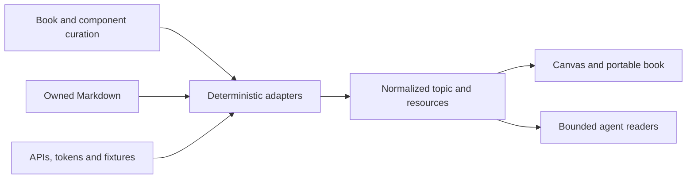

# Visual Studio Code Design System

This directory holds shared design specifications, the topic map, and source composition for the design system. Component specifications remain beside their implementation. Guidance is readable and maintainable without a canvas.

## Content ownership

- Product tokens, APIs, styles, and examples stay in product code and its tests.
- Component usage and accessibility guidance live beside their component, such as [Button guidance](../../src/vs/base/browser/ui/button/button.design.md).
- Foundations and reusable patterns use flat `{topic}.design.md` files here, such as [typography](typography.design.md), [colors](colors.design.md), and [management modals](modal.design.md). Keep a topic's images in `{topic}/assets/` and supporting example copy with the topic, such as [motion examples](motion/examples.md). Existing technical contracts, instructions, and workflows retain their scope.
- [topics.json](topics.json) identifies each shared topic's kind and design specification, preserves old document addresses, and declares one component collection. [Component curation](content/components/curation.json) supplies that collection's design documents, implementation owners, selected APIs, and fixture relationships; don't duplicate the component inventory.
- [content/topics/](content/topics/) owns editorial source bindings, section selections, and specimen relationships, not page layout or executable presentation. [content/](content/) also retains component, token, and source-coverage curation.

The separately installed [design-system explorer](https://github.com/chryw/vscode-design-system) owns rendering, navigation, layout, controllers, source adapters, and headless tools. It reads content from the **selected checkout**, not its own installation. A checkout without a topic map exposes source browsing; an invalid map or binding fails explicitly. New readers prefer `topics.json` and accept legacy `book.json` only when the new map is absent. There is only one editable map.

## Read and contribute

Open the **Visual Studio Code Design System** canvas, or use its headless `documents`, `read-document`, and topic commands. Use **Back** and **Forward** to return from cross-topic references, **Topic files** for a chapter's guidance and implementation files, and the chevron beside **Refresh** to choose the content worktree. A topic can draw from several files, and one file can serve several topics. Headless document discovery includes Markdown in the configured scopes, even without a curated chapter; the raw Source library is not a curated-book navigation destination.

Edit the owning document once. Pages reference its sections through `$text` or `guidance` bindings; browser, CLI, canvas actions, and portable exports use the same projections. No launcher skill or viewer-source edit is needed to add guidance within an existing scope. Guidance edits refresh live; structural catalog or fixture-binding changes require reopening the provider.

Follow [authoring conventions](authoring.md), [pattern conventions](patterns.md), [component qualification](components.md), and [token qualification](foundations.md). Discovery and visualization don't make draft or implementation-specific material a product-wide rule.

## Preview and validate before pushing

The viewer and the content checkout are independent. Use an up-to-date clone of the [viewer repository](https://github.com/chryw/vscode-design-system), or the locally installed viewer, with an explicit checkout path. Nothing needs to be pushed for a preview to include saved working changes.

From the VS Code checkout, run:

```bash
# Fast check: check placement and resolve every chapter's source bindings.
node .github/design-system/scripts/validate.mts --viewer /absolute/path/to/vscode-design-system --sources-only

# Rendering check: build an offline book and open every chapter in Chromium.
# The output directory must not already exist.
node .github/design-system/scripts/validate.mts --viewer /absolute/path/to/vscode-design-system --output /tmp/design-system-review
```

The placement check rejects unregistered design specifications, shared specs outside the flat directory, components separated from their implementation, mismatched map/binding sources, and chained or missing bookmark targets. It checks structure and discovery, not whether an agent's prose is correct; review guidance changes with the owning designers and maintainers.

The rendering check requires this checkout's existing dependencies and Playwright Chromium (`pnpm exec playwright install chromium` if the browser is missing). It fails on broken bindings, empty chapters, reported rendering failures, browser errors, failed requests, or unavailable started examples. Open the generated `design-system.html` to inspect appearance and interactions; `validation.json` records the checked checkout, Git revision, viewer version, and chapter count. Without `--output`, generated files are temporary.

To check the latest viewer against another branch, keep that branch in a separate local checkout or worktree and select both inputs:

```bash
node .github/design-system/scripts/validate.mts \
  --viewer /absolute/path/to/vscode-design-system \
  --root /absolute/path/to/vscode-checkout \
  --output /tmp/other-branch-review
```

Use your normal Git update workflow to update the viewer clone before checking it. The command does not fetch, switch branches, install dependencies, or publish anything. It reads the selected checkout's book and product sources, not content bundled with the viewer. A branch without compatible book data fails explicitly; update or bring the exploration content into that branch rather than falling back to another checkout.

For a live browser preview, run the viewer CLI against the same checkout and open the printed loopback URL:

```bash
node /absolute/path/to/vscode-design-system/scripts/book.mjs serve \
  --root /absolute/path/to/vscode-checkout
```

Stop it with Ctrl+C. For the actual canvas, install or update the independent viewer through the native plugin manager and reuse the worktree's existing canvas in its owning chat. Use the chevron beside **Refresh** to browse another clone or worktree in that same panel, or the main **Refresh** action to reread its saved content, topic catalog, and examples; neither action pulls or switches Git branches. Do not create a new instance for another branch or validation pass. Follow the viewer's [setup and migration guidance](https://github.com/chryw/vscode-design-system/blob/main/docs/setup.md) if a legacy workspace installation exists.

This is a portable-rendering smoke check, not pixel comparison or native canvas-host validation. It does not cover live-server refresh, every theme or fixture variant, lazy examples that were not started, keyboard behavior, or visual quality. Inspect the affected chapter and exercise changed interactions before pushing. Viewer implementation tests belong in the viewer repository; this checkout's installed copy does not include that test suite.



The shared resource output exposes guidance references, source-derived definitions, and curated examples. It is generated from the selected checkout, not another database for contributors to author.

## Find the owning guidance

Read the relevant specifications before building or updating UI. No canvas installation is required.

| Topic | Authored design guidance | Definitions or workflow |
| --- | --- | --- |
| Component usage and pitfalls | The component directory's lowercase-kebab `*.design.md`, such as [Button](../../src/vs/base/browser/ui/button/button.design.md), [InputBox](../../src/vs/base/browser/ui/inputbox/input-box.design.md), or [Dialog](../../src/vs/base/browser/ui/dialog/dialog.design.md) | The same directory's implementation and tests |
| Typography | [Typography](./typography.design.md) | [Size registrations](../../src/vs/platform/theme/common/sizes/baseSizes.ts) |
| Spacing | [Spacing](./spacing.design.md) | [CSS token instructions](../instructions/design-tokens.instructions.md#spacing) |
| Shape, size, and stroke | [Shape](./shape.design.md), [size](./size.design.md), [stroke](./stroke.design.md) | [Size registrations](../../src/vs/platform/theme/common/sizes/baseSizes.ts) |
| Colors and theming | [Colors](./colors.design.md), [theming](./theming.design.md) | [Color compatibility](../../src/vs/platform/theme/common/colors/COLORS.md), [theming workflow](../skills/ux-theming/SKILL.md) |
| Layout | [Layout](./layout.design.md) | [Constraint-based layout workflow](../skills/ux-css-layout/SKILL.md) |
| Elevation | [Elevation](./elevation.design.md) | Existing overlay, dialog, and layout owners linked from the specification |
| Iconography | [Iconography](./iconography.design.md) | [Codicon definitions](../../src/vs/base/common/codicons.ts) |
| Motion | [Motion](./motion.design.md) | [Implementation contracts](../../src/vs/platform/theme/common/motion/MOTION.md), [motion workflow](../skills/motion-design/SKILL.md) |
| Illustration | [Illustration](./illustration.design.md) | The consuming feature's media and rendering code |
| Reusable task patterns | [Pattern conventions](patterns.md) | Shared composition, navigation, behavior, and justified variation across features |
| Management modals | [Modal](./modal.design.md) | Shared management pattern applied to Automations, Customizations, and remote environments |
| Accessibility | [Accessibility](./accessibility.design.md) | [Accessibility workflow](../skills/accessibility/SKILL.md), [implementation instructions](../instructions/accessibility.instructions.md) |
| Cross-cutting requirements | [Design philosophy](../skills/design-philosophy/SKILL.md), [accessibility](../skills/accessibility/SKILL.md), [layout](../skills/ux-css-layout/SKILL.md), [writing](../instructions/coding-guidelines.instructions.md#ui-labels) | Existing instruction applicability and skill workflows remain in force |

Use `<subject>.design.md` for additional authored intent, not API inventories, generated token tables, technical contracts, or book introductions. One specification can serve several chapters. Adding a file within the configured discovery scopes makes it searchable; composing it into a chapter still requires a source binding.
