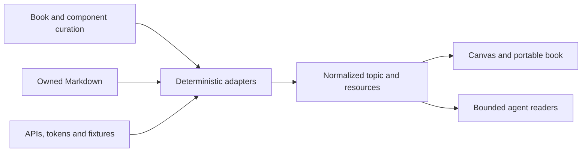

# Visual Studio Code Design System

This directory is the checkout-owned index and composition data for the design system. It contains no viewer implementation and doesn't require a canvas to read or contribute guidance.

## Content ownership

- Product tokens, APIs, styles, and examples stay in product code and its tests.
- Component usage and accessibility guidance live beside their component, such as [Button guidance](../../src/vs/base/browser/ui/button/button.design.md).
- Foundation guidance lives with its owner, such as [typography](../../src/vs/platform/theme/common/sizes/typography.design.md), [color guidance](../../src/vs/platform/theme/common/colors/colors.design.md), and [motion examples](../../src/vs/platform/theme/common/motion/motion-examples.md). Existing specifications, instructions, and skills remain authoritative within their scope.
- Cross-cutting introductions and guidance without a narrower owner live in [guidance/](guidance/).
- [book.json](book.json) declares foundation topics and one component collection. [Component curation](content/components/curation.json) supplies that collection's registrations, aliases, owners, selected APIs, and fixture relationships.
- [pages/](pages/) selects source sections and structured specimens. [content/](content/) retains deliberate component, token, and source-coverage curation, not per-component API tables or field-by-field copies of Markdown.

The separately installed [design-system explorer](https://github.com/chryw/vscode-design-system) provides the viewer, source adapters, controllers, and headless tools. Access to that private repository is required to install it. It reads this directory from the **selected checkout**, not from its own installation. The same renderer can therefore show different checkout-owned books without copying their content into the extension. A missing book or invalid source binding is an explicit error. These documents remain readable without the viewer.

## Read and contribute

Open the **Visual Studio Code Design System** canvas, or use its headless `documents`, `read-document`, and topic commands. The Source library discovers Markdown in the configured scopes, including new documents with no curated chapter.

Edit the owning document once. Pages reference its sections through `$text` or `guidance` bindings; browser, CLI, canvas actions, and portable exports use the same projections. No launcher skill or viewer-source edit is needed to add guidance within an existing scope. Guidance edits refresh live; structural catalog or fixture-binding changes require reopening the provider.

Follow [authoring conventions](authoring.md), [component qualification](components.md), and [token qualification](foundations.md). Discovery and visualization don't make draft or implementation-specific material a product-wide rule.

## Preview and validate before pushing

The viewer and the content checkout are independent. Use an up-to-date clone of the [viewer repository](https://github.com/chryw/vscode-design-system), or the locally installed viewer, with an explicit checkout path. Nothing needs to be pushed for a preview to include saved working changes.

From the VS Code checkout, run:

```bash
# Fast check: resolve every chapter and its source bindings.
node .github/design-system/scripts/validate.mts --sources-only

# Rendering check: build an offline book and open every chapter in Chromium.
# The output directory must not already exist.
node .github/design-system/scripts/validate.mts --output /tmp/design-system-review
```

The rendering check requires this checkout's existing dependencies and Playwright Chromium (`pnpm exec playwright install chromium` if the browser is missing). It fails on broken bindings, empty chapters, reported rendering failures, browser errors, failed requests, or unavailable started examples. Open the generated `design-system.html` to inspect appearance and interactions; `validation.json` records the checked checkout, Git revision, viewer version, and chapter count. Without `--output`, generated files are temporary.

To check the latest viewer against another branch, keep that branch in a separate local checkout or worktree and select both inputs:

```bash
node .github/design-system/scripts/validate.mts \
  --viewer /absolute/path/to/vscode-design-system \
  --root /absolute/path/to/vscode-checkout \
  --output /tmp/other-branch-review
```

Use your normal Git update workflow to update the viewer clone before checking it. The command does not fetch, switch branches, install dependencies, or publish anything. It reads the selected checkout's book and product sources, not content bundled with the viewer. A branch without compatible book data fails explicitly; update or bring the exploration content into that branch rather than falling back to another checkout.

For a live browser preview, run the viewer CLI against the same checkout and open the printed loopback URL:

```bash
node /absolute/path/to/vscode-design-system/scripts/book.mjs serve \
  --root /absolute/path/to/vscode-checkout
```

Stop it with Ctrl+C. For the actual canvas, install or update the independent viewer through the native plugin manager and reuse the worktree's existing canvas in its owning chat. Use **Change checkout** to browse another clone or worktree in that same panel; do not create a new instance for another branch or validation pass. Follow the viewer's [setup and migration guidance](https://github.com/chryw/vscode-design-system/blob/main/docs/setup.md) if a legacy workspace installation exists.

This is a portable-rendering smoke check, not pixel comparison or native canvas-host validation. It does not cover live-server refresh, every theme or fixture variant, lazy examples that were not started, keyboard behavior, or visual quality. Inspect the affected chapter and exercise changed interactions before pushing. Viewer implementation tests belong in the viewer repository; this checkout's installed copy does not include that test suite.



The shared resource output exposes guidance references, source-derived definitions, and curated examples. It is generated from the selected checkout, not another database for contributors to author.

## Find the owning guidance

Read the relevant specifications before building or updating UI. No canvas installation is required.

| Topic | Authored design guidance | Definitions or workflow |
| --- | --- | --- |
| Component usage and pitfalls | The component directory's lowercase-kebab `*.design.md`, such as [Button](../../src/vs/base/browser/ui/button/button.design.md), [InputBox](../../src/vs/base/browser/ui/inputbox/input-box.design.md), or [Dialog](../../src/vs/base/browser/ui/dialog/dialog.design.md) | The same directory's implementation and tests |
| Typography | [Typography](../../src/vs/platform/theme/common/sizes/typography.design.md) | [Size registrations](../../src/vs/platform/theme/common/sizes/baseSizes.ts) |
| Spacing | [Spacing](../../src/vs/platform/theme/common/sizes/spacing.design.md) | [CSS token instructions](../instructions/design-tokens.instructions.md#spacing) |
| Shape, size, and stroke | [Shape](../../src/vs/platform/theme/common/sizes/shape.design.md), [size](../../src/vs/platform/theme/common/sizes/size.design.md), [stroke](../../src/vs/platform/theme/common/sizes/stroke.design.md) | [Size registrations](../../src/vs/platform/theme/common/sizes/baseSizes.ts) |
| Colors and theming | [Colors](../../src/vs/platform/theme/common/colors/colors.design.md), [theming](../../src/vs/platform/theme/common/theming.design.md) | [Color compatibility](../../src/vs/platform/theme/common/colors/COLORS.md), [theming workflow](../skills/ux-theming/SKILL.md) |
| Elevation | [Elevation](guidance/elevation.design.md) | Existing overlay, dialog, and layout owners linked from the specification |
| Iconography | [Iconography](../../src/vs/base/common/iconography.design.md) | [Codicon definitions](../../src/vs/base/common/codicons.ts) |
| Motion | [Motion](../../src/vs/platform/theme/common/motion/motion.design.md) | [Implementation contracts](../../src/vs/platform/theme/common/motion/MOTION.md), [motion workflow](../skills/motion-design/SKILL.md) |
| Illustration | [Illustration](guidance/illustration.design.md) | The consuming feature's media and rendering code |
| Management modals | [Modal](guidance/modal.design.md) | Shared host and three-scenario design guidance |
| Cross-cutting requirements | [Design philosophy](../skills/design-philosophy/SKILL.md), [accessibility](../skills/accessibility/SKILL.md), [layout](../skills/ux-css-layout/SKILL.md), [writing](../instructions/coding-guidelines.instructions.md#ui-labels) | Existing instruction applicability and skill workflows remain in force |

Use `<subject>.design.md` for additional authored intent, not API inventories, generated token tables, technical contracts, or book introductions. One specification can serve several chapters. Adding a file within the configured discovery scopes makes it searchable; composing it into a chapter still requires a source binding.
