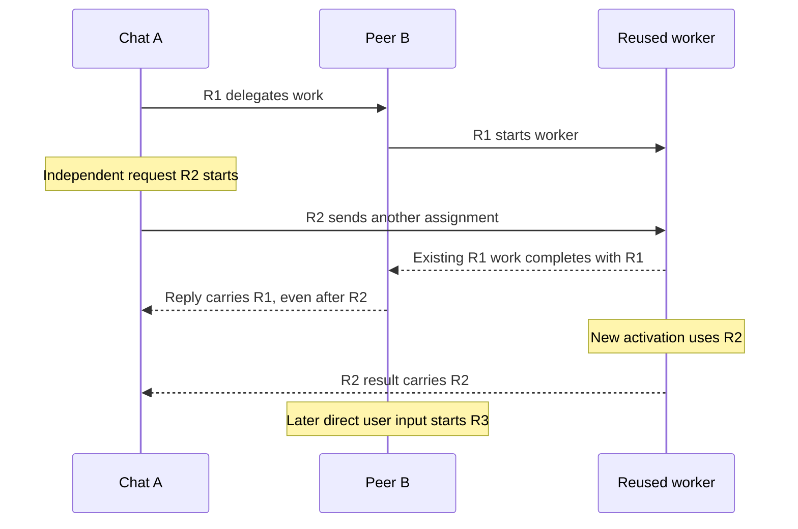

# Originating-trigger attribution

Attribute activity to the request or automation occurrence that initiated it, including delegated work in reused workers and peer chats. Keep the executing chat, turn, agent, model, account, and trace available as separate reporting dimensions.

## Contract

The Copilot runtime establishes an origin when it admits a recognized independent input. For message-driven work it reuses the runtime input UUID. A standalone task API invocation or manual compaction has its own occurrence. Each scheduled occurrence is distinct.

`user`, `automation`, `system`, and `api` describe the runtime's input category. `user` is a declared message-source category, not proof that a person typed the input; automation clients should supply their automation source.

```ts
interface OriginatingTriggerContext {
    triggers: { id: string; kind: 'user' | 'automation' | 'system' | 'api' }[];
    incomplete: boolean;
    involvesSteering: boolean;
}
```

References are lowercase UUIDs, with at most sixteen unique entries. A complete single reference has one initiating cause. Several references preserve genuinely combined initiation. `incomplete` retains missing provenance or overflow instead of selecting an arbitrary owner. The context carries no authorization or account identity.

The runtime captures the context on admission and on concrete execution. Native tasks inherit the spawning operation's snapshot before asynchronous launch; a new delivery to a reused worker carries its sender's snapshot. Independent tool and task API calls do not borrow a concurrently running user's origin. Tool invocation scope also carries its snapshot into auxiliary work, independently of tracing. Persisted inputs, pending work, completed task responses, and workflow runs retain their corresponding context.

`clientTurnId` remains the host execution alias. SDK session identity and chronological event `parentId` keep their existing meanings. None is substituted for the originating trigger.

## SDK and host handoff

The additive `originatingTrigger` property is available on SDK sends, explicitly delegated task API calls, and tool invocation context. The same typed reference crosses a host-created session boundary:

```ts
await peer.send({
    prompt,
    source: `agent-${sender.sessionId}`,
    clientTurnId: peerExecutionTurnId,
    ...(peer.capabilities.originatingTrigger
        ? { originatingTrigger: invocation.originatingTrigger }
        : {})
});
```

Ordinary independent input needs no origin argument. A later direct user request to `peer` starts a new origin. Creating an independently organized session through a tool still inherits the invoking execution's origin; workspace organization does not determine causality.

VS Code copies invocation context outside model-generated arguments, persists delegated-turn metadata, and forwards it when dispatching the recipient's input. Queue replacement uses the replacing invocation's snapshot. For older SDK serializers, the host uses the capability-gated RPC input and the exact tool-start snapshot when the callback omits its additive field. Missing metadata stays unattributed.

The shared host annotates completed-call timing and edit-survival observations from runtime-reported snapshots. A turn combining known and unattributed completed calls is partial; a later exact observation for the same call can repair that missingness. Existing host steering-submission fields remain separate from the runtime's consumed-steering observation.

The Copilot adapter persists captured execution origins in existing turn-scoped metadata. A resume reads the exact host/provider turn alias, not the chat's latest origin. Turn-starting notifications record their context and event alias before the first model response, so a first-call failure can still be resumed accurately; passive notifications do not replace active ownership. Consumed steering retains the running execution's origin when the host presents that steering as another turn. Metadata follows the existing turn deletion and remapping lifecycle.

All six SDKs expose the handoff. Java callbacks and generated requests share the new context types; historical Java constructor signatures and Python positional parameters are preserved. Go positional literals and exhaustive Rust literals for extended public structs may require updating. The Node projection uses an ordinary array while validation and the public schema retain the sixteen-reference bound.

## Lifecycle examples

| Flow | Origin of resulting activity |
| --- | --- |
| R1 invokes parallel or nested workers | R1, captured at invocation |
| R1's worker finishes after R2 starts elsewhere | R1 |
| R2 sends new work to R1's existing worker | R2 for that activation; existing R1 work retains R1 |
| R1 creates peer B, which later replies to A | R1 through both handoffs |
| R1's reply waits behind R2 | R1 when the reply is processed |
| A person later writes directly to B | A new origin |
| R2 reads an old R1 result | R2 owns the new execution; the old result remains a data dependency |
| Steering is consumed during R1 | R1 remains the running execution's initiator; the steering input retains its own identity and context |
| Two independent completions initiate one run | Both origins, one usage observation |
| An automation definition runs twice | Two origins |
| A task API starts work without a delegated context | A new API occurrence |
| A runtime continuation has no recoverable origin | Unknown |
| A pending invocation is resumed | Its captured context, where retained |
| R2 fails after a reused worker successfully completed R1 | R2 owns the failed activation and any resulting notification; the older successful response retains R1 |
| Child execution rolls over its context window | The current activation's origin |
| Fusion requests compaction for its routed model | The Fusion execution's captured origin |
| An interrupted shell read replays a suppressed completion | The completed command's origin, recovered only for the matching execution |
| A new request follows imported or forked history | A new origin |

`involvesSteering` records observed consumed steering. A true value is evidence of steering; a false or absent observation is not a completeness claim about an entire distributed history. It does not redistribute earlier work.



## Telemetry

Existing response telemetry carries `originatingTriggerAttribution` (`known`, `multiple`, `partial`, or `unknown`). A complete single cause carries `originatingTriggerId` and `originatingTriggerKind`. Shared or partial causes use the bounded `originatingTriggers` JSON array. `involvesSteering` is a measurement.

Usage remains one fact per model call. Standard/restricted copies and forwarded parent copies must be deduplicated according to their existing event contracts. Exploding a multi-origin array into edges does not make the full cost additive across those edges.

Use the model that actually served each call and appropriate input, cached-input, cache-write, and output rates for monetary cost. Token counts and AI-credit quantities are not USD.

## Reporting options and counterexamples

The following synthetic ledger illustrates grouping choices; these are example USD amounts, not observed production pricing.

| Work | Origin | Chat | Model | Executing account | USD |
| --- | --- | --- | --- | --- | ---: |
| Initial analysis | R1 | A | M1 | account-1 | 0.040 |
| Initial worker | R1 | S1 | M2 | account-1 | 0.020 |
| Nested review | R1 | S2 | M3 | account-1 | 0.030 |
| Peer review | R1 | B | M2 | account-1 | 0.060 |
| Queued peer reply | R1 | A | M1 | account-1 | 0.010 |
| Human follow-up in B | R2 | B | M2 | account-1 | 0.050 |
| Reused worker | R2 | S1 | M2 | account-1 | 0.240 |
| Processing an older result | R2 | B | M2 | account-1 | 0.010 |
| Automation occurrence | R3 | A | M3 | account-2 | 0.300 |
| Automation reuses the worker | R3 | S1 | M2 | account-2 | 0.400 |
| Next automation occurrence | R4 | A | M3 | account-2 | 0.100 |
| Combined R1/R3 notifications | Shared | A | M1 | account-1 | 0.020 |

Every additive view totals **USD 1.280**:

- **Trigger:** R1 0.160; R2 0.300; R3 0.700; R4 0.100; shared 0.020.
- **Executing chat:** A 0.470; B 0.120; S1 0.660; S2 0.030.
- **Serving model:** M1 0.070; M2 0.780; M3 0.430.
- **Executing account:** account-1 0.480; account-2 0.800.

Lifetime worker ownership would move **USD 0.640** of R2/R3 work onto R1. Attributing a delayed reply to the receiver's current request moves R1 work onto R2. Treating every consumed result as a new initiating parent makes the old-result read incorrectly revert to R1. Summing the shared 0.020 under both R1 and R3 raises the total to 1.300. Grouping by automation definition combines distinct occurrences and hides their distribution.

An initiating-account view requires an authoritative trigger-to-account observation. Execution account, device, machine, and historical chat creator are distinct. Reporting chooses whether to retain shared work separately or apply an explicit allocation rule.

## Availability and validation boundaries

The host integration is gated on the runtime capability. Deployment requires a published SDK/runtime containing the companion contract; existing installations remain functional without the enrichment.

Legacy history, unsupported remote-provider handoffs, and utility activity without a captured cause can remain unknown. Unknown usage remains in totals. An empty continuation without a recoverable context is not assigned to a convenient historical creator.

Evaluate coverage by both call count and token/cost weight, split by actual model, execution path, version, experiment arm, and origin category. Keep missing usage, missing attribution, unpriced models, and window-boundary effects distinct. A late response can belong to a trigger outside the query window.

Local scripted runtime scenarios establish propagation and conservation, not production coverage. Cross-platform provider validation and backend observation are required before these annotations are treated as scorecard-ready.
