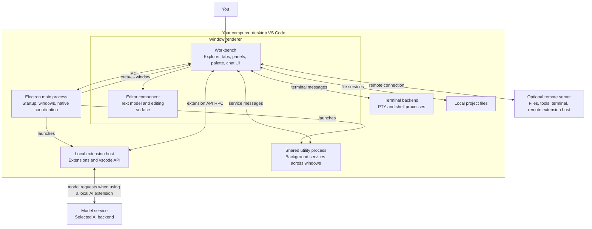
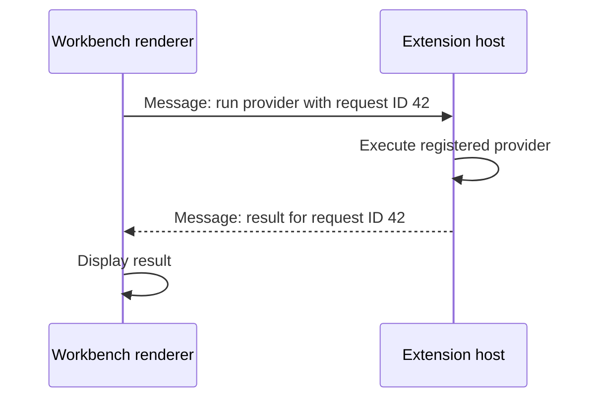
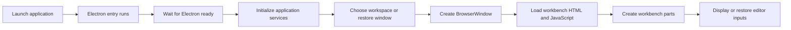
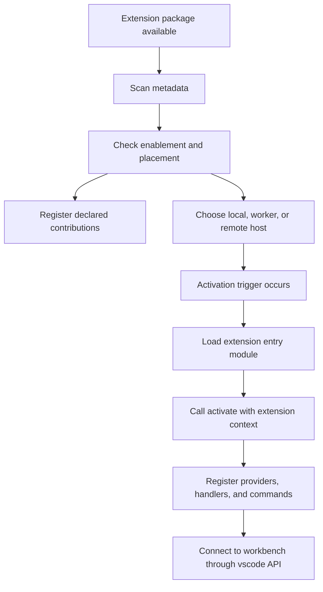
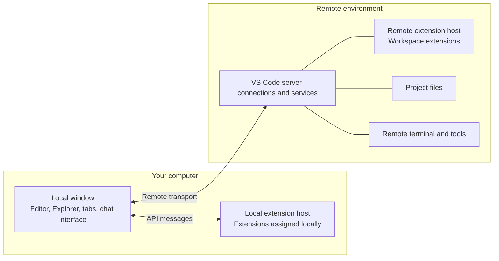
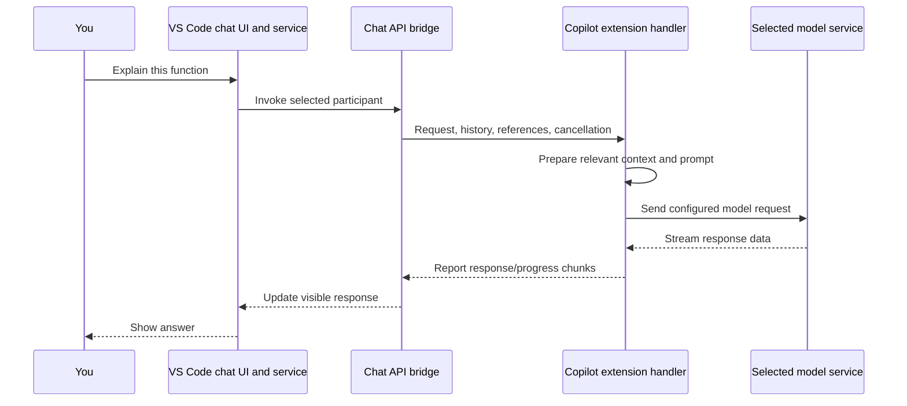
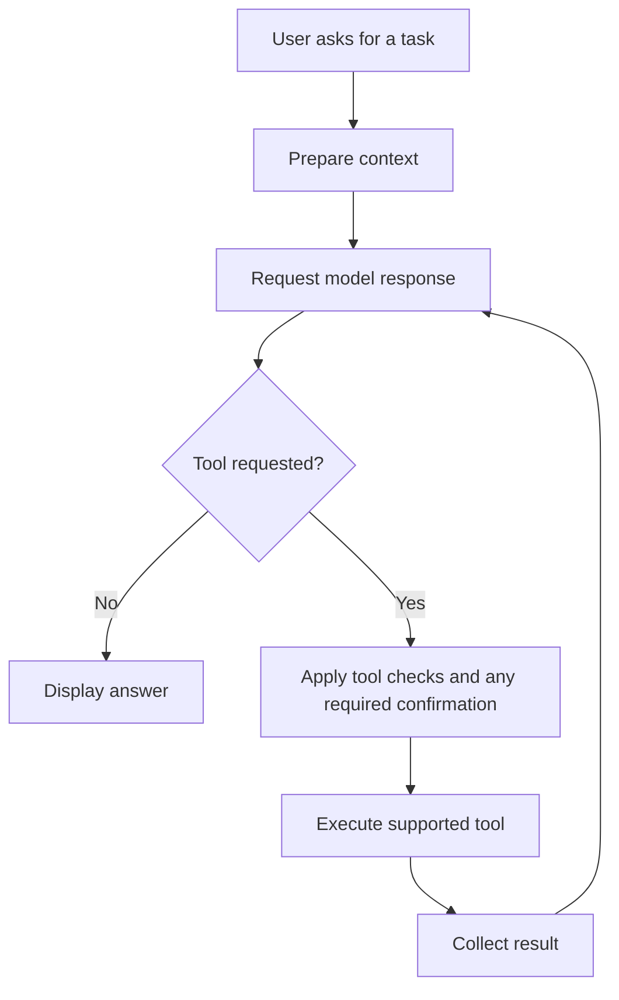

# VS Code architecture, explained step by step

This guide is a simpler companion to [the detailed investigation](VS-Code-Reverse-Engineering-Report.md). It describes the source in this workspace. The earlier REA investigation was static and partial; the additional Copilot and remote findings here were checked directly in source. No running application, account, or cloud backend was inspected.

## 1. Start with six ideas

Imagine VS Code as a workshop:

| Software term | Workshop analogy | Actual meaning |
|---|---|---|
| Editor | Your writing surface | Component that displays and changes document text |
| Workbench | The whole workbench around that surface | Explorer, tabs, panels, commands, status bar, and editors together |
| Electron main process | Workshop manager | Coordinates application startup, native windows, and native services |
| Renderer | The visible room and its controls | Executes the window's browser-based interface |
| Extension host | A separate room for additional workers | Runtime that loads and executes extension code |
| Services and messages | Shared facilities and request slips | Components request capabilities; processes exchange messages to cooperate |

The analogy has limits: these are software components and execution environments, not people. One extension host can run many extensions, and one window can use more than one kind of extension host.

**The editor is inside the workbench. The workbench runs in a renderer. Extensions usually execute outside that renderer and connect through APIs.**

## 2. The whole application at a glance



This is a map of responsibilities. It omits many helper processes and intermediate services. The AI extension may execute elsewhere depending on its host placement, and model routing can vary.

Source anchors: [workbench construction:135](src/vs/workbench/electron-browser/desktop.main.ts#L135), [native window creation:878](src/vs/platform/windows/electron-main/windowImpl.ts#L878), [extension launch:105](src/vs/platform/extensions/electron-main/extensionHostStarter.ts#L105), [shared-process launch:147](src/vs/platform/sharedProcess/electron-main/sharedProcess.ts#L147).

## 3. Translate the confusing words

### Process, thread, and component

A **process** is a running program environment with its own memory. An Electron renderer and an extension host are separate processes in the ordinary desktop local-host path. A **thread** is an execution path within a process. A **component** is a logical piece of code; it does not necessarily get its own process or thread.

Explorer, tabs, and the Command Palette are components within the workbench. They are not three separate operating-system processes.

### Electron, Chromium, and Node.js

**Electron** lets a desktop application use web technology for its interface and native capabilities for operating-system integration. **Chromium** supplies browser rendering infrastructure. **Node.js** supplies JavaScript execution with capabilities such as working with files and launching processes.

This does not mean every renderer has unrestricted Node.js access. VS Code configures sandboxed windows and a preload bridge: [window preferences:211](src/vs/platform/windows/electron-main/windows.ts#L211), [preload configuration:858](src/vs/platform/windows/electron-main/windowImpl.ts#L858).

### IPC and RPC

**IPC: Inter-Process Communication.** Two processes cannot simply use each other's in-memory objects. They send messages.

**RPC: Remote Procedure Call.** A layer that makes message exchange look like a method request. Here, “remote” can mean another process on the same computer.



RPC supplies bookkeeping around these messages. See [RPCProtocol:115](src/vs/workbench/services/extensions/common/rpcProtocol.ts#L115).

### API, service, provider, and contribution

- **API:** agreed operations another component can call. `vscode` is the API extensions import.
- **Service:** a capability such as opening editors or reading files.
- **Provider:** a plugged-in implementation, such as a completion provider for a language.
- **Contribution:** something registered with the application, such as a command or chat participant. Some contributions are declared in metadata before extension code runs.
- **Dependency injection:** supplying required services to a component rather than having it construct every dependency itself.

### Source, source control, workspace, and remote

**Source code** means the files implementing software. In this repository, `src/vs/workbench` implements much of VS Code itself.

**Source control** means tracking changes to your project, commonly with Git. VS Code provides a general source-control UI; the Git extension connects Git-specific behavior to it.

A **workspace** is the folder or collection of folders you opened, together with relevant project configuration. A **remote workspace** stores or operates on that project in another environment, such as a server, WSL environment, or container. It does not mean your whole visible window is rendered on that server.

## 4. What happens when you launch VS Code?



The first JavaScript entry comes from [package.json:17](package.json#L17). [src/main.ts:6](src/main.ts#L6) enters the implementation. [mainImpl.ts:178](src/mainImpl.ts#L178) waits for readiness, and [mainImpl.ts:235](src/mainImpl.ts#L235) loads main-process code. [CodeApplication.startup:702](src/vs/code/electron-main/app.ts#L702) coordinates startup. The window loads its workbench page at [windowImpl.ts:1393](src/vs/platform/windows/electron-main/windowImpl.ts#L1393).

The renderer then creates the workbench at [desktop.main.ts:135](src/vs/workbench/electron-browser/desktop.main.ts#L135), and the workbench renders its parts at [workbench.ts:151](src/vs/workbench/browser/workbench.ts#L151).

This is the ordinary desktop path. Existing-instance forwarding, agent windows, empty windows, recovery, and remote connection setup introduce branches. Background work overlaps with rendering; the diagram is not an exact timing trace.

## 5. What does each process do?

| Process or runtime | Main job | What to remember |
|---|---|---|
| Electron main | Manage application lifecycle, native windows, and native service coordination | Usually shared across ordinary application windows in one application instance |
| Renderer | Run the visible workbench and editor | Heavy work here can affect UI responsiveness |
| Shared process | Host background services useful across windows | A separate utility process in this checkout; not the extension host |
| Local extension host | Execute Node-based extensions | Many extensions can share a host; not one process per extension |
| Web extension host | Execute compatible extensions in a worker | Uses a browser worker environment rather than a Node extension runtime |
| Remote extension host | Execute appropriate extensions near a remote project | Runs on the remote side |
| Terminal backend and shell | Execute terminal programs | A terminal view and the shell it displays are different things |

The native host factory explicitly handles local-process, worker, and remote cases: [nativeExtensionService.ts:570](src/vs/workbench/services/extensions/electron-browser/nativeExtensionService.ts#L570). The local launcher uses an Electron utility-process wrapper: [extensionHostStarter.ts:77](src/vs/platform/extensions/electron-main/extensionHostStarter.ts#L77), ultimately [utilityProcess.fork:261](src/vs/platform/utilityProcess/electron-main/utilityProcess.ts#L261).

Important: API files named `mainThread...` normally mean the workbench side of an extension API, not Electron main.

## 6. What happens when you open and change a file?


**Explorer** is the navigation view. **Tabs and groups** organize open editor inputs. **The text model** holds editable content. **The editor widget** renders and interacts with that model. **The file service** routes reads and writes to the appropriate provider.

For example, Explorer calls the editor service at [explorerView.ts:620](src/vs/workbench/contrib/files/browser/views/explorerView.ts#L620). The text editor attaches a text model at [textFileEditor.ts:129](src/vs/workbench/contrib/files/browser/editors/textFileEditor.ts#L129). The file wrapper reads content at [textFileEditorModel.ts:547](src/vs/workbench/services/textfile/common/textFileEditorModel.ts#L547), tracks dirty state around [line 707](src/vs/workbench/services/textfile/common/textFileEditorModel.ts#L707), and writes a snapshot at [line 1033](src/vs/workbench/services/textfile/common/textFileEditorModel.ts#L1033).

“Dirty” simply means unsaved changes. Saving is not just clearing a flag: the model remains dirty if you made newer edits while the save was running.

The **Command Palette** is a searchable route to named actions ([commandsQuickAccess.ts:273](src/vs/workbench/contrib/quickaccess/browser/commandsQuickAccess.ts#L273)). The **terminal** is a workbench feature connected to a PTY backend, which connects to a shell ([terminalProcess.ts:321](src/vs/platform/terminal/node/terminalProcess.ts#L321)).

## 7. Extensions: how extra capabilities become part of the application

An extension is a package containing metadata and, where needed, executable code and resources. Its `package.json` describes identity, entry points, and contributions. Installing a package, discovering its metadata, and activating its code are different steps.



The scanner handles system and user extensions: [extensionsScannerService.ts:210](src/vs/platform/extensionManagement/common/extensionsScannerService.ts#L210). The extension service routes activation triggers: [abstractExtensionService.ts:993](src/vs/workbench/services/extensions/common/abstractExtensionService.ts#L993). The host calls an extension's optional `activate(context)` function at [extHostExtensionService.ts:590](src/vs/workbench/api/common/extHostExtensionService.ts#L590).

When extension code imports `vscode`, the host supplies the API implementation ([API factory:151](src/vs/workbench/api/common/extHost.api.impl.ts#L151)). That is why an extension can request an editor operation without importing VS Code's internal editor classes.

Examples:

- A completion extension registers a provider. The workbench can invoke it through RPC when the editor needs suggestions: [extHostLanguageFeatures.ts:2682](src/vs/workbench/api/common/extHostLanguageFeatures.ts#L2682), [mainThreadLanguageFeatures.ts:621](src/vs/workbench/api/browser/mainThreadLanguageFeatures.ts#L621).
- A debugger integrates through debug sessions and adapters: [debugSession.ts:346](src/vs/workbench/contrib/debug/browser/debugSession.ts#L346).
- The Git extension creates a source-control provider: [repository.ts:994](extensions/git/src/repository.ts#L994). The generic workbench service accepts providers at [scmService.ts:389](src/vs/workbench/contrib/scm/common/scmService.ts#L389).

## 8. Remote windows: where is everything actually running?

Suppose you open a project on another machine. You still interact with a local window. Remote-capable services let that window work with files and tools elsewhere.



Example workflow:

1. A remote connection is resolved and established.
2. The local workbench receives remote environment and extension information.
3. Remote file operations use the remote file-system provider.
4. Suitable workspace extensions execute in the remote host, close to the files and tools they use.
5. Editor rendering and interaction remain in the local window.

Source: [RemoteExtensionHost:48](src/vs/workbench/services/extensions/common/remoteExtensionHost.ts#L48), [authority resolution:97](src/vs/workbench/services/extensions/common/remoteExtensionHost.ts#L97), [remote file provider registration:35](src/vs/workbench/services/remote/common/remoteFileSystemProviderClient.ts#L35), [server extension-host connection:491](src/vs/server/node/remoteExtensionHostAgentServer.ts#L491), [remote terminal channel:90](src/vs/server/node/remoteTerminalChannel.ts#L90).

Transport and bootstrap depend on the remote solution. This diagram does not claim that every remote session uses one particular SSH, tunnel, or socket setup. Extension placement is selected by the host machinery, rather than putting every extension on the server.

**Three different meanings of “remote” must stay separate:** a remote workspace holds your project elsewhere; RPC can connect processes on your own computer; a remote AI endpoint runs model inference elsewhere. Using cloud AI does not make your workspace a remote workspace.

## 9. GitHub Copilot Chat: how it is added to VS Code

This checkout includes Copilot's client extension source under `extensions/copilot`. Its manifest identifies it as `copilot-chat`, published by GitHub, with the display name GitHub Copilot ([package.json:2](extensions/copilot/package.json#L2)).

There are three parts to understand:

| Part | Responsibility | Where to look |
|---|---|---|
| VS Code chat platform | Display chat, manage requests, connect participants, show streamed progress | `src/vs/workbench/contrib/chat` and chat API bridges |
| Copilot extension | Register participants, interpret requests, prepare context and model requests, coordinate supported tools | `extensions/copilot/src` |
| Model/backend services | Process selected model requests and return responses | External to this inspected client source; server implementation was not investigated |

Copilot is integrated through extension mechanisms plus chat-specific platform APIs. It is not necessary to place an AI model inside the text editor component to add this experience.

### How the integration starts

1. The manifest declares activation events including `onStartupFinished` and `onLanguageModelChat:copilot`, and a compiled main entry of `./dist/extension` ([package.json:80](extensions/copilot/package.json#L80)). It also declares chat participants ([package.json:1269](extensions/copilot/package.json#L1269)).
2. The Node source entry exports `activate`, which calls shared activation logic ([Node extension.ts:37](extensions/copilot/src/extension/extension/vscode-node/extension.ts#L37)).
3. Shared activation builds services and contribution instances ([shared extension.ts:33](extensions/copilot/src/extension/extension/vscode/extension.ts#L33)).
4. Copilot registers participants with `vscode.chat.createChatParticipant(...)` ([chatParticipants.ts:99](extensions/copilot/src/extension/conversation/vscode-node/chatParticipants.ts#L99)). A participant is a registered handler for chat requests, not a separate operating-system process.
5. VS Code's extension-host API sends registration to the workbench ([extHostChatAgents2.ts:708](src/vs/workbench/api/common/extHostChatAgents2.ts#L708)). The workbench registers an implementation that can call back into the host ([mainThreadChatAgents2.ts:340](src/vs/workbench/api/browser/mainThreadChatAgents2.ts#L340)).

Having this source in the checkout does not establish that Copilot is built, enabled, signed in, or available in the particular application you launch. Distribution packaging and account access are separate concerns.

### What happens after you press Send?



Verified source points:

- The chat service accepts a request and invokes an agent: [chatServiceImpl.ts:1573](src/vs/workbench/contrib/chat/common/chatService/chatServiceImpl.ts#L1573), [invocation:2273](src/vs/workbench/contrib/chat/common/chatService/chatServiceImpl.ts#L2273).
- The workbench calls the extension-host agent over RPC: [mainThreadChatAgents2.ts:355](src/vs/workbench/api/browser/mainThreadChatAgents2.ts#L355).
- Copilot constructs a request handler using history, request, response stream, and cancellation: [chatParticipants.ts:265](extensions/copilot/src/extension/conversation/vscode-node/chatParticipants.ts#L265).
- The handler infers document context and processes request references: [chatParticipantRequestHandler.ts:121](extensions/copilot/src/extension/prompt/node/chatParticipantRequestHandler.ts#L121), [references:160](extensions/copilot/src/extension/prompt/node/chatParticipantRequestHandler.ts#L160).
- Endpoint and fetcher layers handle model requests and streaming: [chatEndpoint.ts:587](extensions/copilot/src/platform/endpoint/node/chatEndpoint.ts#L587), [chatMLFetcher.ts:141](extensions/copilot/src/extension/prompt/node/chatMLFetcher.ts#L141).
- Progress returns through the extension API: [extHostChatAgents2.ts:105](src/vs/workbench/api/common/extHostChatAgents2.ts#L105).

Context is prepared according to the request and feature path; this does not prove that every request includes every file. Exact transmitted content was not captured. Authentication is handled through services, including the VS Code authentication API ([authenticationService.ts:7](extensions/copilot/src/platform/authentication/vscode-node/authenticationService.ts#L7)). Endpoint selection and authentication vary, including alternate-provider configurations. The diagram is a conceptual client workflow, not a network trace or a description of private server internals.

### How can an AI chat edit files or run tools?

A model can return a request to use a tool. Client-side orchestration can then execute that tool within its supported permissions and confirmation rules, collect the result, and send another model request.



The Copilot source includes a tool-calling loop ([toolCallingLoop.ts:333](extensions/copilot/src/extension/intents/node/toolCallingLoop.ts#L333)) and manifest tool contributions ([package.json:163](extensions/copilot/package.json#L163)). Not every chat request uses this loop, and confirmation behavior depends on the tool and configuration. The model produces requests; software on the client or another configured execution environment performs the actual operations.

## 10. Where settings and remembered state fit

Keep three boxes in your head:

```text
Project content       Preferences                 Remembered application state
source files          settings.json               editor/workspace state
images, documents     .vscode/settings.json       extension/workbench stored values
```

Profile paths define user settings resources ([userDataProfile.ts:196](src/vs/platform/userDataProfile/common/userDataProfile.ts#L196)). Folder settings use `.vscode/settings.json` ([configuration.ts:15](src/vs/workbench/services/configuration/common/configuration.ts#L15)). Desktop state includes SQLite `state.vscdb` databases for profile and workspace scopes ([storageMain.ts:294](src/vs/platform/storage/electron-main/storageMain.ts#L294), [workspace state:424](src/vs/platform/storage/electron-main/storageMain.ts#L424)). These databases are not the place where your project's source files are stored.

## 11. A practical way to read the repository

Read one user action across the layers instead of trying to understand every file at once:

1. **Opening a file:** Explorer → editor service → text-file model → file provider → editor widget.
2. **Getting completions:** editor → language provider registry → extension API bridge → extension or language tool → results.
3. **Using Git:** source-control UI → provider interface → Git extension → Git-specific operations.
4. **Remote editing:** local window → remote connection → remote file/tool services → results in local UI.
5. **Copilot chat:** chat UI → chat service → participant API bridge → Copilot handler → model request → streamed response.

For every arrow, ask: Is this an ordinary function call, an API boundary, a process message, or a network request? That question explains much of why VS Code has the structure it does.
