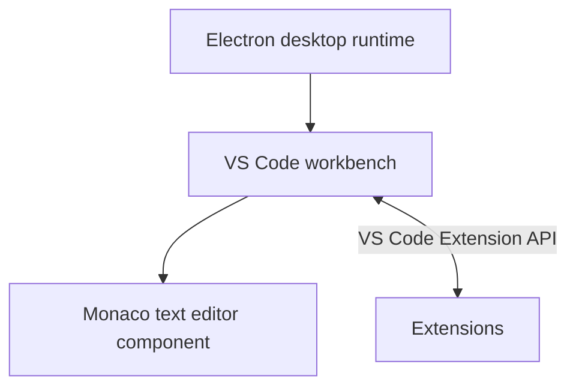
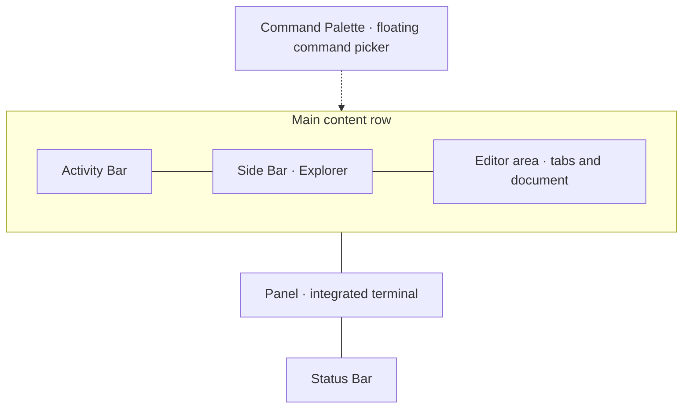
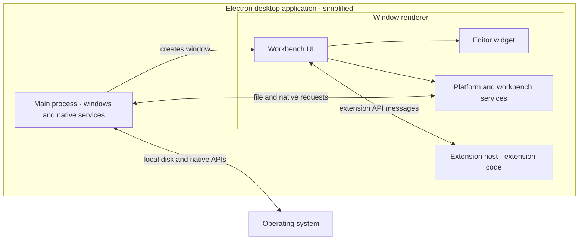
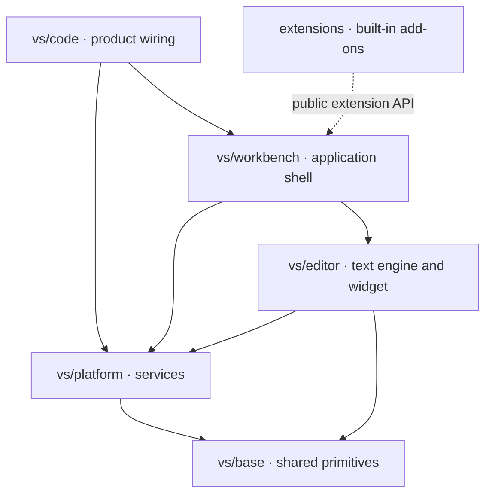
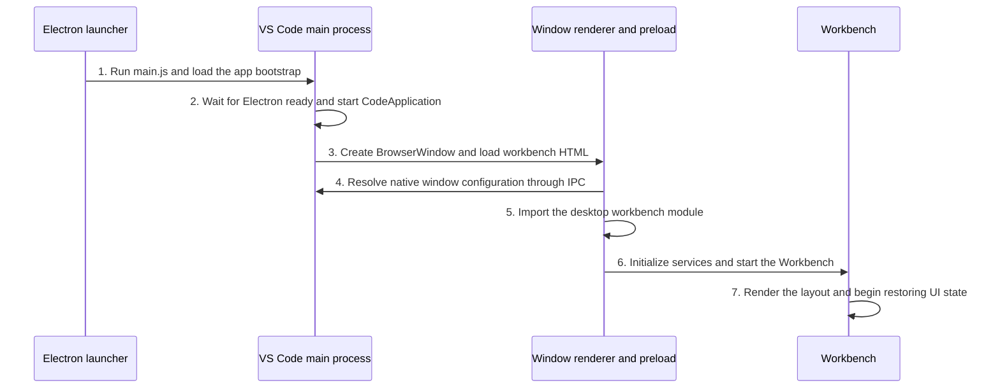
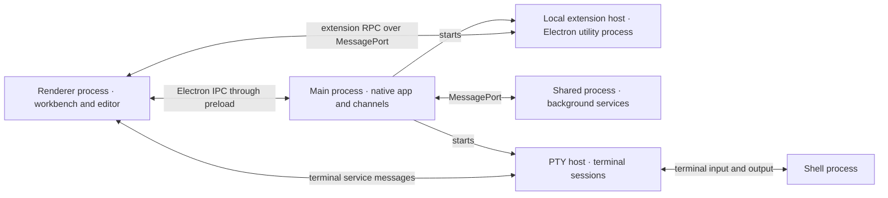
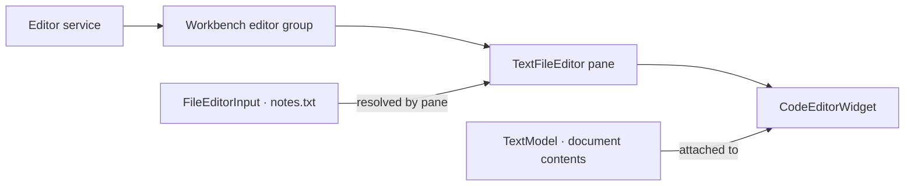
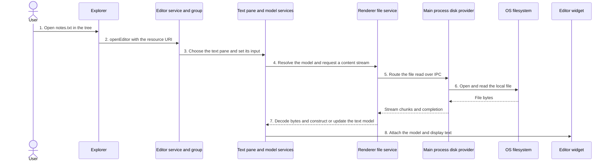
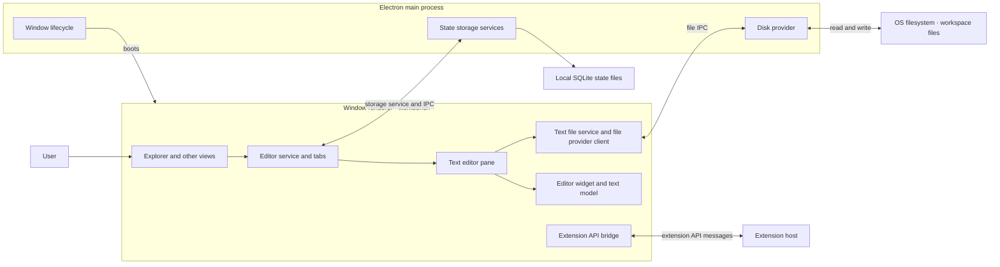

<!-- Copyright (c) Microsoft Corporation. All rights reserved. -->

# VS Code Foundation and Architecture

**Part 1** follows the standard desktop workbench, from opening a window to displaying a file. The numbered sections build up the architecture one piece at a time.

## Evidence and scope

| Label | What it means |
| --- | --- |
| **Source** | Verified by reading the checkout. Arrows in source traces describe paths in code. |
| **Artifact** | Observed in the installed package or through REA’s static inspection. |
| **Simplified** | A teaching view that groups steps or leaves out branches. |
| **Open** | A detail that would need additional source or runtime evidence. |

**Source revision.** The local branch is `well-beaver` at `a576fbf6ae64b12f5bc4f7e63a17ca9f1469b85c`. That commit adds a Markdown report. Its parent, `6b7ba7ebf1906f2851a1351f63086533ce772b73`, is an ancestor of the locally fetched `origin/main` and has identical application source. The source links use that parent. GitHub’s commit pages did not load in the browsing tool, so the checkout supplied the source and line references. [Official repository](https://github.com/microsoft/vscode)

### How REA was used

I cloned `morluto/rea` into the workspace at `rea/` and reviewed its `main` branch at `a627952bd53184f8ddd70d537e93c762efe77b28`. The checkout explains the analysis method. The artifact checks below came from the already-connected REA tool. The exact revision of that running tool was not established. [REA repository](https://github.com/morluto/rea) · [Static analyzer source](https://github.com/morluto/rea/blob/a627952bd53184f8ddd70d537e93c762efe77b28/src/application/javascript/JavaScriptArtifactAnalysis.ts#L361-L390)

REA parses JavaScript and HTML as text. A parse result tells you what the analyzer could read, while the coverage report tells you how much it examined. For example, a selected-file run with zero parse failures gives evidence about that file. Any calls it identifies are still candidates for what can happen when the app runs. REA documents a separate Electron inspection path for observing a running renderer through the Chrome DevTools Protocol (CDP). [Static analyzer output](https://github.com/morluto/rea/blob/a627952bd53184f8ddd70d537e93c762efe77b28/src/application/javascript/JavaScriptArtifactAnalysis.ts#L361-L388) · [Coverage and retained observations](https://github.com/morluto/rea/blob/a627952bd53184f8ddd70d537e93c762efe77b28/docs/guides/javascript/javascript-application-workflows.md#L83-L94) · [Electron observation](https://github.com/morluto/rea/blob/a627952bd53184f8ddd70d537e93c762efe77b28/docs/guides/javascript/electron-observation.md#L1-L16)

### Installed VS Code artifact checks

The Windows package identifies itself as Visual Studio Code **1.146.0**, build `69047191fc427f2f92828279aae1d90d8eeda7ab`. The manifest and installed files were read directly. The connected REA tool supplied complementary static analysis.

| Check | Evidence | What it establishes |
| --- | --- | --- |
| Desktop entry | The installed `resources/app/package.json` declares `./out/main.js`. REA parsed the selected launcher bundle with zero parse failures. The semantic graph reached its node budget. Evidence `ev_e1e8de09d9577e6b6a43e01f8734611fc6cfbd1f7584db6ff4c345854b52bc74`. | The packaged manifest points to a compiled JavaScript launcher. |
| Renderer entry | The installed `out/vs/code/electron-browser/workbench/workbench.html` loads `./workbench.js` as a module. | The workbench page has its own renderer entry script. |
| Preload bridge | REA parsed the installed `out/vs/base/parts/sandbox/electron-browser/preload.js` with zero parse failures and partial application coverage. Direct inspection of the same file found Electron's `ipcRenderer` and `contextBridge.exposeInMainWorld("vscode", f)`. Evidence `ev_dd40fb869e5a39fd5e2657c14c6bf175f4f8034a34e0a3364d29d27222218e7b`. | The installed preload contains the code that exposes the `vscode` bridge. The symbol-level observation came from reading the bundle directly. |

**Open.** The installed build and source checkout have different commit IDs. Startup timing, actual IPC messages, and the Explorer action would require observing the running app. The diagrams in sections 5 and 8 follow the pinned VS Code source.

## 1. What is VS Code?

**Source.** VS Code is a desktop application for editing code and working with projects. The official repository develops **Code - OSS**, the open-source base for Microsoft’s Visual Studio Code distribution. [Repository README](https://github.com/microsoft/vscode/blob/6b7ba7ebf1906f2851a1351f63086533ce772b73/README.md)

| Piece | Plain-language role | Technical detail |
| --- | --- | --- |
| Electron | Gives the application a desktop window and native capabilities. | Chromium renders web UI. Node.js provides native-side JavaScript APIs, such as filesystem access. [Electron process model](https://www.electronjs.org/docs/latest/tutorial/process-model) |
| Workbench | The application shell that holds tabs, views, and commands. | The desktop entry creates a `Workbench` and starts it in the window document. [Desktop entry](https://github.com/microsoft/vscode/blob/6b7ba7ebf1906f2851a1351f63086533ce772b73/src/vs/workbench/electron-browser/desktop.main.ts#L120-L148) |
| Monaco editor component | The surface that draws lines, handles typing, and moves the cursor. | The workbench creates a `CodeEditorWidget` from `src/vs/editor`. Monaco is also available as a standalone web editor. [Widget integration](https://github.com/microsoft/vscode/blob/6b7ba7ebf1906f2851a1351f63086533ce772b73/src/vs/workbench/browser/parts/editor/textCodeEditor.ts#L30-L48) · [Monaco](https://microsoft.github.io/monaco-editor/) |
| Extensions | Add features such as Git commands, themes, or language support. | Extension manifests declare contributions, and extensions with executable code can run in an extension host. [Built-in Git manifest](https://github.com/microsoft/vscode/blob/6b7ba7ebf1906f2851a1351f63086533ce772b73/extensions/git/package.json) · [Extension hosts](https://code.visualstudio.com/api/advanced-topics/extension-host) |

Most application logic is TypeScript, which adds types and compiles to JavaScript. HTML gives the renderer a document, and CSS styles the parts of the window. The desktop package starts with compiled JavaScript. [Project architecture](https://github.com/microsoft/vscode/blob/6b7ba7ebf1906f2851a1351f63086533ce772b73/.github/copilot-instructions.md) · [Build entry](https://github.com/microsoft/vscode/blob/6b7ba7ebf1906f2851a1351f63086533ce772b73/package.json#L14-L18) · [Workbench HTML](https://github.com/microsoft/vscode/blob/6b7ba7ebf1906f2851a1351f63086533ce772b73/src/vs/code/electron-browser/workbench/workbench.html)

## 2. What do we see on screen?

**Simplified.** This is a conventional layout with the Panel below the editor and the Command Palette floating above the content. Layout settings can move or hide parts. [Workbench layout](https://github.com/microsoft/vscode/blob/6b7ba7ebf1906f2851a1351f63086533ce772b73/src/vs/workbench/browser/layout.ts)

| Area | What you do there | Source mapping |
| --- | --- | --- |
| Activity Bar | Switch between view containers such as Explorer and Search. | [ActivitybarPart](https://github.com/microsoft/vscode/blob/6b7ba7ebf1906f2851a1351f63086533ce772b73/src/vs/workbench/browser/parts/activitybar/activitybarPart.ts) |
| Side Bar and Explorer | Browse folders and files. Explorer is a view housed in a container. | [SidebarPart](https://github.com/microsoft/vscode/blob/6b7ba7ebf1906f2851a1351f63086533ce772b73/src/vs/workbench/browser/parts/sidebar/sidebarPart.ts) · [Explorer view](https://github.com/microsoft/vscode/blob/6b7ba7ebf1906f2851a1351f63086533ce772b73/src/vs/workbench/contrib/files/browser/views/explorerView.ts) |
| Editor area | Open tabs and arrange documents in split groups. | [EditorPart](https://github.com/microsoft/vscode/blob/6b7ba7ebf1906f2851a1351f63086533ce772b73/src/vs/workbench/browser/parts/editor/editorPart.ts) |
| Panel and terminal | Switch between tools such as the terminal, where you interact with a shell. The panel is a layout part and the terminal is a view. | [PanelPart](https://github.com/microsoft/vscode/blob/6b7ba7ebf1906f2851a1351f63086533ce772b73/src/vs/workbench/browser/parts/panel/panelPart.ts) · [TerminalView](https://github.com/microsoft/vscode/blob/6b7ba7ebf1906f2851a1351f63086533ce772b73/src/vs/workbench/contrib/terminal/browser/terminalView.ts) |
| Status Bar | Read status entries and interact with their actions, such as language-mode selection. | [StatusbarPart](https://github.com/microsoft/vscode/blob/6b7ba7ebf1906f2851a1351f63086533ce772b73/src/vs/workbench/browser/parts/statusbar/statusbarPart.ts) |
| Command Palette | Search for and run commands. The quick-access registry wires the command picker to its provider. | [Quick Access registration](https://github.com/microsoft/vscode/blob/6b7ba7ebf1906f2851a1351f63086533ce772b73/src/vs/workbench/contrib/quickaccess/browser/quickAccess.contribution.ts#L42-L55) · [CommandsQuickAccessProvider](https://github.com/microsoft/vscode/blob/6b7ba7ebf1906f2851a1351f63086533ce772b73/src/vs/workbench/contrib/quickaccess/browser/commandsQuickAccess.ts) |

## 3. Big-picture system architecture

A **process** is a running instance of a program or one of its helpers, with its own memory. For example, the process drawing the VS Code window can ask another process to read bytes from a local file. A **service** is a named capability, such as reading files or choosing an editor. A service can run in the caller’s process or forward work across a process boundary.

| Component | Responsibility |
| --- | --- |
| Main process | Coordinates app startup, creates windows, and registers native-facing communication channels. [CodeApplication](https://github.com/microsoft/vscode/blob/6b7ba7ebf1906f2851a1351f63086533ce772b73/src/vs/code/electron-main/app.ts#L702-L805) · [Channel registration](https://github.com/microsoft/vscode/blob/6b7ba7ebf1906f2851a1351f63086533ce772b73/src/vs/code/electron-main/app.ts#L1392-L1548) |
| Window renderer | Runs the workbench UI, which combines layout, feature views, editor groups, and text widgets. [Desktop workbench](https://github.com/microsoft/vscode/blob/6b7ba7ebf1906f2851a1351f63086533ce772b73/src/vs/workbench/electron-browser/desktop.main.ts#L120-L148) · [Workbench startup](https://github.com/microsoft/vscode/blob/6b7ba7ebf1906f2851a1351f63086533ce772b73/src/vs/workbench/browser/workbench.ts#L111-L168) |
| Services | Offer reusable operations through named interfaces. For example, `FileService` selects the provider that knows how to read a resource. [Service instantiation](https://github.com/microsoft/vscode/blob/6b7ba7ebf1906f2851a1351f63086533ce772b73/src/vs/platform/instantiation/common/instantiationService.ts) · [FileService](https://github.com/microsoft/vscode/blob/6b7ba7ebf1906f2851a1351f63086533ce772b73/src/vs/platform/files/common/fileService.ts#L582-L609) |
| Extension host | Runs extension code in a separate execution environment and talks to the workbench through an extension API protocol. [Local host](https://github.com/microsoft/vscode/blob/6b7ba7ebf1906f2851a1351f63086533ce772b73/src/vs/workbench/services/extensions/electron-browser/localProcessExtensionHost.ts) · [Extension host manager](https://github.com/microsoft/vscode/blob/6b7ba7ebf1906f2851a1351f63086533ce772b73/src/vs/workbench/services/extensions/common/extensionHostManager.ts#L247-L280) |
| Operating system | Supplies real files, native windows, and shell processes. The local disk provider uses Node filesystem APIs. [Disk provider](https://github.com/microsoft/vscode/blob/6b7ba7ebf1906f2851a1351f63086533ce772b73/src/vs/platform/files/node/diskFileSystemProvider.ts#L365-L440) · [Terminal process](https://github.com/microsoft/vscode/blob/6b7ba7ebf1906f2851a1351f63086533ce772b73/src/vs/platform/terminal/node/terminalProcess.ts) |

**Simplified.** The drawing uses one window and one extension host. Section 6 adds helper processes and remote context. Opening an ordinary local file follows local storage paths, so the diagram needs no external service. [Local provider registration](https://github.com/microsoft/vscode/blob/6b7ba7ebf1906f2851a1351f63086533ce772b73/src/vs/workbench/electron-browser/desktop.main.ts#L267-L287)

## 4. Repository structure

| Folder | What it contains and why it exists | Where to start and how it connects |
| --- | --- | --- |
| `src/vs/code` | Product entry points and application wiring. | The Electron main entry coordinates native services and the desktop window bootstraps the workbench. [Main entry](https://github.com/microsoft/vscode/blob/6b7ba7ebf1906f2851a1351f63086533ce772b73/src/vs/code/electron-main/main.ts) · [Window entry](https://github.com/microsoft/vscode/blob/6b7ba7ebf1906f2851a1351f63086533ce772b73/src/vs/code/electron-browser/workbench/workbench.ts) |
| `src/vs/base` | Shared primitives such as events and resource identifiers. | Higher layers reuse these building blocks. [Events](https://github.com/microsoft/vscode/blob/6b7ba7ebf1906f2851a1351f63086533ce772b73/src/vs/base/common/event.ts) · [URI](https://github.com/microsoft/vscode/blob/6b7ba7ebf1906f2851a1351f63086533ce772b73/src/vs/base/common/uri.ts) |
| `src/vs/platform` | Reusable service contracts and implementations, including files, storage, and object creation. | Services use base primitives and supply capabilities to the editor, workbench, and product wiring. [Files](https://github.com/microsoft/vscode/tree/6b7ba7ebf1906f2851a1351f63086533ce772b73/src/vs/platform/files) · [Instantiation](https://github.com/microsoft/vscode/tree/6b7ba7ebf1906f2851a1351f63086533ce772b73/src/vs/platform/instantiation) |
| `src/vs/editor` | Text models, cursor behavior, views, and editing widgets. | Supplies the reusable text editing surface the workbench embeds. [TextModel](https://github.com/microsoft/vscode/blob/6b7ba7ebf1906f2851a1351f63086533ce772b73/src/vs/editor/common/model/textModel.ts) · [CodeEditorWidget](https://github.com/microsoft/vscode/blob/6b7ba7ebf1906f2851a1351f63086533ce772b73/src/vs/editor/browser/widget/codeEditor/codeEditorWidget.ts) |
| `src/vs/workbench` | Window layout, feature contributions, app-level services, and the extension API bridge. | Uses the editor and platform layers to assemble a full application. [Workbench startup](https://github.com/microsoft/vscode/blob/6b7ba7ebf1906f2851a1351f63086533ce772b73/src/vs/workbench/browser/workbench.ts) · [Feature contributions](https://github.com/microsoft/vscode/tree/6b7ba7ebf1906f2851a1351f63086533ce772b73/src/vs/workbench/contrib) |
| `extensions` | Built-in extensions with their own manifests and, where applicable, implementation code. | Integrate through contribution points and the public API. The Git extension is one example. [Git extension](https://github.com/microsoft/vscode/tree/6b7ba7ebf1906f2851a1351f63086533ce772b73/extensions/git) · [Extension API bridge](https://github.com/microsoft/vscode/tree/6b7ba7ebf1906f2851a1351f63086533ce772b73/src/vs/workbench/api) |

**Simplified.** Solid arrows mean “uses” or “assembles.” The dotted arrow represents the extension API relationship. These are major folder relationships, with direct imports and environment-specific rules left out. [Project architecture](https://github.com/microsoft/vscode/blob/6b7ba7ebf1906f2851a1351f63086533ce772b73/.github/copilot-instructions.md) · [Layer checker](https://github.com/microsoft/vscode/blob/6b7ba7ebf1906f2851a1351f63086533ce772b73/build/checker/layersChecker.ts)

## 5. Startup flow

**Source trace.** Follow a fresh desktop launch opening a standard workbench window. The **preload** is code that runs before the window’s UI script and exposes a controlled bridge. For example, the window can ask it for startup configuration.

| Step | What the code does |
| --- | --- |
| 1 | The package points Electron at `out/main.js`. Its TypeScript source imports `mainImpl`. [Package entry](https://github.com/microsoft/vscode/blob/6b7ba7ebf1906f2851a1351f63086533ce772b73/package.json#L14-L18) · [Main entry](https://github.com/microsoft/vscode/blob/6b7ba7ebf1906f2851a1351f63086533ce772b73/src/main.ts#L6-L10) |
| 2 | After the Electron `ready` event, the bootstrap sets up the module environment and imports `vs/code/electron-main/main`. `CodeMain` handles startup and delegates to `CodeApplication`. [Electron ready and import](https://github.com/microsoft/vscode/blob/6b7ba7ebf1906f2851a1351f63086533ce772b73/src/mainImpl.ts#L176-L247) · [CodeMain](https://github.com/microsoft/vscode/blob/6b7ba7ebf1906f2851a1351f63086533ce772b73/src/vs/code/electron-main/main.ts#L92-L160) |
| 3 | `CodeApplication` initializes channels and calls `openFirstWindow`. The window service creates or reuses a window, and the standard window path loads the workbench page. [App startup](https://github.com/microsoft/vscode/blob/6b7ba7ebf1906f2851a1351f63086533ce772b73/src/vs/code/electron-main/app.ts#L732-L803) · [Window service](https://github.com/microsoft/vscode/blob/6b7ba7ebf1906f2851a1351f63086533ce772b73/src/vs/platform/windows/electron-main/windowsMainService.ts#L1675-L1689) · [BrowserWindow creation](https://github.com/microsoft/vscode/blob/6b7ba7ebf1906f2851a1351f63086533ce772b73/src/vs/platform/windows/electron-main/windowImpl.ts#L849-L880) · [Page selection](https://github.com/microsoft/vscode/blob/6b7ba7ebf1906f2851a1351f63086533ce772b73/src/vs/platform/windows/electron-main/windowImpl.ts#L1385-L1397) |
| 4 | The HTML loads the workbench script. The preload retrieves native window configuration through an Electron IPC invocation. [Workbench HTML](https://github.com/microsoft/vscode/blob/6b7ba7ebf1906f2851a1351f63086533ce772b73/src/vs/code/electron-browser/workbench/workbench.html#L77-L81) · [Preload](https://github.com/microsoft/vscode/blob/6b7ba7ebf1906f2851a1351f63086533ce772b73/src/vs/base/parts/sandbox/electron-browser/preload.ts#L35-L58) |
| 5 | The renderer bootstrap imports the desktop workbench module and calls its exported `main(configuration)`. [Module import](https://github.com/microsoft/vscode/blob/6b7ba7ebf1906f2851a1351f63086533ce772b73/src/vs/code/electron-browser/workbench/workbench.ts#L490-L525) · [Main call](https://github.com/microsoft/vscode/blob/6b7ba7ebf1906f2851a1351f63086533ce772b73/src/vs/code/electron-browser/workbench/workbench.ts#L737-L755) |
| 6 | The desktop entry waits for the document and initial services, then starts the workbench on the window’s document body. [Desktop entry](https://github.com/microsoft/vscode/blob/6b7ba7ebf1906f2851a1351f63086533ce772b73/src/vs/workbench/electron-browser/desktop.main.ts#L120-L148) |
| 7 | The workbench renders its parts and starts restoring saved state. [Render and restore calls](https://github.com/microsoft/vscode/blob/6b7ba7ebf1906f2851a1351f63086533ce772b73/src/vs/workbench/browser/workbench.ts#L143-L165) · [Restore implementation](https://github.com/microsoft/vscode/blob/6b7ba7ebf1906f2851a1351f63086533ce772b73/src/vs/workbench/browser/workbench.ts#L394-L444) |

**Artifact cross-check.** The installed package has the launcher entry, workbench page entry, and preload bridge described in steps 1, 3, and 4. See the installed artifact checks above.

**Open.** The source trace reaches the code that renders the workbench. First-paint timing and the order in which background tasks finish would need a runtime capture. Existing-instance handoff, splash behavior, and special window types can change the flow. [Instance startup branches](https://github.com/microsoft/vscode/blob/6b7ba7ebf1906f2851a1351f63086533ce772b73/src/vs/code/electron-main/main.ts#L103-L160) · [Window variants](https://github.com/microsoft/vscode/blob/6b7ba7ebf1906f2851a1351f63086533ce772b73/src/vs/platform/windows/electron-main/windowImpl.ts#L1385-L1397)

## 6. Processes and communication

**IPC** means inter-process communication. For example, the window can ask the main process to read a file and get its contents back over a named channel. **RPC** means remote procedure call. It packages a method invocation as a message so code in another process can handle it. A **MessagePort** is one endpoint of a message channel.

| Process or link | Source evidence |
| --- | --- |
| Renderer ↔ main | The preload exposes a limited IPC bridge. A renderer service gets named channels, and `CodeApplication` registers their main-process handlers. [Preload](https://github.com/microsoft/vscode/blob/6b7ba7ebf1906f2851a1351f63086533ce772b73/src/vs/base/parts/sandbox/electron-browser/preload.ts#L106-L145) · [Renderer IPC service](https://github.com/microsoft/vscode/blob/6b7ba7ebf1906f2851a1351f63086533ce772b73/src/vs/platform/ipc/electron-browser/mainProcessService.ts) · [Main channels](https://github.com/microsoft/vscode/blob/6b7ba7ebf1906f2851a1351f63086533ce772b73/src/vs/code/electron-main/app.ts#L1392-L1548) |
| Local extension host | Main starts a `WindowUtilityProcess` with the Node extension host entry point. The renderer acquires the message port. `ExtensionHostManager` wraps the protocol in RPC. [Host starter](https://github.com/microsoft/vscode/blob/6b7ba7ebf1906f2851a1351f63086533ce772b73/src/vs/platform/extensions/electron-main/extensionHostStarter.ts#L72-L124) · [Port setup](https://github.com/microsoft/vscode/blob/6b7ba7ebf1906f2851a1351f63086533ce772b73/src/vs/workbench/services/extensions/electron-browser/localProcessExtensionHost.ts#L407-L460) · [RPC setup](https://github.com/microsoft/vscode/blob/6b7ba7ebf1906f2851a1351f63086533ce772b73/src/vs/workbench/services/extensions/common/extensionHostManager.ts#L247-L280) |
| Shared process | A utility process supplies background services shared across windows. VS Code connects to it over MessagePorts. [Shared process launch and connections](https://github.com/microsoft/vscode/blob/6b7ba7ebf1906f2851a1351f63086533ce772b73/src/vs/platform/sharedProcess/electron-main/sharedProcess.ts#L156-L209) |
| PTY host and shell | A **pseudoterminal** (PTY) lets a shell behave as though it were connected to a real terminal. The terminal view is UI. The PTY host manages the session and passes input and output between that UI and the shell. [Local terminal backend](https://github.com/microsoft/vscode/blob/6b7ba7ebf1906f2851a1351f63086533ce772b73/src/vs/workbench/contrib/terminal/electron-browser/localTerminalBackend.ts) · [PTY host starter](https://github.com/microsoft/vscode/blob/6b7ba7ebf1906f2851a1351f63086533ce772b73/src/vs/platform/terminal/electron-main/electronPtyHostStarter.ts#L45-L72) · [PTY service entry](https://github.com/microsoft/vscode/blob/6b7ba7ebf1906f2851a1351f63086533ce772b73/src/vs/platform/terminal/node/ptyHostMain.ts#L83-L96) · [Terminal process](https://github.com/microsoft/vscode/blob/6b7ba7ebf1906f2851a1351f63086533ce772b73/src/vs/platform/terminal/node/terminalProcess.ts) |

**Simplified.** Process isolation can limit the effect of a crash or a long-running task and helps keep the UI responsive. Communication between processes adds message overhead. Electron and Chromium can create other processes, and the helper processes shown here have their own startup conditions. [Electron process model](https://www.electronjs.org/docs/latest/tutorial/process-model)

| Environment | Where things run |
| --- | --- |
| Desktop with local files | Electron hosts the window. VS Code can run both a local Node extension host and a local web-worker extension host, depending on extension requirements. [Extension-host configurations](https://code.visualstudio.com/api/advanced-topics/extension-host) |
| Browser-based VS Code | The workbench runs in a browser page. Compatible web extensions can run in a web worker, a background JavaScript execution context provided by the browser. [Web entry](https://github.com/microsoft/vscode/blob/6b7ba7ebf1906f2851a1351f63086533ce772b73/src/vs/workbench/browser/web.main.ts) · [Worker extension host](https://github.com/microsoft/vscode/blob/6b7ba7ebf1906f2851a1351f63086533ce772b73/src/vs/workbench/services/extensions/browser/webWorkerExtensionHost.ts) |
| Remote workspace | The UI stays on the client. A VS Code Server on the remote side can host workspace extensions and supply access to remote files. Host placement depends on the extension and the available hosts. [Remote architecture](https://code.visualstudio.com/docs/remote/remote-overview) · [Remote extension host](https://github.com/microsoft/vscode/blob/6b7ba7ebf1906f2851a1351f63086533ce772b73/src/vs/workbench/services/extensions/common/remoteExtensionHost.ts) · [Remote file provider](https://github.com/microsoft/vscode/blob/6b7ba7ebf1906f2851a1351f63086533ce772b73/src/vs/workbench/services/remote/common/remoteFileSystemProviderClient.ts) |

## 7. How the editor and workbench relate

A tab for `notes.txt` belongs to an **editor group**, the workbench area that owns a set of tabs. The **editor input** identifies what to open. The **editor pane** presents it. The **text model** holds the document contents in memory, and the **editor widget** shows those contents and handles editing. [Group open path](https://github.com/microsoft/vscode/blob/6b7ba7ebf1906f2851a1351f63086533ce772b73/src/vs/workbench/browser/parts/editor/editorGroupView.ts#L1318-L1386) · [File editor input](https://github.com/microsoft/vscode/blob/6b7ba7ebf1906f2851a1351f63086533ce772b73/src/vs/workbench/contrib/files/browser/editors/fileEditorInput.ts) · [Text model](https://github.com/microsoft/vscode/blob/6b7ba7ebf1906f2851a1351f63086533ce772b73/src/vs/editor/common/model/textModel.ts)

For example, selecting a tab changes the group’s active editor. The text-file pane resolves the input and attaches the resulting model to its widget. The widget can then display the text and handle a keystroke. The workbench still owns the tab and split layout. [Editor service](https://github.com/microsoft/vscode/blob/6b7ba7ebf1906f2851a1351f63086533ce772b73/src/vs/workbench/services/editor/browser/editorService.ts#L540-L610) · [Pane and model attachment](https://github.com/microsoft/vscode/blob/6b7ba7ebf1906f2851a1351f63086533ce772b73/src/vs/workbench/contrib/files/browser/editors/textFileEditor.ts#L102-L133) · [Widget creation](https://github.com/microsoft/vscode/blob/6b7ba7ebf1906f2851a1351f63086533ce772b73/src/vs/workbench/browser/parts/editor/textCodeEditor.ts#L30-L48) · [Widget model attachment](https://github.com/microsoft/vscode/blob/6b7ba7ebf1906f2851a1351f63086533ce772b73/src/vs/editor/browser/widget/codeEditor/codeEditorWidget.ts#L507-L532)

**Dependency injection** supplies a component with the service it declares. For example, the Explorer receives an editor service and calls `openEditor`. The code that creates the component supplies the implementation. This keeps the Explorer focused on choosing a resource. [Explorer service use](https://github.com/microsoft/vscode/blob/6b7ba7ebf1906f2851a1351f63086533ce772b73/src/vs/workbench/contrib/files/browser/views/explorerView.ts#L603-L626) · [InstantiationService](https://github.com/microsoft/vscode/blob/6b7ba7ebf1906f2851a1351f63086533ce772b73/src/vs/platform/instantiation/common/instantiationService.ts)

## 8. Trace one user action · open a file from Explorer

**Source trace.** Assume the user opens a regular local `notes.txt` that needs a fresh read and uses the default text editor. A **URI** is a resource address. In this example, its `file:` scheme routes the request to the local disk provider.

| Step | Verified source path |
| --- | --- |
| 1–2 | Explorer uses a workbench tree. Its resource navigator translates eligible clicks or keyboard selection events into an open event. The Explorer view checks the item and calls `editorService.openEditor` with its resource and open options, targeting the active or side group. [Explorer tree](https://github.com/microsoft/vscode/blob/6b7ba7ebf1906f2851a1351f63086533ce772b73/src/vs/workbench/contrib/files/browser/views/explorerView.ts#L528-L545) · [ResourceNavigator](https://github.com/microsoft/vscode/blob/6b7ba7ebf1906f2851a1351f63086533ce772b73/src/vs/platform/list/browser/listService.ts#L676-L773) · [Explorer open handler](https://github.com/microsoft/vscode/blob/6b7ba7ebf1906f2851a1351f63086533ce772b73/src/vs/workbench/contrib/files/browser/views/explorerView.ts#L603-L626) |
| 3 | `EditorService` resolves the resource into a typed input and delegates to a group. The default text editor registration creates the file input, and the pane registry associates `FileEditorInput` with `TextFileEditor`. The group’s pane manager calls `setInput`. [EditorService](https://github.com/microsoft/vscode/blob/6b7ba7ebf1906f2851a1351f63086533ce772b73/src/vs/workbench/services/editor/browser/editorService.ts#L540-L610) · [Default editor and file input](https://github.com/microsoft/vscode/blob/6b7ba7ebf1906f2851a1351f63086533ce772b73/src/vs/workbench/services/textfile/common/textEditorService.ts#L83-L194) · [Pane registration](https://github.com/microsoft/vscode/blob/6b7ba7ebf1906f2851a1351f63086533ce772b73/src/vs/workbench/contrib/files/browser/files.contribution.ts#L61-L84) · [Group dispatch](https://github.com/microsoft/vscode/blob/6b7ba7ebf1906f2851a1351f63086533ce772b73/src/vs/workbench/browser/parts/editor/editorGroupView.ts#L1360-L1386) · [Pane setInput](https://github.com/microsoft/vscode/blob/6b7ba7ebf1906f2851a1351f63086533ce772b73/src/vs/workbench/browser/parts/editor/editorPanes.ts#L430-L472) |
| 4 | `TextFileEditor.setInput` resolves the input. `FileEditorInput` asks the text-file model manager to resolve the document. The fresh-read path reaches `textFileService.readStream`, which applies desktop read limits before obtaining bytes from `fileService.readFileStream`. [TextFileEditor](https://github.com/microsoft/vscode/blob/6b7ba7ebf1906f2851a1351f63086533ce772b73/src/vs/workbench/contrib/files/browser/editors/textFileEditor.ts#L102-L133) · [FileEditorInput](https://github.com/microsoft/vscode/blob/6b7ba7ebf1906f2851a1351f63086533ce772b73/src/vs/workbench/contrib/files/browser/editors/fileEditorInput.ts#L338-L382) · [Model manager](https://github.com/microsoft/vscode/blob/6b7ba7ebf1906f2851a1351f63086533ce772b73/src/vs/workbench/services/textfile/common/textFileEditorModelManager.ts) · [Model read](https://github.com/microsoft/vscode/blob/6b7ba7ebf1906f2851a1351f63086533ce772b73/src/vs/workbench/services/textfile/common/textFileEditorModel.ts#L527-L567) · [Text file service](https://github.com/microsoft/vscode/blob/6b7ba7ebf1906f2851a1351f63086533ce772b73/src/vs/workbench/services/textfile/browser/textFileService.ts#L199-L227) |
| 5 | The renderer registers a local disk provider for `file:`. For this streamed read, `FileService` calls the provider, whose client listens for chunks on a named main-process channel. The main process registers the server for that channel. [Provider registration](https://github.com/microsoft/vscode/blob/6b7ba7ebf1906f2851a1351f63086533ce772b73/src/vs/workbench/electron-browser/desktop.main.ts#L267-L275) · [Read dispatch](https://github.com/microsoft/vscode/blob/6b7ba7ebf1906f2851a1351f63086533ce772b73/src/vs/platform/files/common/fileService.ts#L582-L687) · [Renderer provider](https://github.com/microsoft/vscode/blob/6b7ba7ebf1906f2851a1351f63086533ce772b73/src/vs/workbench/services/files/electron-browser/diskFileSystemProvider.ts#L37-L83) · [Stream IPC client](https://github.com/microsoft/vscode/blob/6b7ba7ebf1906f2851a1351f63086533ce772b73/src/vs/platform/files/common/diskFileSystemProviderClient.ts#L103-L135) · [Main channel](https://github.com/microsoft/vscode/blob/6b7ba7ebf1906f2851a1351f63086533ce772b73/src/vs/code/electron-main/app.ts#L1418-L1424) |
| 6 | The channel server calls the Node disk provider, which reads chunks using a file handle. [Disk channel server](https://github.com/microsoft/vscode/blob/6b7ba7ebf1906f2851a1351f63086533ce772b73/src/vs/platform/files/node/diskFileSystemProviderServer.ts#L115-L151) · [Disk stream](https://github.com/microsoft/vscode/blob/6b7ba7ebf1906f2851a1351f63086533ce772b73/src/vs/platform/files/node/diskFileSystemProvider.ts#L255-L267) · [Read loop](https://github.com/microsoft/vscode/blob/6b7ba7ebf1906f2851a1351f63086533ce772b73/src/vs/platform/files/common/io.ts#L48-L95) |
| 7 | The text-file service decodes the bytes using the selected text encoding. The text-file model creates or updates the in-memory editor model from the content. [Text decoding](https://github.com/microsoft/vscode/blob/6b7ba7ebf1906f2851a1351f63086533ce772b73/src/vs/workbench/services/textfile/browser/textFileService.ts#L199-L290) · [Model creation and update](https://github.com/microsoft/vscode/blob/6b7ba7ebf1906f2851a1351f63086533ce772b73/src/vs/workbench/services/textfile/common/textFileEditorModel.ts#L628-L680) |
| 8 | The text-file pane calls `setModel` on its editor control. The widget attaches the model and creates the view used to display it. [TextFileEditor](https://github.com/microsoft/vscode/blob/6b7ba7ebf1906f2851a1351f63086533ce772b73/src/vs/workbench/contrib/files/browser/editors/textFileEditor.ts#L102-L133) · [Widget setModel](https://github.com/microsoft/vscode/blob/6b7ba7ebf1906f2851a1351f63086533ce772b73/src/vs/editor/browser/widget/codeEditor/codeEditorWidget.ts#L507-L532) · [Model and view setup](https://github.com/microsoft/vscode/blob/6b7ba7ebf1906f2851a1351f63086533ce772b73/src/vs/editor/browser/widget/codeEditor/codeEditorWidget.ts#L1751-L2006) |

**Open.** This trace starts at Explorer’s tree open event and ends at editor view setup. A runtime trace could measure when the window displays the first text and when extensions observe the document. Cached models, backups, binary files, and custom editor associations can follow other branches. [Model resolution branches](https://github.com/microsoft/vscode/blob/6b7ba7ebf1906f2851a1351f63086533ce772b73/src/vs/workbench/services/textfile/common/textFileEditorModel.ts#L273-L343) · [Binary handling](https://github.com/microsoft/vscode/blob/6b7ba7ebf1906f2851a1351f63086533ce772b73/src/vs/workbench/contrib/files/browser/editors/textFileEditor.ts#L245-L290) · [Editor resolver](https://github.com/microsoft/vscode/blob/6b7ba7ebf1906f2851a1351f63086533ce772b73/src/vs/workbench/services/editor/browser/editorResolverService.ts#L160-L220)

## 9. Configuration and storage overview

A **workspace** is the project context the window has opened, such as one folder or a saved group of folders. A **profile** groups user settings and related preferences. Configuration expresses choices, such as font size. Application state records things the app remembers, such as a selected view.

| Data | Mechanism and example |
| --- | --- |
| User and workspace settings | User settings live in the selected profile’s `settings.json`. A single-folder workspace typically uses `.vscode/settings.json`. A saved multi-root `.code-workspace` file can contain workspace-wide `settings`, while each root may have folder settings. The configuration service combines applicable values from multiple scopes. [Settings docs](https://code.visualstudio.com/docs/configure/settings) · [Profile paths](https://github.com/microsoft/vscode/blob/6b7ba7ebf1906f2851a1351f63086533ce772b73/src/vs/platform/userDataProfile/common/userDataProfile.ts#L180-L200) · [Workspace configuration service](https://github.com/microsoft/vscode/blob/6b7ba7ebf1906f2851a1351f63086533ce772b73/src/vs/workbench/services/configuration/browser/configurationService.ts) |
| Workspace files | Source files remain ordinary files addressed through a filesystem provider. A saved `.code-workspace` file describes the workspace and its folder list. [Multi-root workspaces](https://code.visualstudio.com/docs/editing/workspaces/multi-root-workspaces) · [Workspace definitions](https://github.com/microsoft/vscode/blob/6b7ba7ebf1906f2851a1351f63086533ce772b73/src/vs/platform/workspace/common/workspace.ts) |
| Extension data | `workspaceState` and `globalState` offer key-value storage. The implementation uses workspace and profile storage scopes respectively. `storageUri` and `globalStorageUri` provide locations for extension-managed files. `secrets` is a separate API for sensitive values. [ExtensionContext declaration](https://github.com/microsoft/vscode/blob/6b7ba7ebf1906f2851a1351f63086533ce772b73/src/vscode-dts/vscode.d.ts#L8430-L8532) · [Extension state implementation](https://github.com/microsoft/vscode/blob/6b7ba7ebf1906f2851a1351f63086533ce772b73/src/vs/platform/extensionManagement/common/extensionStorage.ts#L155-L176) |
| Application state | Desktop workbench storage uses a renderer service backed by main-process storage. On-disk implementations use embedded SQLite databases named `state.vscdb`. The layout, for example, reads the active sidebar view from workspace storage. [Desktop storage bridge](https://github.com/microsoft/vscode/blob/6b7ba7ebf1906f2851a1351f63086533ce772b73/src/vs/workbench/services/storage/electron-browser/storageService.ts) · [SQLite storage implementations](https://github.com/microsoft/vscode/blob/6b7ba7ebf1906f2851a1351f63086533ce772b73/src/vs/platform/storage/electron-main/storageMain.ts#L294-L470) · [Layout state](https://github.com/microsoft/vscode/blob/6b7ba7ebf1906f2851a1351f63086533ce772b73/src/vs/workbench/browser/layout.ts#L850-L904) |

**Does it require a central database?** For the local desktop workflows in this guide, no. Project files and settings stay in the filesystem, while parts of the app’s remembered state use local embedded SQLite. SQLite is a database engine that can read and write a local database file within the application’s process. [Settings docs](https://code.visualstudio.com/docs/configure/settings) · [Desktop SQLite wiring](https://github.com/microsoft/vscode/blob/6b7ba7ebf1906f2851a1351f63086533ce772b73/src/vs/platform/storage/electron-main/storageMain.ts#L424-L470)

## 10. How the parts fit together

**Simplified.** Start VS Code and Electron brings up a window. The workbench builds the layout and loads enough state to restore your workspace. When you open `notes.txt`, the Explorer passes its address to the editor service. The workbench selects a pane, the file services fetch and decode the bytes, and the editor widget presents the text model. Meanwhile, extension code can add capabilities through its own host. The startup and file-open source paths are linked in sections 5 and 8. [Extension host wiring](https://github.com/microsoft/vscode/blob/6b7ba7ebf1906f2851a1351f63086533ce772b73/src/vs/workbench/services/extensions/common/extensionHostManager.ts#L247-L280)

### Glossary

| Term | Meaning in this guide |
| --- | --- |
| Electron | Desktop runtime combining Chromium and Node.js. |
| Main process | Electron’s application controller and a host for native services. |
| Renderer | Process that runs and draws a window’s web UI. |
| Workbench | The application shell containing views, tabs, layout, and actions. |
| Editor pane | Workbench component that presents an input, such as a text file. |
| Text model | In-memory representation of a document’s text. |
| Editor widget | Editing UI that displays and interacts with a text model. |
| Extension API and host | The public contract for add-ons and the execution environment for their code. |
| IPC and RPC | Messages between processes, and method invocations carried as messages. |
| URI and file provider | A resource address and the implementation that can read or write resources of that kind. |
| Workspace and profile | The project context and a collection of user preferences. |
| PTY | Interface that lets an application interact with a shell as a terminal. |

### Check your understanding

1. If one desktop window shows Explorer and a text file, which parts belong to Electron, the workbench, and the editor widget?
2. On a fresh launch, which process creates the window, and which one starts the workbench?
3. When you open a fresh local file, which request crosses the renderer–main boundary, and what comes back?
4. If you replace the text in a model, what are the separate responsibilities of the model, widget, and editor group?
5. Where would you look for a workspace setting, the text of a project file, and a remembered workspace UI state?

### Topics for a deeper session

- Trace a keystroke from the editor widget through the text model, undo, and save.
- Trace a single extension command from its manifest through activation and RPC.
- Compare the local and remote file providers with the same Explorer action.
- Observe a controlled startup to compare window creation, first paint, and extension host readiness.
