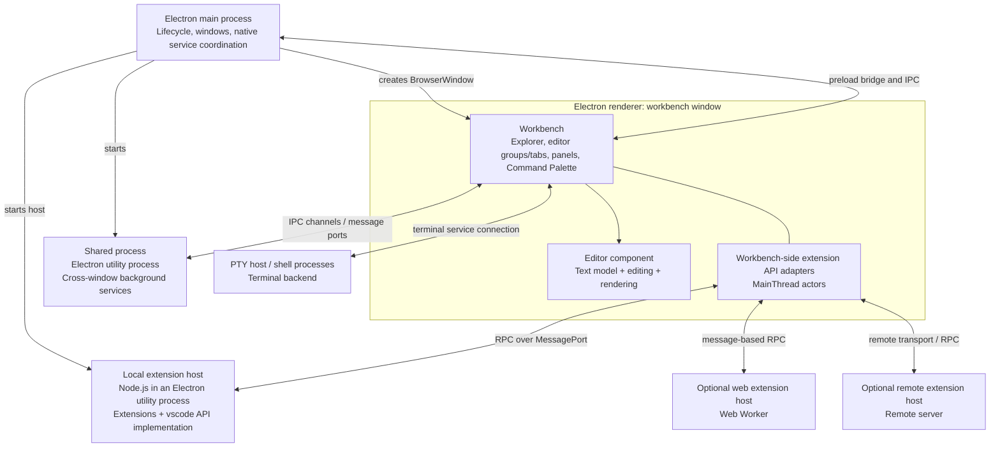

# VS Code Reverse Engineering Report

Investigation date: 2026-11-17. Workspace: `D:\codebase\vscode`. Checkout HEAD: `6b7ba7ebf1906f2851a1351f63086533ce772b73`. The package identifies this tree as `code-oss-dev`, version `1.148.0`; these describe this checkout, not an assertion about the latest public release.

## Evidence and how to read this report

This is a static investigation of the source in this workspace. REA analyzed the Electron main implementation and the extension-host launcher directory. Important conclusions were checked against source symbols and their surrounding code. No application was launched and no user data was inspected or modified.

Source citations below use repository-relative links with `#L` line anchors. The numbers refer to this checkout; editors that do not navigate Markdown line fragments can use the stated line number directly.

REA evidence:

| Scope | Result | Retained parent evidence ID |
|---|---|---|
| `src/vs/code/electron-main` | Two sources parsed; no parse failures; application graph partial, semantic coverage unknown; 4,718 semantic unknown records | `ev_6a27a7cfd24875f071ce4609d38208f1f2201b2bbf090c39a177c73b37bb93f1` |
| `src/vs/platform/extensions/electron-main` | One source parsed; no parse failures; application graph partial, semantic coverage unknown; 188 semantic unknown records | `ev_e4b753212068166a6802a79f6d98f6df777bdf01e6b6130bade100b62e56b339` |

These IDs identify evidence retained in the REA session, not files delivered with this report. REA's static extraction cannot prove runtime reachability or fully resolve the dependency-injection and wrapper relationships here. For example, its launcher summary reports no direct utility-process creation: the source delegates through `WindowUtilityProcess`, and following that wrapper reveals the Electron fork. A missing REA finding is not evidence that a feature is absent.

**Verification labels:** “Source verified” means the implementation supports the statement. Diagrams are simplified interpretations of those sources. Runtime timing, the exact process count, active extensions, actual storage paths, and behavior of a particular installed product remain **unverified**.

## 1. What VS Code does and its technologies

VS Code provides a graphical environment for opening projects, editing text and source code, navigating files, running terminals, debugging programs, and working with source control. Extensions add languages, tools, and integrations. Think of it as an editor component inside a larger application shell, with separate processes for application management and extension execution.

The source is primarily TypeScript. Desktop UI uses browser technologies—HTML, CSS, the DOM, and JavaScript—inside Electron. Electron supplies Chromium rendering and access to Node.js and native operating-system capabilities. This checkout uses ES modules, declares `out/main.js` as its application entry, and configures Electron as its native build runtime. See [package.json:1](package.json#L1), especially lines 7–19.

The terminal combines a browser terminal surface with native pseudoterminal support. The dependency manifest includes xterm packages and `node-pty` ([package.json:147](package.json#L147)); the native terminal process imports `spawn` from `node-pty` ([terminalProcess.ts:23](src/vs/platform/terminal/node/terminalProcess.ts#L23)). Desktop state also uses SQLite, discussed in section 9.

Architecture lesson: use the browser for rendering while putting native operations behind explicit service boundaries. The existence of a desktop boundary does not make every operation run in Electron main.

## 2. Repository overview and code layers

| Folder | What a learner should look for |
|---|---|
| `src/` | Core application code and many colocated unit tests |
| `src/vs/base/` | Reusable primitives: events, disposables, cancellation, IPC, storage helpers |
| `src/vs/platform/` | Shared service contracts and implementations: files, configuration, windows, extensions, storage |
| `src/vs/editor/` | Text model, editing behavior, language-feature registries, editor widget |
| `src/vs/workbench/` | Full application UI, services, feature contributions, extension API bridges |
| `src/vs/code/` | Desktop entry points and Electron composition |
| `src/vs/server/` | Server-side application support, including remote scenarios |
| `src/vs/sessions/` | Separate agent-sessions window layer present in this checkout |
| `extensions/` | Built-in extensions, such as Git and TypeScript language support |
| `build/` | Build, packaging, distribution, and related tooling |
| `scripts/` | Developer launch and test scripts |
| `test/` | Integration, smoke, and other test infrastructure |
| `resources/` | Product assets such as icons |
| `out/` | Generated JavaScript output, when built; not the TypeScript source of truth |

The repository's own architectural overview describes these layers ([copilot-instructions.md:5](.github/copilot-instructions.md#L5)). Within a layer, `common` generally contains code that does not require a particular UI or host; `browser`, `node`, `electron-main`, and `electron-browser` indicate environment-specific responsibilities. Folder names describe intended environments, not a one-to-one list of running processes.

The conceptual dependency direction is:

```text
base → platform → editor → workbench
                          ↑ desktop composition supplies native services
```

The arrow means “provides foundations for”; this is a teaching model, not an exhaustive import graph. Services let higher-level code request capabilities without constructing every implementation itself. For example, the dependency-injection service identifier and decorator mechanism are defined in [instantiation.ts:41](src/vs/platform/instantiation/common/instantiation.ts#L41). Workbench feature contributions start through a registry in [workbench.ts:142](src/vs/workbench/browser/workbench.ts#L142).

Architecture lesson: layering controls code dependencies; process boundaries control where code executes. They solve different problems.

## 3. High-level architecture



This diagram shows logical responsibilities and selected communication paths. It omits Chromium GPU/helper processes, auxiliary windows, individual language tools, and other background workers. It does not imply exactly one host for every window or one process per extension. The host factory supports local-process, local-worker, and remote locations ([nativeExtensionService.ts:570](src/vs/workbench/services/extensions/electron-browser/nativeExtensionService.ts#L570)).

## 4. Launching VS Code and displaying a window

Simple explanation: Electron starts the application, the main process prepares its services and chooses what to open, then a renderer loads and constructs the workbench.

Source-verified normal desktop path:

1. **Enter the application.** The package points to compiled `out/main.js`. Its source enables the Node compile cache and imports `mainImpl` ([main.ts:6](src/main.ts#L6)).
2. **Prepare Electron startup.** `mainImpl` configures early application state and waits for Electron's `ready` event ([mainImpl.ts:178](src/mainImpl.ts#L178)). Its startup routine bootstraps ES modules and imports the Electron-main implementation ([mainImpl.ts:235](src/mainImpl.ts#L235)).
3. **Establish the main application.** The main implementation handles startup and instance coordination, then constructs and starts `CodeApplication` ([main.ts:103](src/vs/code/electron-main/main.ts#L103), [main.ts:157](src/vs/code/electron-main/main.ts#L157)). A later invocation can forward work to an existing instance rather than creating a completely independent application.
4. **Initialize services and select windows.** `CodeApplication.startup()` sets up application services, shared-process connectivity, and opens initial windows ([app.ts:702](src/vs/code/electron-main/app.ts#L702), [app.ts:754](src/vs/code/electron-main/app.ts#L754), [app.ts:801](src/vs/code/electron-main/app.ts#L801)). `openFirstWindow` contains branches for command-line requests and startup modes ([app.ts:1551](src/vs/code/electron-main/app.ts#L1551)).
5. **Create the native window.** The window implementation supplies a preload script and constructs `electron.BrowserWindow` ([windowImpl.ts:858](src/vs/platform/windows/electron-main/windowImpl.ts#L858), [windowImpl.ts:878](src/vs/platform/windows/electron-main/windowImpl.ts#L878)). Default web preferences enable sandboxing ([windows.ts:211](src/vs/platform/windows/electron-main/windows.ts#L211)).
6. **Load the renderer entry.** The window loads the built or development workbench HTML ([windowImpl.ts:1393](src/vs/platform/windows/electron-main/windowImpl.ts#L1393)). Renderer bootstrap selects `workbench.desktop.main.js` ([workbench.ts:513](src/vs/code/electron-browser/workbench/workbench.ts#L513)).
7. **Compose the UI.** Desktop startup initializes services and creates `Workbench` ([desktop.main.ts:120](src/vs/workbench/electron-browser/desktop.main.ts#L120)). Workbench startup starts contributions, renders UI parts, and lays them out ([workbench.ts:142](src/vs/workbench/browser/workbench.ts#L142)).

Rendering, editor restoration, extension startup, and background initialization have asynchronous stages. This list is an explanatory dependency sequence, not a measured timeline. This checkout also contains agent-window branches; not every launch follows the ordinary editor-window path.

## 5. Processes and communication

| Component | Simple explanation | Technical responsibility and evidence |
|---|---|---|
| Electron main | The desktop application's coordinator | Owns application lifecycle and native windows; composes main-process services. [CodeApplication:218](src/vs/code/electron-main/app.ts#L218) |
| Renderer | The process drawing and interacting with the window | Runs workbench UI and editor components; uses browser APIs and bridged native services. [desktop.main.ts:135](src/vs/workbench/electron-browser/desktop.main.ts#L135) |
| Shared process | Background services that multiple windows can use | Created as a utility process with shared-process entry point. [sharedProcess.ts:147](src/vs/platform/sharedProcess/electron-main/sharedProcess.ts#L147) |
| Local extension host | A runtime in which extension code executes | Launcher creates `WindowUtilityProcess` and starts `vs/workbench/api/node/extensionHostProcess`. [extensionHostStarter.ts:77](src/vs/platform/extensions/electron-main/extensionHostStarter.ts#L77), [extensionHostStarter.ts:105](src/vs/platform/extensions/electron-main/extensionHostStarter.ts#L105) |

The utility-process wrapper ultimately calls Electron `utilityProcess.fork` with `bootstrap-fork.js`, passing the intended entry point through environment configuration ([utilityProcess.ts:246](src/vs/platform/utilityProcess/electron-main/utilityProcess.ts#L246)). Thus the local extension host in this checkout is a separate Node-capable utility process, not a renderer running the extension UI.

The shared-process entry imports background cleanup, localization, telemetry, and user-data synchronization services, illustrating the kinds of cross-window work hosted there ([sharedProcessMain.ts:16](src/vs/code/electron-utility/sharedProcess/sharedProcessMain.ts#L16)). Its role is broader than extension execution.

**IPC** moves messages between processes. A service can expose named channels rather than sharing ordinary objects across process memory. For example, application startup registers an extension-host starter channel ([app.ts:1543](src/vs/code/electron-main/app.ts#L1543)). Main-to-shared connectivity uses a message-port client ([app.ts:1211](src/vs/code/electron-main/app.ts#L1211)).

**RPC** puts a method-call-shaped interface on a message transport. The workbench host manager creates an `RPCProtocol` ([extensionHostManager.ts:258](src/vs/workbench/services/extensions/common/extensionHostManager.ts#L258)); the host creates its peer ([extensionHostMain.ts:176](src/vs/workbench/api/common/extensionHostMain.ts#L176)). Local host setup uses a `MessagePort` connection ([localProcessExtensionHost.ts:414](src/vs/workbench/services/extensions/electron-browser/localProcessExtensionHost.ts#L414)).

Important naming distinction: extension API classes named `MainThread...` are workbench-side actors, typically in the renderer. “MainThread” here does not mean Electron's main process.

Separate extension execution helps keep extension computation outside the UI execution context, but it does not guarantee responsiveness or constitute a complete security sandbox. Exact host counts and isolation behavior for installed extensions were not measured.

## 6. Editor and workbench: where visible features live

The **editor** handles text and editing interactions. The **workbench** organizes the whole application around editor components. A workbench editor can also display a notebook, image, or other specialized resource; not every tab is a plain text widget.

| Visible feature | What happens internally | Source |
|---|---|---|
| Text editor | `TextModel` represents text; `CodeEditorWidget` supplies the interactive browser editor | [textModel.ts:186](src/vs/editor/common/model/textModel.ts#L186), [codeEditorWidget.ts:70](src/vs/editor/browser/widget/codeEditor/codeEditorWidget.ts#L70) |
| Explorer | A workbench tree view requests opening a selected resource through the editor service | [explorerView.ts:179](src/vs/workbench/contrib/files/browser/views/explorerView.ts#L179), [open request:620](src/vs/workbench/contrib/files/browser/views/explorerView.ts#L620) |
| Tabs and editor groups | Workbench editor parts organize editor groups and route opening into a group | [editorPart.ts:129](src/vs/workbench/browser/parts/editor/editorPart.ts#L129), [group opening:312](src/vs/workbench/browser/parts/editor/editorPart.ts#L312) |
| Terminal | A workbench service manages terminals; native backend connects to shell processes through a pseudoterminal | [terminalService.ts:66](src/vs/workbench/contrib/terminal/browser/terminalService.ts#L66), [terminalProcess.ts:321](src/vs/platform/terminal/node/terminalProcess.ts#L321) |
| Command Palette | A quick-access provider presents commands; selecting a command delegates to the command infrastructure | [commandsQuickAccess.ts:44](src/vs/workbench/contrib/quickaccess/browser/commandsQuickAccess.ts#L44), [show action:273](src/vs/workbench/contrib/quickaccess/browser/commandsQuickAccess.ts#L273) |

A command is a named action, so menus, keybindings, and the palette can provide different routes to the same behavior. A tab is a workbench presentation of an editor input; the text model beneath it is a different object with a different lifetime.

## 7. Extension discovery, activation, and API connection

Simple explanation: first VS Code learns which extensions exist, then decides where to run them, and later starts their code when needed. Discovering an extension does not automatically mean running its entry point.

1. **Discovery and metadata.** The scanner supports system extensions, user extensions, and extensions under development. Profile-aware scanning and location-based scanning are separate paths ([extensionsScannerService.ts:210](src/vs/platform/extensionManagement/common/extensionsScannerService.ts#L210), [extensionsScannerService.ts:607](src/vs/platform/extensionManagement/common/extensionsScannerService.ts#L607)). Extension manifests declare entry points and contributions; the Git extension provides a concrete example ([Git package.json:51](extensions/git/package.json#L51)).
2. **Registration and placement.** The abstract service initializes the registry and computes running locations ([abstractExtensionService.ts:466](src/vs/workbench/services/extensions/common/abstractExtensionService.ts#L466), [running locations:539](src/vs/workbench/services/extensions/common/abstractExtensionService.ts#L539)). Native host creation selects local process, worker, or remote host ([nativeExtensionService.ts:570](src/vs/workbench/services/extensions/electron-browser/nativeExtensionService.ts#L570)). Enablement and workspace-trust handling affect what can run; native scanning explicitly waits for initialized trust state ([nativeExtensionService.ts:463](src/vs/workbench/services/extensions/electron-browser/nativeExtensionService.ts#L463)).
3. **Activation request.** Events are routed to extension host managers through `activateByEvent` ([abstractExtensionService.ts:993](src/vs/workbench/services/extensions/common/abstractExtensionService.ts#L993)). Host startup also handles `*` and startup-finished activation ([extHostExtensionService.ts:647](src/vs/workbench/api/common/extHostExtensionService.ts#L647)). Some activation events can be supplied by contribution handling; do not assume every extension needs every trigger explicitly listed in its manifest.
4. **Load and activate.** The host loads the extension entry module, creates its context, and calls an exported `activate(context)` when present ([extHostExtensionService.ts:490](src/vs/workbench/api/common/extHostExtensionService.ts#L490), [activation call:590](src/vs/workbench/api/common/extHostExtensionService.ts#L590)). Dependency activation is handled by the activator ([extHostExtensionActivator.ts:273](src/vs/workbench/api/common/extHostExtensionActivator.ts#L273)). Declarative contributions can be useful without an activation function.
5. **Supply the API.** The Node host integrates `vscode` imports with an API factory and registers extension API actors ([node/extHostExtensionService.ts:88](src/vs/workbench/api/node/extHostExtensionService.ts#L88), [factory setup:156](src/vs/workbench/api/node/extHostExtensionService.ts#L156), [extHost.api.impl.ts:151](src/vs/workbench/api/common/extHost.api.impl.ts#L151)). Calls that need workbench services cross the RPC boundary.

Architecture lesson: declarative metadata lets the application advertise capabilities before loading all implementation code. Activation can defer work until it is relevant.

## 8. Opening, editing, and saving a file

For an ordinary text file, the visible editor is one part of a pipeline. Resources are identified by URIs, allowing the same high-level services to work with different file-system providers.

```mermaid
sequenceDiagram
    participant User
    participant UI as Explorer / editor service
    participant Model as TextFileEditorModel + TextModel
    participant Files as Text file / file services
    participant Provider as File-system provider
    User->>UI: Open a file
    UI->>Model: Resolve editor input and text
    Model->>Files: readStream(resource)
    Files->>Provider: Read through URI-scheme provider
    Provider-->>Model: Content and metadata via services
    UI->>Model: Attach text model to editor widget
    User->>Model: Type edits
    Note over Model: In-memory text changes; dirty state tracked
    User->>Model: Save
    Model->>Model: Run save preparation / participants
    Model->>Files: Write text snapshot with metadata
    Files->>Provider: Write bytes
    Provider-->>Model: Result via services
    Note over Model: Clear dirty only if saved version is current
```

**Open.** Explorer asks the editor service to open a URI ([explorerView.ts:620](src/vs/workbench/contrib/files/browser/views/explorerView.ts#L620)). A text-file editor resolves its input and attaches the resulting text model to the control ([textFileEditor.ts:103](src/vs/workbench/contrib/files/browser/editors/textFileEditor.ts#L103), [model attachment:129](src/vs/workbench/contrib/files/browser/editors/textFileEditor.ts#L129)). The model can resolve supplied content, recovery content, or file content. Ordinary file loading calls `textFileService.readStream` ([textFileEditorModel.ts:527](src/vs/workbench/services/textfile/common/textFileEditorModel.ts#L527)).

**Edit.** Keystrokes change the in-memory text model; they do not require a file write for every key. The text-file wrapper observes content changes and updates dirty state ([textFileEditorModel.ts:707](src/vs/workbench/services/textfile/common/textFileEditorModel.ts#L707)). “Dirty” means the editor has changes that need saving.

**Save.** Save processing coordinates concurrent saves and save preparation ([textFileEditorModel.ts:831](src/vs/workbench/services/textfile/common/textFileEditorModel.ts#L831), [save participants:927](src/vs/workbench/services/textfile/common/textFileEditorModel.ts#L927)). It writes a snapshot with encoding, modification time, and an ETag used for conflict detection ([write:1033](src/vs/workbench/services/textfile/common/textFileEditorModel.ts#L1033)). Success clears dirty state only if the model version still matches the saved version ([success:1048](src/vs/workbench/services/textfile/common/textFileEditorModel.ts#L1048)). That protects edits made while saving.

**Provider boundary.** `FileService` registers providers by URI scheme and exposes read/write operations ([fileService.ts:52](src/vs/platform/files/common/fileService.ts#L52), [write:383](src/vs/platform/files/common/fileService.ts#L383), [read:542](src/vs/platform/files/common/fileService.ts#L542)). Desktop composition registers the disk provider for `file:` ([desktop.main.ts:272](src/vs/workbench/electron-browser/desktop.main.ts#L272)). Remote and virtual resources can use different providers. Custom editors, untitled files, notebooks, and save-as have additional paths; the sequence above is not a universal file-operation trace.

## 9. Settings, user data, and workspace data

Simple explanation: project files hold your work, settings describe preferences, and application state remembers how the UI and extensions were being used. These are related but different kinds of data.

| Data | Representation and scope | Source |
|---|---|---|
| User settings | Profile settings resource, normally `settings.json` within the profile location | [userDataProfile.ts:196](src/vs/platform/userDataProfile/common/userDataProfile.ts#L196) |
| Folder settings | `.vscode/settings.json`, applying to a project folder | [configuration.ts:15](src/vs/workbench/services/configuration/common/configuration.ts#L15) |
| Effective configuration | Configuration service combines appropriate user/workspace/folder and other configuration models | [configurationService.ts:137](src/vs/workbench/services/configuration/browser/configurationService.ts#L137), [configurationModels.ts:1063](src/vs/platform/configuration/common/configurationModels.ts#L1063) |
| Profile state | SQLite `state.vscdb` under profile global storage | [storageMain.ts:294](src/vs/platform/storage/electron-main/storageMain.ts#L294) |
| Workspace state | SQLite `state.vscdb` under `workspaceStorage/<workspace-id>/` | [storageMain.ts:424](src/vs/platform/storage/electron-main/storageMain.ts#L424) |
| Other application data | User root also contains locations for logs, caches, synchronization, and untitled workspace data | [environmentService.ts:59](src/vs/platform/environment/common/environmentService.ts#L59) |

The native environment derives an application settings home from `<userDataPath>/User` and a workspace-storage home beneath it ([environmentService.ts:62](src/vs/platform/environment/common/environmentService.ts#L62), [workspace storage:92](src/vs/platform/environment/common/environmentService.ts#L92)). Profiles can change relevant resources. Actual absolute roots depend on product configuration, startup options, and portable mode; this investigation did not read the user's real data directories.

Settings are not simply one JSON object loaded once. The workbench tracks multiple configuration sources and profile changes. Policy, language-specific overrides, remote settings, and setting scope make the full precedence model more detailed than “workspace always wins.” This report does not claim to enumerate every precedence rule.

SQLite state is accessed through storage services rather than by UI components opening database files directly. The database implementation is explicitly constructed by main-side storage code ([storageMain.ts:314](src/vs/platform/storage/electron-main/storageMain.ts#L314), [workspace database:448](src/vs/platform/storage/electron-main/storageMain.ts#L448)). A stored workspace ID identifies application state; it is not the contents of the project's source files.

## 10. Language features, debugging, and source control

### Language features

Simple explanation: the editor asks a registered provider for information such as completions. The provider can live in the core or in an extension, and an extension may in turn talk to a language server.

The editor has a language-features service with registries ([languageFeaturesService.ts:12](src/vs/editor/common/services/languageFeaturesService.ts#L12)). An extension's completion registration creates a host-side adapter and tells the workbench about it ([extHostLanguageFeatures.ts:2682](src/vs/workbench/api/common/extHostLanguageFeatures.ts#L2682)). The workbench registers a provider whose requests call back across RPC ([mainThreadLanguageFeatures.ts:621](src/vs/workbench/api/browser/mainThreadLanguageFeatures.ts#L621)).

```text
Editor request → provider registry → workbench API adapter
               → extension-host RPC → extension provider
               → optional language tool/server → result back to editor
```

LSP, the Language Server Protocol, is an optional additional boundary between an extension client and a language server. It is not the protocol for every internal editor operation. The built-in JSON extension uses a language-client abstraction ([jsonClient.ts:183](extensions/json-language-features/client/src/jsonClient.ts#L183)); TypeScript support has its own server process interface ([server.ts:69](extensions/typescript-language-features/src/tsServer/server.ts#L69)). These sources demonstrate why “all languages use LSP” would be too broad a claim.

### Debugging

Simple explanation: the workbench manages the debugging experience, while an adapter translates requests for a particular runtime or debugger.

The debug service starts a debugging operation, resolves a configuration, and creates a session ([debugService.ts:354](src/vs/workbench/contrib/debug/browser/debugService.ts#L354), [session creation:456](src/vs/workbench/contrib/debug/browser/debugService.ts#L456)). Session initialization asks a debugger contribution for an adapter and initializes that adapter ([debugSession.ts:346](src/vs/workbench/contrib/debug/browser/debugSession.ts#L346)). The raw debug-session implementation explicitly encapsulates the Debug Adapter Protocol ([rawDebugSession.ts:40](src/vs/workbench/contrib/debug/browser/rawDebugSession.ts#L40)). The adapter boundary supports DAP: requests such as launch, stepping, and breakpoints are distinct from ordinary editor text operations.

The UI can display paused source and breakpoint markers while the debug session owns runtime execution state. Adapter implementation and transport vary; no particular debug target or adapter process was run during this investigation.

### Source control

Simple explanation: the workbench supplies a source-control UI and provider interface; a Git extension supplies Git-specific behavior.

`SCMService` registers providers and exposes repositories ([scmService.ts:358](src/vs/workbench/contrib/scm/common/scmService.ts#L358), [registration:389](src/vs/workbench/contrib/scm/common/scmService.ts#L389)). The built-in Git repository implementation calls `scm.createSourceControl('git', ...)` ([repository.ts:994](extensions/git/src/repository.ts#L994)). This separates a general source-control interface from one concrete version-control tool. Source-control changes and diffs can be presented through workbench editors without putting Git operations into the core text model.

## 11. Important source files and responsibilities

This index is a practical reading route. Start with the entry points, then follow a single feature across its service and process boundaries.

| Source file and starting line | Responsibility |
|---|---|
| [package.json:1](package.json#L1) | Product metadata, entry point, build scripts, dependencies |
| [src/main.ts:6](src/main.ts#L6) | Minimal application entry and compile-cache setup |
| [src/mainImpl.ts:178](src/mainImpl.ts#L178) | Electron readiness and bootstrap |
| [code/electron-main/main.ts:103](src/vs/code/electron-main/main.ts#L103) | Main startup and application construction |
| [code/electron-main/app.ts:702](src/vs/code/electron-main/app.ts#L702) | Application lifecycle, service composition, initial windows |
| [windowImpl.ts:858](src/vs/platform/windows/electron-main/windowImpl.ts#L858) | BrowserWindow configuration and renderer loading |
| [desktop.main.ts:120](src/vs/workbench/electron-browser/desktop.main.ts#L120) | Compose native workbench services and open UI |
| [workbench.ts:66](src/vs/workbench/browser/workbench.ts#L66) | Workbench startup, rendering, layout, contributions |
| [codeEditorWidget.ts:70](src/vs/editor/browser/widget/codeEditor/codeEditorWidget.ts#L70) | Interactive editor widget |
| [textModel.ts:186](src/vs/editor/common/model/textModel.ts#L186) | In-memory text representation |
| [editorPart.ts:129](src/vs/workbench/browser/parts/editor/editorPart.ts#L129) | Editor groups and workbench editor layout |
| [explorerView.ts:179](src/vs/workbench/contrib/files/browser/views/explorerView.ts#L179) | File Explorer UI |
| [commandsQuickAccess.ts:44](src/vs/workbench/contrib/quickaccess/browser/commandsQuickAccess.ts#L44) | Command Palette provider |
| [terminalService.ts:66](src/vs/workbench/contrib/terminal/browser/terminalService.ts#L66) | Workbench terminal coordination |
| [terminalProcess.ts:321](src/vs/platform/terminal/node/terminalProcess.ts#L321) | Native terminal process spawning |
| [sharedProcess.ts:147](src/vs/platform/sharedProcess/electron-main/sharedProcess.ts#L147) | Shared utility-process creation |
| [extensionHostStarter.ts:105](src/vs/platform/extensions/electron-main/extensionHostStarter.ts#L105) | Local extension-host process launch |
| [nativeExtensionService.ts:570](src/vs/workbench/services/extensions/electron-browser/nativeExtensionService.ts#L570) | Select and construct extension-host implementations |
| [extensionsScannerService.ts:210](src/vs/platform/extensionManagement/common/extensionsScannerService.ts#L210) | Discover installed extensions |
| [abstractExtensionService.ts:993](src/vs/workbench/services/extensions/common/abstractExtensionService.ts#L993) | Route activation events |
| [extHostExtensionService.ts:590](src/vs/workbench/api/common/extHostExtensionService.ts#L590) | Invoke extension activation code |
| [extHost.api.impl.ts:151](src/vs/workbench/api/common/extHost.api.impl.ts#L151) | Construct extension API and actors |
| [rpcProtocol.ts:115](src/vs/workbench/services/extensions/common/rpcProtocol.ts#L115) | Extension-host RPC machinery |
| [textFileEditorModel.ts:295](src/vs/workbench/services/textfile/common/textFileEditorModel.ts#L295) | Resolve, dirty tracking, save lifecycle |
| [fileService.ts:52](src/vs/platform/files/common/fileService.ts#L52) | URI-based file-system provider routing |
| [configurationService.ts:137](src/vs/workbench/services/configuration/browser/configurationService.ts#L137) | Load user and workspace configuration sources |
| [storageMain.ts:294](src/vs/platform/storage/electron-main/storageMain.ts#L294) | Persistent desktop storage databases |
| [mainThreadLanguageFeatures.ts:621](src/vs/workbench/api/browser/mainThreadLanguageFeatures.ts#L621) | Bridge extension language providers to editor services |
| [debugService.ts:354](src/vs/workbench/contrib/debug/browser/debugService.ts#L354) | Start and coordinate debug sessions |
| [scmService.ts:358](src/vs/workbench/contrib/scm/common/scmService.ts#L358) | Source-control provider and repository coordination |

## 12. Glossary

| Term | Simple explanation |
|---|---|
| Electron | Framework that combines Chromium windows with Node.js and desktop integration |
| Chromium | Browser engine infrastructure used to render desktop UI |
| Main process | Electron application's coordinator for lifecycle and native windows |
| Renderer | Process that executes and draws a window's browser-based UI |
| Workbench | The complete application shell around editor components |
| Editor widget | Interactive component displaying and editing text |
| Text model | In-memory representation of a document's text |
| Extension host | Runtime responsible for loading and executing extension code |
| Utility process | Electron-managed background process that can run Node-capable tasks |
| Shared process | VS Code background process providing services across windows |
| IPC | Inter-process communication: passing messages between separate processes |
| RPC | Remote procedure call: requesting a method on the other side of a message connection |
| MessagePort | Endpoint used to send and receive messages over a channel |
| Preload | Startup script used to provide controlled integration to a renderer |
| Sandbox | Restrictions on a process's direct access to capabilities such as operating-system APIs |
| Service | Named capability, such as reading files or opening editors |
| Dependency injection | Supplying a component's required services rather than making it construct them |
| Contribution | Feature metadata or implementation registered with an application extension point |
| Activation event | Trigger that can cause an extension's runtime code to start |
| URI | Resource identifier including a scheme, such as `file:`; not necessarily a local disk path |
| Provider | Implementation plugged into a common capability interface |
| Dirty | Document state indicating edits that still need saving |
| ETag | Version-related metadata used to help detect conflicting file changes |
| Workspace | Folder or collection of folders and associated project configuration |
| Profile | Selected collection of user configuration and related resources |
| PTY | Pseudoterminal: interface connecting a terminal UI to a shell or terminal program |
| LSP | Language Server Protocol: messages between a language client and a supporting language server |
| DAP | Debug Adapter Protocol: messages between a debugging client and a debug adapter |
| SCM | Source control management: interfaces for tracking and presenting version-control changes |
| Disposable | Resource or registration that can be explicitly cleaned up when no longer needed |

## Investigation limits

- Source verified: the cited entry points, classes, registration sites, process launch wrappers, API bridges, file lifecycle, and storage construction sites exist in this checkout.
- Simplified: diagrams and narrative collapse intermediate services, error handling, platform-specific branches, and specialized editors.
- Unverified at runtime: startup duration, actual process topology, installed/active extensions, user settings, storage contents, remote connectivity, and behavior of a built distribution.
- REA scope was deliberately limited to focused source directories. Neither its graph nor this report is an exhaustive dependency map or security audit of the repository.
- This was a documentation-only investigation. No builds or application tests were required to establish the static findings.
