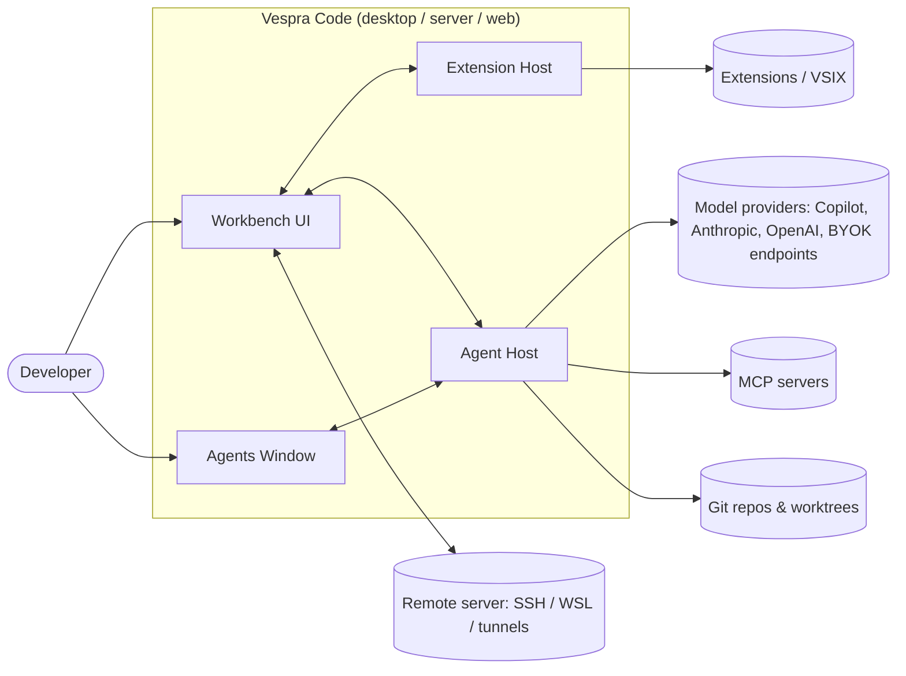
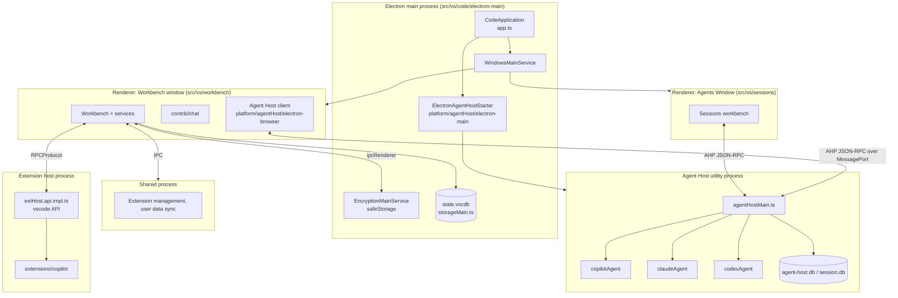
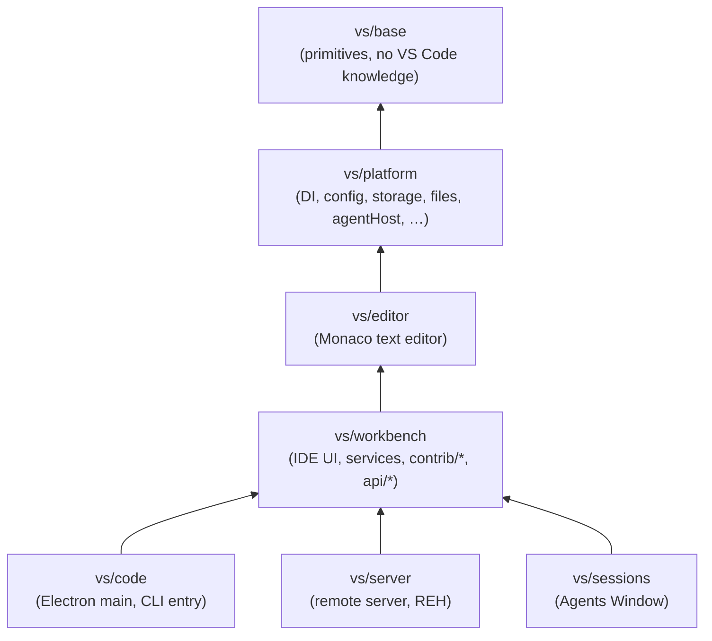
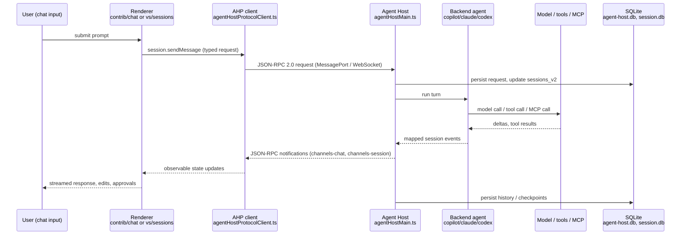

# Vespra Code — Project Architecture Blueprint

> Internal reference for the Vespra team. Describes how the `vespra-company/vespracode` tree is actually structured today so new work stays consistent with it. Every path below was verified against the source at the time of writing; when the code and this document disagree, the code wins and this document should be fixed.
>
> Upstream base: Code OSS `1.143.0` (`package.json#version`). Product identity: `product.json` (`nameShort: "Vespra"`, `nameLong: "Vespra Code"`, `applicationName: "vespra"`, `dataFolderName: ".vespra"`, `urlProtocol: "vespra"`).

---

## Table of contents

1. [Architecture detection and analysis](#1-architecture-detection-and-analysis)
2. [Architectural overview](#2-architectural-overview)
3. [Architecture visualization](#3-architecture-visualization)
4. [Core architectural components](#4-core-architectural-components)
5. [Architectural layers and dependencies](#5-architectural-layers-and-dependencies)
6. [Data architecture](#6-data-architecture)
7. [Cross-cutting concerns](#7-cross-cutting-concerns)
8. [Service communication patterns](#8-service-communication-patterns)
9. [Technology-specific patterns (TypeScript / Electron / Node)](#9-technology-specific-patterns)
10. [Implementation patterns](#10-implementation-patterns)
11. [Testing architecture](#11-testing-architecture)
12. [Build, packaging and deployment architecture](#12-build-packaging-and-deployment-architecture)
13. [Extension and evolution patterns](#13-extension-and-evolution-patterns)
14. [Architectural pattern examples](#14-architectural-pattern-examples)
15. [Architectural decision records](#15-architectural-decision-records)
16. [Architecture governance](#16-architecture-governance)
17. [Blueprint for new development](#17-blueprint-for-new-development)
18. [Vespra fork delta](#18-vespra-fork-delta)

---

## 1. Architecture detection and analysis

### Technology stack (detected)

| Concern | Technology | Evidence |
|---|---|---|
| Language | TypeScript (strict, ESM) | `src/tsconfig.json`, `tsconfig.base.json` |
| Runtime (desktop) | Electron (main / renderer / utility processes) | `src/vs/code/electron-main/main.ts`, `src/vs/platform/agentHost/electron-main/electronAgentHostStarter.ts` |
| Runtime (server) | Node.js `24.18.0` (`.nvmrc`) | `src/vs/server/node/server.main.ts` |
| Runtime (web) | Browser + Web Worker extension host | `src/vs/workbench/browser/web.main.ts`, `src/vs/workbench/services/extensions/browser/webWorkerExtensionHost.ts` |
| Build | Gulp (`gulpfile.mjs` -> `build/gulpfile.ts`) + esbuild (`build/lib/esbuild.ts`, `build/next/index.ts`) | root `package.json` scripts |
| Lint / hygiene | ESLint with local plugin (`.eslint-plugin-local/`), `build/hygiene.ts` | `npm run eslint`, `npm run hygiene` |
| Unit tests | Mocha (TDD UI) for Node, Playwright-driven browser harness | `test/unit/node/index.js`, `test/unit/browser/index.js` |
| Integration / E2E | `vscode-test`, smoke tests (Playwright), agent-host E2E runner | `test/smoke`, `test/integration/agentHost/runner.ts` |
| Persistence | SQLite via `@vscode/sqlite3` (`state.vscdb`, `agent-host.db`, `session.db`) | `src/vs/base/parts/storage/node/storage.ts`, `src/vs/platform/agentHost/node/agentHostDatabase.ts` |
| AI SDKs | `@github/copilot-sdk`, `@anthropic-ai/claude-agent-sdk`, `@openai/codex` | `src/vs/platform/agentHost/node/{copilot,claude,codex}/` |
| Protocol | Agent Host Protocol (AHP), JSON-RPC 2.0, `PROTOCOL_VERSION = '1.1.0'` | `src/vs/platform/agentHost/common/state/protocol/version/registry.ts` |
| Telemetry | 1DS appenders present but disabled by product config | `product.json#enableTelemetry: false`, no `aiConfig` |

### Architectural pattern (detected)

A **strictly layered modular monolith** with a **multi-process runtime**:

- **Layered**: `base -> platform -> editor -> workbench -> {code, server, sessions}`; the dependency direction is one-way and machine-enforced.
- **Target-environment partitioning**: every layer is split into `common/`, `browser/`, `node/`, `electron-browser/`, `electron-main/`, `electron-utility/`, `worker/` folders, each with its own type-check tsconfig.
- **Service-oriented DI**: all behavior is exposed through `createDecorator`'d service interfaces, registered via `registerSingleton` and resolved by the instantiation service.
- **Contribution model**: features self-register into registries (`Registry.as(...)`, `registerWorkbenchContribution2`, `registerAction2`) and are pulled in by a few entry-point "main" files.
- **Process isolation**: UI (renderer), extensions (extension host process/worker), AI agents (Agent Host utility process), file/git/terminal services (shared process / server) communicate over message-passing RPC, never shared memory.

---

## 2. Architectural overview

Vespra Code is Code OSS plus a first-party AI stack (Agent Host, Agents/Sessions Window, chat, MCP) rebranded and with Microsoft telemetry/phone-home removed. The architecture has four guiding principles that the codebase enforces rather than merely recommends:

1. **Dependencies flow downward only.** `src/vs/base` knows nothing about the editor; `src/vs/workbench` may use everything below it; `src/vs/sessions` sits on top of workbench and workbench must never import it (`src/vs/sessions/README.md`, `src/vs/sessions/LAYERS.md`).
2. **Code is partitioned by the environment it can run in.** Code in `common/` must run anywhere (no DOM, no Node); `browser/` may touch the DOM; `node/` may use Node APIs; `electron-*` may use Electron. `npm run valid-layers-check` type-checks each partition against the correct `lib`/`types` (`build/checker/tsconfig.*.json`).
3. **Everything is a service behind an interface.** Consumers depend on `IFooService` (a `ServiceIdentifier`), never on a concrete class. Implementations differ per environment and are chosen at bootstrap (`src/vs/workbench/electron-browser/desktop.main.ts` vs `src/vs/workbench/browser/web.main.ts`).
4. **Isolation by process.** Crashes in extensions or agents must not take down the UI, so they live in separate OS processes with RPC boundaries (`RPCProtocol` for extensions, AHP over MessagePort/WebSocket for agents).

Boundaries are enforced by: the layer checker, the `local/code-layering` and `local/code-import-patterns` ESLint rules (`.eslint-plugin-local/code-layering.ts`, `.eslint-plugin-local/code-import-patterns.ts`), `build/hygiene.ts`, and `Disposable`-based lifecycle rules reviewed in code review (`.github/copilot-instructions.md`).

---

## 3. Architecture visualization

### 3.1 System context (C4 level 1)



### 3.2 Process / container view (C4 level 2, desktop)



### 3.3 Layer dependency graph



Arrows point from dependent to dependency; nothing may point the other way.

### 3.4 Data flow: a chat turn through the Agent Host



### 3.5 Data flow: an extension API call

```mermaid
sequenceDiagram
    participant X as Extension code
    participant API as vscode API object<br/>extHost.api.impl.ts
    participant EH as ExtHostMessageService
    participant RPC as RPCProtocol
    participant MT as MainThreadMessageService
    participant N as INotificationService

    X->>API: vscode.window.showInformationMessage()
    API->>EH: showMessage(extension, Severity.Info, …)
    EH->>RPC: $showMessage(...) via MainContext proxy
    RPC->>MT: deserialize, invoke
    MT->>N: notify / modal dialog
    N-->>MT: chosen item handle
    MT-->>RPC-->>EH-->>X: Thenable<MessageItem>
```

---

## 4. Core architectural components

### 4.1 `vs/base` — primitives

- **Purpose**: environment-agnostic building blocks: events (`src/vs/base/common/event.ts`), lifecycle (`src/vs/base/common/lifecycle.ts`), cancellation (`src/vs/base/common/cancellation.ts`), errors (`src/vs/base/common/errors.ts`), URIs, async utilities, IPC primitives (`src/vs/base/parts/ipc/`), SQLite storage (`src/vs/base/parts/storage/node/storage.ts`).
- **Structure**: `common/`, `browser/`, `node/`, `worker/`, plus `parts/` for larger reusable subsystems (ipc, storage, sandbox, request).
- **Rule**: must never import from `platform` or above; must not reference product concepts.

### 4.2 `vs/platform` — services and DI

- **Purpose**: service interfaces and implementations that are not UI-specific: instantiation (DI), configuration, storage, files, logging, telemetry, policy, product, remote connections, extension management, user data profiles/sync, **and the whole Agent Host** (`src/vs/platform/agentHost/`).
- **Key abstraction**: `createDecorator<T>(serviceId)` in `src/vs/platform/instantiation/common/instantiation.ts` produces a parameter decorator that is also the service identifier. `registerSingleton(id, Ctor, InstantiationType.Eager | Delayed)` in `src/vs/platform/instantiation/common/extensions.ts` records implementations; `Delayed` services are proxied and instantiated on first property access or idle.
- **Variation**: each service typically has a `common/` interface and per-environment implementations (e.g. `IFileService` -> `DiskFileSystemProvider` on Node, `IndexedDBFileSystemProvider` on web).

### 4.3 `vs/editor` — Monaco

- **Purpose**: the text editor (model, view, languages, contributions) that is also published standalone as the Monaco editor (`.github/workflows/monaco-editor.yml`).
- **Rule**: must not depend on `workbench`; editor contributions register through `registerEditorContribution`.

### 4.4 `vs/workbench` — the IDE

- **Purpose**: the IDE shell: parts/layout, services (`src/vs/workbench/services/`), features (`src/vs/workbench/contrib/`, ~100 contribution folders including `chat`, `mcp`, `terminal`, `scm`, `debug`), and the extension API bridge (`src/vs/workbench/api/`).
- **Composition**: `src/vs/workbench/browser/workbench.ts` assembles the `ServiceCollection`; entry points `desktop.main.ts` / `web.main.ts` import the `workbench.common.main.ts` / `workbench.desktop.main.ts` / `workbench.web.main.ts` contribution lists.
- **Contribution rules**: a `contrib/<feature>` may only import from its own folder, `services/`, `api/`, and lower layers — never from another `contrib/` (`.github/instructions/source-code-organization.instructions.md`).

### 4.5 Extension system (`vs/workbench/api` + `vs/workbench/services/extensions`)

- **Protocol**: `src/vs/workbench/api/common/extHost.protocol.ts` defines `MainContext` / `ExtHostContext` proxy identifiers and `$method` shapes; `RPCProtocol` (`src/vs/workbench/services/extensions/common/rpcProtocol.ts`) serializes calls over the host's message channel.
- **Hosts** (`ExtensionHostKind` in `extensionHostKind.ts`): `LocalProcess` (`electron-browser/localProcessExtensionHost.ts`, class `NativeLocalProcessExtensionHost`), `LocalWebWorker` (`browser/webWorkerExtensionHost.ts`), `Remote` (`common/remoteExtensionHost.ts`). `ExtensionHostManager` owns one host and instantiates `@extHostNamedCustomer` main-thread actors.
- **API factory**: `createApiFactoryAndRegisterActors` in `src/vs/workbench/api/common/extHost.api.impl.ts` builds the `vscode` namespace per extension and gates proposed APIs with `checkProposedApiEnabled`.
- **Contribution points**: `ExtensionsRegistry.registerExtensionPoint` (`src/vs/workbench/services/extensions/common/extensionsRegistry.ts`) registers a JSON schema and a handler; `AbstractExtensionService._handleExtensionPoint` fans manifests out to handlers.
- **Resilience**: `ExtensionHostCrashTracker` auto-restarts the host if fewer than 3 crashes occur in 5 minutes (`abstractExtensionService.ts`).

### 4.6 Agent Host (`vs/platform/agentHost`)

- **Purpose**: the AI runtime. Hosts backend agents (Copilot SDK, Claude Agent SDK, Codex), tools, MCP, changesets/worktrees, checkpoints, automations, OTel, and durable session storage, all out-of-process from the UI.
- **Protocol**: AHP = JSON-RPC 2.0 with typed channels under `src/vs/platform/agentHost/common/state/protocol/` (`channels-session`, `channels-chat`, `channels-changeset`, `channels-terminal`, `channels-automation`, `channels-otlp`, …). Versioning in `protocol/version/registry.ts` (`PROTOCOL_VERSION = '1.1.0'`, supported `1.0.0`, `0.9.0`). Compatibility requirements for external clients live in `.github/instructions/agent-host-interoperability.instructions.md`.
- **Process model**: desktop spawns an Electron `UtilityProcess` (`electron-main/electronAgentHostStarter.ts` -> `node/agentHostMain.ts`) bridged by MessagePort; external clients connect over WebSocket on a Unix socket/named pipe (`LOCAL_ENDPOINT.md`); the remote server exposes it via `src/vs/server/node/agentHostChannel.ts` and `serverAgentHostManager.ts`.
- **Session identity**: sessions are addressed as `ahp-session:/<uuid>` (`common/agentHostSessionIdentity.ts`) and the identity is immutable for the life of a session.
- **Backends**: `node/copilot/copilotAgent.ts`, `node/claude/claudeAgent.ts` (`chat.agentHost.claudeAgent.enabled`), `node/codex/codexAgent.ts` (`chat.agentHost.codexAgent.enabled` + `sdkRoot`). BYOK models flow from the renderer's language-model registry when `chat.agentHost.byokModels.enabled`.
- **Restart**: `IAgentHostService.restartAgentHost()` (`common/agentService.ts`, IPC channel `vscode:restartAgentHost`) handled by the starter; also restarted on OTel policy changes.

### 4.7 Agents Window (`vs/sessions`)

- **Purpose**: a dedicated session-centric workbench for running and reviewing agents, opened with `--agents` (`src/vs/code/electron-main/app.ts` -> `windowsMainService.openAgentsWindow`).
- **Structure**: `browser/`, `common/`, `services/`, `contrib/<feature>/`, `contrib/providers/<provider>/` (agentHost, remoteAgentHost, copilotChatSessions). Entry points `sessions.desktop.main.ts`, `sessions.web.main.ts`.
- **Rules**: may import `vs/workbench` and below; non-provider contributions must not import provider implementations; design specs are indexed in `src/vs/sessions/README.md` (`LAYERS.md`, `SESSIONS.md`, `AUTOMATIONS.md`, `LAYOUT.md`, …).

### 4.8 Chat & MCP in the workbench (`vs/workbench/contrib/chat`, `contrib/mcp`)

- Chat UI, modes, tools (`languageModelTools` extension point in `contrib/chat/common/tools/languageModelToolsContribution.ts`), participants (`contrib/chat/browser/chatParticipant.contribution.ts`), permissions/policy (`contrib/chat/common/agentHostConfigPolicy.ts`), MCP discovery (`contrib/mcp/common/discovery/extensionMcpDiscovery.ts`, `mcpServerDefinitionProviders` point in `contrib/mcp/common/mcpConfiguration.ts`).
- Extension-facing `vscode.lm` APIs (`registerLanguageModelChatProvider`, `registerTool`, `registerMcpServerDefinitionProvider`) are wired in `extHost.api.impl.ts`.

### 4.9 Built-in `copilot` extension (`extensions/copilot`)

- Compiled separately (`npm run compile-copilot`, run in parallel with `compile-client` by `npm run compile`). Provides the `customendpoint` BYOK provider and the chat participant surface that the default chat agent config (`product.json#defaultChatAgent`) references.

### 4.10 Electron main & CLI (`vs/code`)

- `electron-main/main.ts` bootstraps `CodeApplication` (`app.ts`): single-instance lock, windows, protocol handling (`vespra://`), shared process, Agent Host starter, encryption, storage main.
- `node/cli.ts`, `cliProcessMain.ts`: headless CLI (`--install-extension`, `--agents`, tunnels).

### 4.11 Remote server (`vs/server`)

- `node/server.main.ts` -> `remoteExtensionHostAgentServer.ts`: HTTP + WebSocket server for the web client (`webClientServer.ts`), remote extension host connections (`extensionHostConnection.ts`), file system/terminal channels, and the Agent Host proxy. Connection tokens: `serverConnectionToken.ts`.

---

## 5. Architectural layers and dependencies

### 5.1 Vertical layers

| Layer | May import | Must not import |
|---|---|---|
| `vs/base` | nothing above | `platform`, `editor`, `workbench`, … |
| `vs/platform` | `base` | `editor`, `workbench`, … |
| `vs/editor` | `base`, `platform` | `workbench`, `code`, `server`, `sessions` |
| `vs/workbench` | `base`, `platform`, `editor` | `code`, `server`, `sessions` |
| `vs/code`, `vs/server`, `vs/sessions` | everything below | each other |

### 5.2 Horizontal (target-environment) partitions

| Folder | Allowed globals | Type-check config |
|---|---|---|
| `common/` | pure JS (no DOM, no Node) | all |
| `browser/` | DOM, Web APIs | `build/checker/tsconfig.browser.json` |
| `worker/` | Web Worker globals | `tsconfig.worker.json` |
| `node/` | Node APIs | `tsconfig.node.json` |
| `electron-browser/` | DOM + sandboxed Electron renderer APIs | `tsconfig.electron-browser.json` |
| `electron-main/` | Electron main-process APIs + Node | `tsconfig.electron-main.json` |
| `electron-utility/` | Electron utility process + Node | `tsconfig.electron-utility.json` |

`common` code never imports from a sibling `browser`/`node` folder; `browser` never imports `node`; `electron-*` is the only place Electron is referenced.

### 5.3 Abstraction mechanisms

- Service interfaces in `common/`, implementations in environment folders, registered in environment-specific "main" files (`workbench.desktop.main.ts`, `workbench.web.main.ts`, `sessions.desktop.main.ts`, …).
- Null/stub implementations for unsupported environments (`src/vs/platform/agentHost/browser/nullAgentHostService.ts`, `src/vs/platform/languagePacks/browser/languagePacks.ts`).
- IPC channel pairs (`createChannel` / `ProxyChannel`) so a `common` interface can be implemented in another process.

### 5.4 Known deliberate exceptions

- Standalone Monaco build has its own `src/vs/monaco.d.ts` API surface.
- `src/vs/amdX.ts` shims legacy AMD loading for a handful of third-party assets.

No circular layer dependencies are permitted; the checker fails the build on violations.

---

## 6. Data architecture

### 6.1 Key-value state (`IStorageService`)

- Interface `src/vs/platform/storage/common/storage.ts`; scopes `APPLICATION_SHARED`, `APPLICATION`, `PROFILE`, `WORKSPACE`; targets `USER` (roaming intent) / `MACHINE`.
- Backing: `SQLiteStorageDatabase` (`src/vs/base/parts/storage/node/storage.ts`) wrapped by `src/vs/platform/storage/electron-main/storageMain.ts`; files named `state.vscdb` per application/profile/workspace. Remote/web clients use `RemoteStorageService` over IPC.

### 6.2 Files and workspaces

- `IFileService` (`src/vs/platform/files/common/files.ts`) routes by URI scheme to `IFileSystemProvider`s: `DiskFileSystemProvider` (`node/diskFileSystemProvider.ts`), `InMemoryFileSystemProvider`, `IndexedDBFileSystemProvider` (web user data).
- `IWorkspaceContextService` (`src/vs/platform/workspace/common/workspace.ts`): `EMPTY | FOLDER | WORKSPACE`; implemented by the same `WorkspaceService` as configuration.
- Profiles: `IUserDataProfilesService` (`src/vs/platform/userDataProfile/common/userDataProfile.ts`); user settings live at `{profile}/settings.json` under `User/`, folder settings at `.vscode/settings.json`.

### 6.3 Text models and working copies

- `IModelService` (`src/vs/editor/common/services/model.ts`), `ITextFileService` (`src/vs/workbench/services/textfile/common/textfiles.ts`), `IWorkingCopyService` (`src/vs/workbench/services/workingCopy/common/workingCopyService.ts`), `IUndoRedoService` (`src/vs/platform/undoRedo/common/undoRedo.ts`).

### 6.4 Agent Host persistence

| Store | Location | Contents |
|---|---|---|
| `agent-host.db` | `User/globalStorage/agent-host.db` (or beside root config) — `node/agentHostServices.ts`, `node/agentHostBootstrap.ts`, `node/agentHostDatabase.ts` | session registry (`sessions_v2`), chat catalogs (`session_chat_catalogs` / `session_chats`), session state values, folder git/GitHub state, chat summaries, pending worktree removals, attachment-copy metadata |
| `session.db` | per session; `SESSION_DB_FILENAME` in `common/sessionDataService.ts` | chat history and per-chat state |
| `agent-host/otel/agent-host-traces.db` | `<userData>/agent-host/otel/` | OTel spans when `chat.agentHost.otel.dbSpanExporter.enabled` |

Changesets/worktrees: `node/agentHostChangeset*.ts`, `common/changesetUri.ts`. Checkpoints: `node/agentHostCheckpointService.ts`.

### 6.5 Validation

- Settings: `ConfigurationRegistry.validateAndRegisterProperties` (`src/vs/platform/configuration/common/configurationRegistry.ts`); writes to policy-owned keys are rejected in `configurationService.ts`.
- JSON schemas: `IJSONContributionRegistry` (`src/vs/platform/jsonschemas/common/jsonContributionRegistry.ts`) feeds settings/tasks/launch editors (`vscode://schemas/...`).
- Extension manifests: `validateExtensionManifest` / `isValidExtensionVersion` (`src/vs/platform/extensions/common/extensionValidator.ts`).
- Quick input: `validateInput` handled in `src/vs/platform/quickinput/browser/quickInputController.ts`.

---

## 7. Cross-cutting concerns

### 7.1 Authentication & secrets

- `IAuthenticationService` (`src/vs/workbench/services/authentication/common/authentication.ts`, impl `browser/authenticationService.ts`); providers come from extensions (`extensions/github-authentication`, `extensions/microsoft-authentication`) through `vscode.authentication.registerAuthenticationProvider`.
- `ISecretStorageService` (`src/vs/platform/secrets/common/secrets.ts`) encrypts via `IEncryptionService` (`src/vs/platform/encryption/common/encryptionService.ts`; Electron impl uses `safeStorage` in `electron-main/encryptionMainService.ts`), falling back to in-memory when unavailable.
- Server access is gated by a connection token (`src/vs/server/node/serverConnectionToken.ts`: `--connection-token`, `--connection-token-file`, `--without-connection-token`) validated in `webClientServer.ts`.
- Agent Host auth: `node/agentHostAuthenticationService.ts`; Claude proxy auth in `node/claude/claudeProxyAuth.ts`.

### 7.2 Error handling & resilience

- Global unexpected-error funnel: `onUnexpectedError` / `setUnexpectedErrorHandler` (`src/vs/base/common/errors.ts`). Never swallow errors silently; use `isCancellationError` to ignore cancellations.
- Cooperative cancellation: `CancellationToken(Source)` (`src/vs/base/common/cancellation.ts`).
- Lifecycle: `Disposable`, `DisposableStore`, `MutableDisposable`, `toDisposable` (`src/vs/base/common/lifecycle.ts`); every listener/registration must be owned by a store (`this._register(...)`).
- Extension host crash recovery: `ExtensionHostCrashTracker` (<3 crashes / 5 min) in `abstractExtensionService.ts`.
- Remote reconnection: `PersistentConnection` in `src/vs/platform/remote/common/remoteAgentConnection.ts` with backoff `[0,5,5,10,…]` seconds, reconnection tokens, and a grace window before permanent failure.
- Agent Host restart: IPC channel `vscode:restartAgentHost`; renderer client `electron-browser/localAgentHostService.ts`; older-host compatibility shim `browser/agentHostOlderHostCompatibility.ts`.

### 7.3 Logging & monitoring

- `ILogService` / `ILoggerService` (`src/vs/platform/log/common/log.ts`), levels `Off|Trace|Debug|Info|Warning|Error`, file loggers (`fileLog.ts`), surfaced as Output channels (`src/vs/workbench/services/output/common/output.ts`).
- Telemetry plumbing exists (`src/vs/platform/telemetry/common/telemetry.ts`, 1DS appenders in `1dsAppender.ts`) but `product.json` sets `enableTelemetry: false`, `enabledTelemetryLevels.error/usage: false`, `removeTelemetryMachineId: true`, and ships no `aiConfig.ariaKey`, so nothing is sent.
- Agent Host observability: OpenTelemetry (`src/vs/platform/agentHost/OTEL.md`, `node/otel/`), settings `chat.agentHost.otel.*` with OTLP/file/console exporters or local SQLite spans; enterprise override slots `chat.agentHost.otel.*.policy`. Performance notes in `src/vs/platform/agentHost/PERFORMANCE.md`.

### 7.4 Configuration management

- `IConfigurationService` (`src/vs/platform/configuration/common/configuration.ts`); workbench `WorkspaceService` (`src/vs/workbench/services/configuration/browser/configurationService.ts`) merges default -> policy -> application/profile user -> remote user -> workspace -> folder.
- Targets: `APPLICATION, USER, USER_LOCAL, USER_REMOTE, WORKSPACE, WORKSPACE_FOLDER, DEFAULT, MEMORY`. Scopes: `APPLICATION, MACHINE, APPLICATION_MACHINE, WINDOW, RESOURCE, LANGUAGE_OVERRIDABLE, MACHINE_OVERRIDABLE`.
- Policy overlay: `IPolicyService` (`src/vs/platform/policy/common/policy.ts`; `NativePolicyService`, `FilePolicyService`, `MultiplexPolicyService`); exported with `npm run export-policy-data` (`build/lib/policies/exportPolicyData.ts`).
- Product config: `IProductService` (`src/vs/platform/product/common/productService.ts`). In dev, `src/bootstrap-meta.ts` reads `product.json` (+ optional `product.overrides.json`); in built output the `/*BUILD->INSERT_PRODUCT_CONFIGURATION*/` placeholder in `product.ts` is replaced at bundle time (`build/next/index.ts`).
- Feature flags are ordinary settings (e.g. `chat.agentHost.claudeAgent.enabled`, `chat.agentHost.codexAgent.enabled`, `chat.agentHost.byokModels.enabled`) declared in `src/vs/platform/agentHost/common/agentHostStarter.config.contribution.ts` and consumed by the starter/host.
- Settings sync: `IUserDataSyncService` (`src/vs/platform/userDataSync/common/userDataSync.ts`).

### 7.5 Localization

- `localize` / `localize2` from `src/vs/nls.ts`; build-time externalization in `build/lib/nls.ts` (emits `nls.messages.json`, `nls.keys.json`, …). Language packs: `ILanguagePackService` (`src/vs/platform/languagePacks/common/languagePacks.ts`).

---

## 8. Service communication patterns

| Boundary | Mechanism | Format | Sync/async | Versioning |
|---|---|---|---|---|
| Renderer <-> Extension host | `RPCProtocol` over process/worker message channel | binary-framed JSON with URI/Buffer revivers | async proxies (`$method`) | `vscode.d.ts` is the contract; proposals gated by `enabledApiProposals` |
| Renderer <-> Agent Host | AHP (JSON-RPC 2.0) over `MessagePort` (desktop), WebSocket (external / remote) | JSON | request/response + notifications | `PROTOCOL_VERSION` handshake, `SUPPORTED_PROTOCOL_VERSIONS`, older-host compatibility shim |
| Renderer <-> Main / Shared process | `vs/base/parts/ipc` channels (`ProxyChannel`) | JSON over Electron IPC / MessagePort | async | internal, same build |
| Client <-> Remote server | `PersistentConnection` WebSocket with reconnection tokens | VS Code IPC protocol | async | commit hash must match |
| Agent Host <-> model providers | HTTPS via SDKs (`@github/copilot-sdk`, `@anthropic-ai/claude-agent-sdk`, `@openai/codex`) | provider-specific | streaming | SDK semver pins in `package.json` |
| Agent Host <-> MCP servers | MCP (stdio / HTTP) | JSON-RPC | async | MCP spec |

Service discovery is static: implementations are bound at bootstrap in the environment-specific main files; the Agent Host advertises its local endpoint as documented in `src/vs/platform/agentHost/LOCAL_ENDPOINT.md`.

---

## 9. Technology-specific patterns

### TypeScript / Node / Electron

- **Strict ESM TypeScript** with `--experimental-strip-types` used for build scripts (`node --experimental-strip-types build/hygiene.ts`).
- **Decorator-based DI** (`@IFooService private readonly fooService: IFooService` constructor parameters); no runtime reflection.
- **Observables and events**: `Event<T>` / `Emitter<T>` for pub/sub; `observable`-based derived state in newer code (`src/vs/base/common/observable.ts`).
- **Electron sandboxing**: renderers are sandboxed; Node access is proxied via preload/IPC; Electron APIs only appear in `electron-main` / `electron-browser` / `electron-utility` folders.
- **Utility processes** for isolation: extension host and Agent Host both run as separate processes with their own entry points (`agentHostMain.ts`).
- **Workers**: language services and heavy computation run in Web Workers (`worker/` partitions; `tsconfig.worker.json`).

---

## 10. Implementation patterns

### Interface design

- One `IFooService` + `const IFooService = createDecorator<IFooService>('fooService')` per service, with `readonly _serviceBrand: undefined;` as the brand.
- Prefer small, environment-neutral interfaces in `common/`; add environment-specific sub-interfaces only when needed (`INativeHostService`).

### Service implementation

- Extend `Disposable`; register listeners with `this._register(...)`; expose change notifications as `onDidChangeX: Event<...>`.
- Register with `registerSingleton(IFooService, FooService, InstantiationType.Delayed)` unless the service must run at startup (`Eager`).
- Report failures with typed errors; respect `CancellationToken` in every long-running call.

### Repository / persistence

- Key-value: `IStorageService.get/store` with explicit `StorageScope` + `StorageTarget`.
- Structured: SQLite behind a small gateway class (`agentHostDatabase.ts`, `agentHostSessionStateDatabase.ts`); migrations are explicit files (`agentHostAttachmentMigration.ts`, `agentHostChatCatalogMigration.ts`, spec `agentHostChatCatalogV2.md`).

### "Controller" / API edge

- Extension API: add a `$method` to the shape in `extHost.protocol.ts`, implement the main-thread side with `@extHostNamedCustomer(MainContext.X)`, implement the ext-host side, and expose it in `extHost.api.impl.ts` behind `checkProposedApiEnabled` until stable.
- AHP: add a request/notification type in the right `channels-*` folder, bump `PROTOCOL_VERSION` when the contract changes, and keep the old shape accepted for the versions listed in `SUPPORTED_PROTOCOL_VERSIONS`.

### Domain model

- Session identity (`ahp-session:/<uuid>`) is an immutable value; never rewrite a session URI after creation.
- Chat and changeset state are event-sourced from AHP notifications and projected into UI models (`agentHostCatalogProjection.ts`, `agentHostChangesetStateCache.ts`).

---

## 11. Testing architecture

| Level | Location | Runner / command |
|---|---|---|
| Unit (Node) | `src/vs/**/test/node/**`, `**/test/common/**` | `npm run test-node` (Mocha TDD) or `./scripts/test.sh --run <file>` |
| Unit (browser) | `src/vs/**/test/browser/**` | `npm run test-browser` (Playwright-launched browsers) |
| Build scripts | `build/**` | `npm run test-build-scripts` |
| Extension API integration | `extensions/vscode-api-tests` | `npm run test-extension` (`vscode-test`) |
| Agent Host E2E | `test/integration/agentHost/` | `npm run test-agent-host-e2e` (`runner.ts`), coverage via `coverage.ts` |
| Sessions E2E | `src/vs/sessions/test/`, `.github/workflows/sessions-e2e.yml` | Playwright |
| Smoke | `test/smoke/` | `npm run smoketest` |
| Colorize / perf | `extensions/vscode-colorize-tests`, `vscode-colorize-perf-tests`, `.github/workflows/chat-perf.yml` | CI |
| Component fixtures | `test/componentFixtures/` | `.github/workflows/component-fixtures.yml` |

Conventions: tests end with `ensureNoDisposablesAreLeakedInTestSuite()`; services are substituted via `TestInstantiationService` / in-memory implementations; test descriptions and regression behavior live in tests rather than in architecture docs (`src/vs/sessions/README.md`).

---

## 12. Build, packaging and deployment architecture

### Build pipeline

- `npm ci` runs `build/npm/preinstall.ts` (toolchain checks) and `postinstall` (sub-package installs, built-in extension download via `build/lib/builtInExtensions.ts`).
- `npm run compile` = `compile-client` (gulp -> `out/`) in parallel with `compile-copilot` (`extensions/copilot`). On memory-constrained Windows machines run them sequentially; `compile-client` alone finishes in about two minutes once `compile-copilot` has completed.
- `npm run watch` for incremental dev; `./scripts/code.sh` / `scripts\code.bat` launch from `out/`.
- Bundling: esbuild via `build/lib/esbuild.ts`, `build/next/index.ts` (also performs product.json injection and NLS externalization with `build/lib/nls.ts`).

### Artifacts

| Target | Output | Gulp file |
|---|---|---|
| Desktop app | `../VSCode-<platform>-<arch>` | `build/gulpfile.vscode.ts` |
| Remote Extension Host (server) | `../vscode-reh-<platform>-<arch>` | `build/gulpfile.reh.ts` |
| REH + web client | `../vscode-reh-web-<platform>-<arch>` | `build/gulpfile.reh.ts` |
| Web-only | `../vscode-web` | `build/gulpfile.vscode.web.ts` |
| CLI (Rust) | `cli/` | `npm run compile-cli` |

Installer identity: `product.json#win32*AppId`, `win32AppUserModelId: Vespra.Code`, `darwinBundleIdentifier: com.vespra.code`.

### CI

GitHub Actions under `.github/workflows/`: `pr.yml` fan-out to `pr-linux-test.yml`, `pr-darwin-test.yml`, `pr-win32-test.yml`, `pr-linux-cli-test.yml`; `sessions-e2e.yml`; `chat-perf.yml`; `codeql.yml`; `monaco-editor.yml`; `telemetry.yml` (event schema checks); `pr-node-modules.yml` / `node_modules_cache`.

### Runtime topologies

1. **Desktop**: Electron main + renderer windows (workbench, Agents Window) + extension host + shared process + Agent Host utility process.
2. **Remote**: desktop client connects to `vscode-reh` over SSH/tunnel; extensions and Agent Host run server-side (`serverAgentHostManager.ts`), UI stays local.
3. **Web**: `vscode-reh-web` serves the browser workbench; extensions run in a Web Worker; Agent Host is unavailable (`NullAgentHostService`) unless proxied.

---

## 13. Extension and evolution patterns

### Adding a feature

1. Pick the layer: UI feature -> `src/vs/workbench/contrib/<feature>/`; Agents Window feature -> `src/vs/sessions/contrib/<feature>/`; non-UI service -> `src/vs/platform/<area>/`; agent runtime -> `src/vs/platform/agentHost/node/`.
2. Create `common/` interface first, then environment implementations.
3. Register via `registerWorkbenchContribution2` / `registerAction2` / `Registry.as(...)` in a `*.contribution.ts`, and import that file from the correct `*.main.ts` so it loads.
4. Declare settings with `Registry.as<IConfigurationRegistry>(Extensions.Configuration).registerConfiguration` and, if policy-relevant, add a `.policy` counterpart and re-run `npm run export-policy-data`.
5. Add tests beside the code (`test/common`, `test/browser`, `test/node`).

### Modifying safely

- Keep `vscode.d.ts` backward compatible; put new API behind `vscode.proposed.<name>.d.ts` and register it in `src/vs/platform/extensions/common/extensionsApiProposals.ts` (generated — edit via the script, not by hand).
- Changing AHP: never break `SUPPORTED_PROTOCOL_VERSIONS`; follow `.github/instructions/agent-host-interoperability.instructions.md`.
- Data migrations: add a migration module and bump the schema version rather than editing tables in place.
- Deprecate with `@deprecated` JSDoc and keep the old path one release.

### Integrating external systems

- New model backend: implement under `src/vs/platform/agentHost/node/<backend>/`, map provider events to AHP session events (pattern: `claudeMapSessionEvents.ts`), gate with a `chat.agentHost.<backend>.enabled` setting.
- New tool or MCP server: use `vscode.lm.registerTool` / `registerMcpServerDefinitionProvider` from an extension, or the `languageModelTools` / `mcpServerDefinitionProviders` contribution points.
- New auth provider: an extension implementing `registerAuthenticationProvider`.
- Anti-corruption layer: keep SDK types inside `node/<backend>/` and translate at the boundary; `common/` must only see AHP types.

---

## 14. Architectural pattern examples

### Service interface + DI

```ts
// src/vs/platform/instantiation/common/instantiation.ts
export function createDecorator<T>(serviceId: string): ServiceIdentifier<T> {
	if (_util.serviceIds.has(serviceId)) {
		return _util.serviceIds.get(serviceId)!;
	}
	const id = function (target: Function, key: string, index: number) {
		if (arguments.length !== 3) {
			throw new Error('@IServiceName-decorator can only be used to decorate a parameter');
		}
		storeServiceDependency(id, target, index);
	} as ServiceIdentifier<T>;
	id.toString = () => serviceId;
	_util.serviceIds.set(serviceId, id);
	return id;
}
```

Usage pattern:

```ts
export const IFooService = createDecorator<IFooService>('fooService');
export interface IFooService {
	readonly _serviceBrand: undefined;
	readonly onDidChange: Event<void>;
	doThing(token: CancellationToken): Promise<void>;
}

class FooService extends Disposable implements IFooService {
	declare readonly _serviceBrand: undefined;
	private readonly _onDidChange = this._register(new Emitter<void>());
	readonly onDidChange = this._onDidChange.event;
	constructor(@ILogService private readonly logService: ILogService) { super(); }
	async doThing(token: CancellationToken) { /* … */ }
}
registerSingleton(IFooService, FooService, InstantiationType.Delayed);
```

### Cross-process call (extension API)

```ts
// src/vs/workbench/api/common/extHostMessageService.ts
return this._proxy.$showMessage(severity, message, options, commands).then(handle => { /* … */ });

// src/vs/workbench/api/browser/mainThreadMessageService.ts
$showMessage(severity, message, options, commands) {
	return options.modal
		? this._showModalMessage(severity, message, options.detail, commands, options.useCustom)
		: this._showMessage(severity, message, commands, options);
}
```

### Contribution point registration

```ts
// src/vs/workbench/services/extensions/common/extensionsRegistry.ts
public registerExtensionPoint<T>(desc: IExtensionPointDescriptor<T>): IExtensionPoint<T> {
	if (this._extensionPoints.has(desc.extensionPoint)) {
		throw new Error('Duplicate extension point: ' + desc.extensionPoint);
	}
	const result = new ExtensionPoint<T>(desc.extensionPoint, desc.defaultExtensionKind, desc.canHandleResolver);
	this._extensionPoints.set(desc.extensionPoint, result);
	schema.properties!['contributes'].properties![desc.extensionPoint] = desc.jsonSchema;
	return result;
}
```

### Protocol versioning

```ts
// src/vs/platform/agentHost/common/state/protocol/version/registry.ts
export const PROTOCOL_VERSION = '1.1.0';
export const SUPPORTED_PROTOCOL_VERSIONS: readonly string[] = Object.freeze(['1.0.0', '0.9.0']);
```

---

## 15. Architectural decision records

### ADR-1: Keep the upstream layered monolith; add AI as new layers, not a rewrite

- **Context**: Vespra needs a full IDE plus an agent runtime quickly, with the ability to merge upstream.
- **Decision**: Fork Code OSS; add `vs/platform/agentHost` and `vs/sessions` as additional layers that obey existing rules.
- **Consequences**: upstream merges stay feasible; the layer checker protects new code; the price is carrying a large tree and following upstream conventions strictly.

### ADR-2: Run agents in a separate utility process behind a versioned JSON-RPC protocol (AHP)

- **Context**: agent SDKs are heavy, crash-prone, and must be reachable from the desktop UI, the Agents Window, remote servers and external clients.
- **Decision**: Agent Host utility process; AHP over MessagePort/WebSocket; explicit `PROTOCOL_VERSION` with a compatibility list.
- **Consequences**: UI survives agent crashes and can restart the host; external tooling can integrate; every contract change needs versioning discipline.

### ADR-3: Multiple backend agents behind one host (Copilot, Claude, Codex, BYOK)

- **Context**: avoid lock-in to one model vendor.
- **Decision**: per-backend folders under `agentHost/node/`, each mapping SDK events to common AHP session events, gated by settings.
- **Consequences**: provider switching is configuration; mapping layers must be kept in parity (see `src/vs/sessions/SESSION_COMPARISONS.md`).

### ADR-4: Disable telemetry and remove phone-home by product configuration

- **Context**: Vespra's privacy posture.
- **Decision**: `enableTelemetry: false`, no `aiConfig`, `removeTelemetryMachineId: true`; keep telemetry code paths intact for upstream compatibility.
- **Consequences**: zero data egress by default; `telemetry.yml` schema checks still run; future opt-in would need a new collector.

### ADR-5: No marketplace in committed product config

- **Context**: `build/hygiene.ts` rejects `extensionsGallery` in `product.json`; Microsoft marketplace terms forbid third-party use.
- **Decision**: ship without `extensionsGallery`; built-in extensions download from GitHub (`builtInExtensions.ts`).
- **Consequences**: the extension view has no gallery until a `serviceUrl` (e.g. Open VSX) is injected at build time; `product.json#defaultChatAgent` still references `GitHub.copilot*` ids.

### ADR-6: SQLite for durable state everywhere

- **Context**: need reliable, queryable, local persistence for IDE state and agent sessions.
- **Decision**: `state.vscdb` (workbench), `agent-host.db` + `session.db` (agents), `agent-host-traces.db` (OTel) via `@vscode/sqlite3`.
- **Consequences**: offline-first; schema migrations are explicit modules; concurrent access must go through the owning process.

---

## 16. Architecture governance

| Control | What it enforces | How to run |
|---|---|---|
| `build/checker/layersChecker.ts` + `layersTypeCheck.ts` | environment partitions compile with the right globals | `npm run valid-layers-check` |
| `local/code-layering`, `local/code-import-patterns` ESLint rules | layer order and allowed import patterns | `npm run eslint` |
| `build/hygiene.ts` | copyright headers, formatting, forbidden `product.json` keys | `npm run hygiene` / pre-commit |
| `.github/copilot-instructions.md`, `.github/instructions/*.instructions.md` | coding rules for humans and agents (naming, disposables, layering, AHP compatibility) | review |
| `src/vs/sessions/README.md` and indexed specs | Agents Window contracts; "specification change gate" | review |
| `.github/skills/*` (sessions, launch, …) and `.agents/skills/launch` | executable dev workflows | agents |
| `telemetry.yml`, `codeql.yml` | telemetry schema and security scanning | CI |
| `npm run export-policy-data` | policy metadata stays in sync with settings | CI / local |

Documentation practice: architecture specs live next to the code they govern; behavior lives in tests; this blueprint is the cross-subsystem index for the Vespra team.

---

## 17. Blueprint for new development

### Development workflow

1. `npm ci` (Node from `.nvmrc`), then `npm run compile` (or `compile-copilot` then `compile-client` sequentially on low-memory machines), then `./scripts/code.sh` / `scripts\code.bat`. Use `npm run watch` for iteration.
2. Locate the owning layer and partition (Section 13). Read the nearest `README.md` / `*.md` spec and `.github/instructions/*` before editing.
3. Implement interface -> implementation -> registration -> contribution import -> tests.
4. Run `npm run eslint`, `npm run valid-layers-check`, `npm run hygiene`, and the relevant unit tests (`./scripts/test.sh --run <file>`).
5. For Agents Window or Agent Host changes, run `npm run test-agent-host-e2e` and the sessions E2E suite.

### Implementation templates

- Service: `common/<name>.ts` (interface + decorator), `browser|node|electron-*/<name>Service.ts` (impl), `registerSingleton` in the environment main file.
- Workbench feature: `contrib/<feature>/browser/<feature>.contribution.ts` registering actions, views, settings; `common/` for model/state; `test/` beside it.
- AHP addition: `common/state/protocol/channels-<area>/` types + `node/` handler + `browser/agentHostProtocolClient.ts` client surface + version bump.
- Extension API: shape in `extHost.protocol.ts`, `MainThread*` + `ExtHost*` classes, exposure in `extHost.api.impl.ts`, `.d.ts` in `src/vscode-dts/`.

### Common pitfalls

- Importing `browser`/`node` code from `common`, or `contrib/A` from `contrib/B` (fails the layer checker / lint).
- Forgetting `this._register(...)` for emitters or listeners (leaks; tests fail with `ensureNoDisposablesAreLeakedInTestSuite`).
- Editing generated files directly (`extensionsApiProposals.ts`, `action-origin.generated.ts`, `policyData.jsonc`).
- Breaking AHP compatibility without updating `SUPPORTED_PROTOCOL_VERSIONS` and the interoperability instructions.
- Adding `extensionsGallery` or telemetry keys to `product.json` without revisiting ADR-4/ADR-5 and `build/hygiene.ts`.
- Running `compile-client` and `compile-copilot` concurrently on machines with small page files (Windows `VirtualAlloc errno=1455`).

---

## 18. Vespra fork delta

What differs from upstream Code OSS in this tree (as of `main`):

| Area | Upstream | Vespra |
|---|---|---|
| Product identity | `Code - OSS` | `product.json`: `Vespra` / `Vespra Code` / `vespra` / `.vespra` / `vespra://`, Windows AppIds, `com.vespra.code` |
| Telemetry | configurable | hard-disabled (`enableTelemetry: false`, `enabledTelemetryLevels` off, `removeTelemetryMachineId: true`, no `aiConfig`) |
| Documentation links | `code.visualstudio.com` | `docs.vespra.cloud`, issues/licence at `github.com/vespra-company/vespracode` |
| Marketplace | none in OSS | none (ADR-5) |
| Default chat agent | GitHub Copilot ids | unchanged (still `GitHub.copilot*`) |
| AI runtime | — | Agent Host, Agents Window, Claude/Codex/BYOK backends (inherited from the agent-host branch of upstream) |

Keep this table current whenever a fork-specific change lands.
