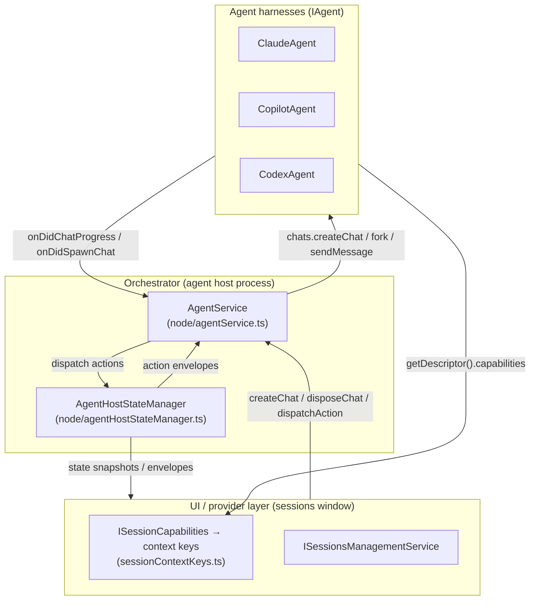
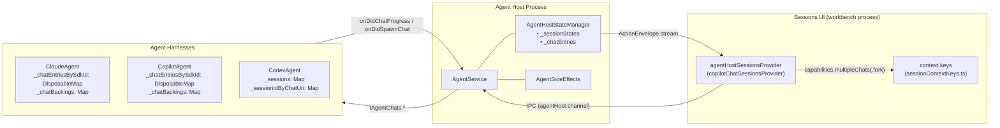
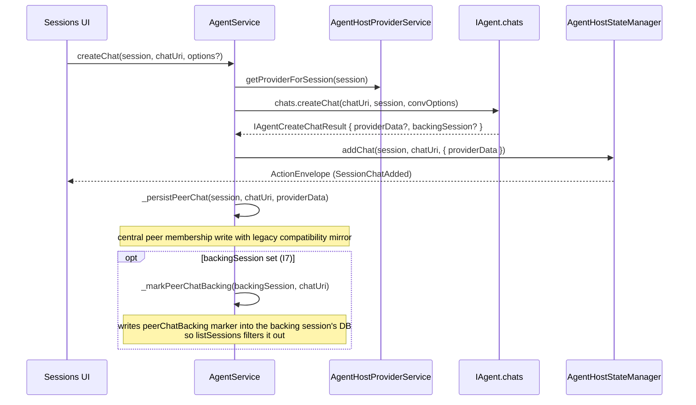
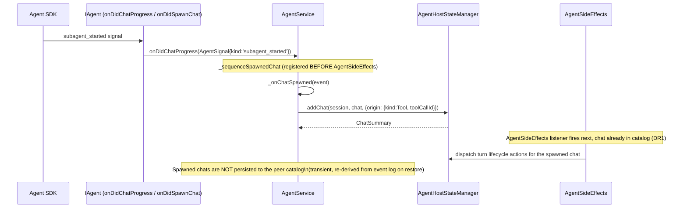
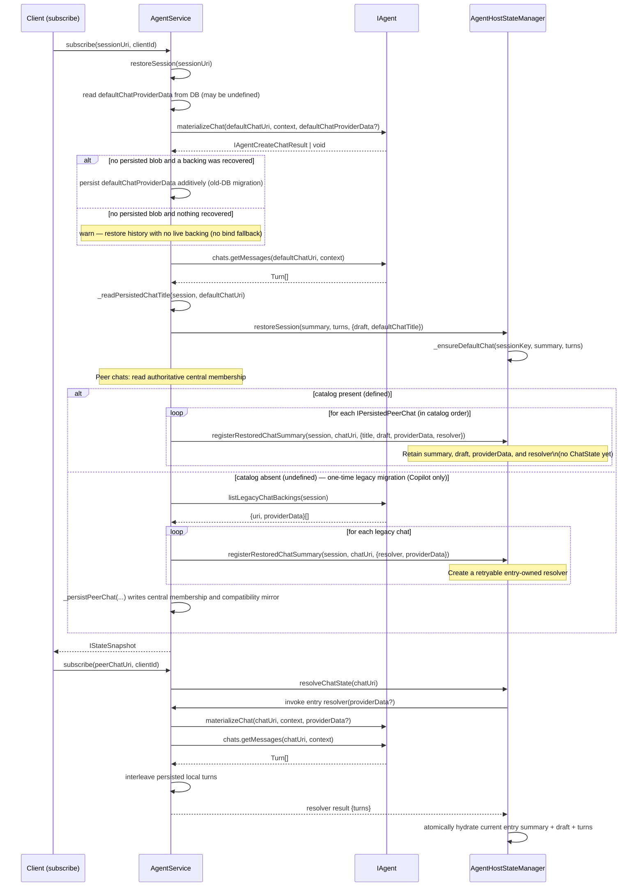
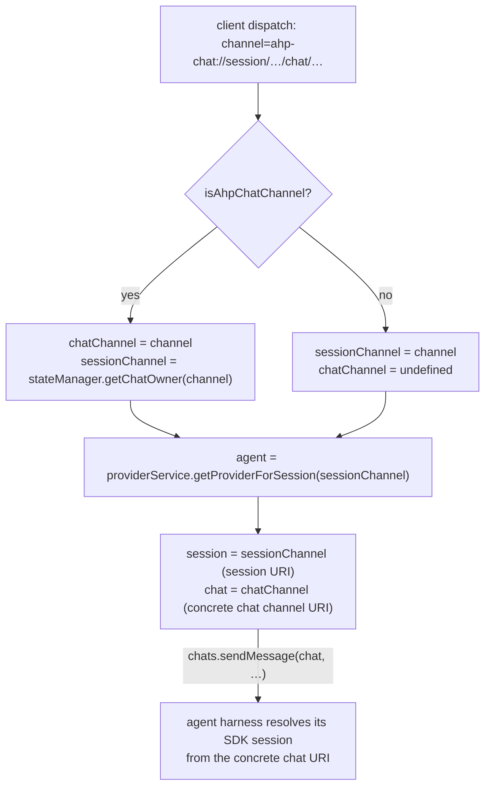

<!--
  AGENTS.md
  Living spec — keep in sync with code after each significant change.
  See: node/agentService.ts, node/agentHostStateManager.ts,
       node/claude/claudeAgent.ts, node/copilot/copilotAgent.ts,
       node/codex/codexAgent.ts, node/agentSideEffects.ts,
       common/agent.ts (IAgent, IAgentChats, IAgentCapabilities),
       common/agentService.ts (IAgentService, IAgentConnection).
-->

# Multi-Chat Architecture

> Node runtime service construction is documented separately in [`node/serviceBootstrapping.md`](node/serviceBootstrapping.md). Host startup timings, process-lifetime correlation, and session workload counts are documented in [`PERFORMANCE.md`](PERFORMANCE.md).

> **Status: COMPLETE** (2026-07-01) All waves A–D and gates G-B1, G-C1, G-C2, G-D1 are done. Codex, Claude, and Copilot all use the unified orchestrator path.
>
> Codex advertises `multipleChats: { fork: true, sideChat: true }`. Model-backed peer, fork, and side-chat parity scenarios run in deterministic replay.
>
> The *operational* chat surface (send/abort/model/agent/history) is fully chat-addressed and uniform across harnesses. Session ownership lives in the orchestrator: it drives every harness through the chat-surface seam — see [§7 Session Ownership (T2/T4)](#7-session-ownership-t2t4--the-orchestrator-owns-the-session).

---

## 1. Mental Model

### Three distinct concepts

| Term | What it is | Owner |
|------|-----------|-------|
| **SDK conversation** | A provider-native conversation/thread with its own restore identity and runtime resources. | Agent harness |
| **Chat** | A thread of turns addressed by a chat channel URI. AH owns its URI and membership; the agent owns its SDK backing. | `AgentService` + agent harness |
| **Orchestrator session** | The protocol-visible entity that bundles a session with its chat catalog, state, and persistence. The orchestrator owns the catalog (which chats exist), the default-chat pointer, and all persistence. | `AgentService` + `AgentHostStateManager` |

### Guiding principles

- **"Represent, don't orchestrate."** The agent harness creates and drives SDK chats; the orchestrator records what exists and routes protocol actions. No agent-specific logic leaks into `AgentService` or `AgentHostStateManager`.
- **Composition over inheritance.** All harnesses share one membership path (`addChat`/`removeChat`), one authoritative persistence path (`AgentHostPeerChatStore` in `agent-host.db`, with a `PEER_CHATS_METADATA_KEY` compatibility mirror), and one restore path (`registerRestoredChatSummary` + `resolveChatState`). Per-harness features are expressed through `IAgentCapabilities` flags, not `if (provider === 'claude') ...` branches.
- **Single catalog path.** Whether a chat is created by the user ("Add Chat") or spawned by the harness (subagent tool call), it enters the catalog through exactly one path (`AgentHostStateManager.addChat`). See invariant I4 below.

### Terminology convention: "session" is overloaded — read it by layer

The word **session** means two different things depending on which side of the seam you are on. To avoid confusion, follow this convention:

| Where | What `session` means | Notes |
|-------|----------------------|-------|
| AHP wire protocol (`common/state/protocol/`) and the orchestrator (`AgentService`, `AgentHostStateManager`) | The **AH session** — the protocol-visible grouping of a default chat plus its peer chats. | This is the vocabulary the generated protocol types pin (`SessionState`, `SessionSummary`, `sessionAdded`, ...); it is immutable and authoritative. |
| Inside an agent harness (`node/claude`, `node/copilot`, `node/codex`) | The agent's **own SDK / provider session** — the provider's native concept (Codex calls it a *thread*). The agent has no notion of the AH grouping; it only ever deals in chats and its own SDK sessions. | Prefer the provider's native term where one exists (Codex "thread"); otherwise spell it out as "SDK session" / "provider session" in comments and local names wherever the two could be confused. |
| The `IAgent` seam (`chats.*` plus chat metadata/configuration events) | Operations receive an exact chat plus opaque persistence/configuration scopes. | Providers never receive AH ownership or chat-role fields. |

**Why we do not rename the agents' "SDK session" symbols:** the generated protocol fixes "Session" = AH session across hundreds of references we cannot change. Provider-internal SDK sessions remain native runtime concepts, while the chat seam exposes no AH session ownership.

---

## 2. Ownership and Layering



### Agent layer (`common/agent.ts:IAgent`)

Responsible for:
- Creating and owning SDK chats (`chats.createChat`, with optional fork input).
- Reading history (`chats.getMessages`).
- Emitting progress signals (`onDidChatProgress`).
- Optionally admitting provider-native metadata through `onDidChatSessionEvent` for environment-owned SDK mirroring. History reads receive exact chat/context plus an acknowledged journal cursor; they never create or resume a runtime. Only the owning provider interprets native records or synchronizes a host title into a live backing.
- Emitting membership events for harness-spawned chats (`onDidSpawnChat`, `onDidEndChat`).
- Re-attaching a chat's backing on restore (`materializeChat`) — including the session's default chat.
- Advertising static capability flags (`getDescriptor().capabilities`).

Agents do **not** maintain the chat catalog, persist membership, know whether a chat is the session or a peer, or inject `AgentHostStateManager`. Host facts they genuinely need (subagent origin, session customizations, prompt-cache metadata, session-title changes, active-client chat membership) arrive through typed seams — see §8.

**File organization rule:** `common/agent.ts` holds the *provider model* — `IAgent` and every type/helper/signal reachable from it (chat lifecycle, create/materialize/legacy-migration payloads, config-resolution parameters, `AgentSignal`/`AgentSession`). `common/agentService.ts` holds the *orchestrator-facing service surface* — `IAgentService`, `IAgentConnection`, `IAgentHostService`, settings/env constants, and diagnostics types. The dependency is one-directional: `agentService.ts` may import from `agent.ts`, but `agent.ts` must never import from `agentService.ts`. `agentService.ts` re-exports the public provider types from `agent.ts` for call-site compatibility; new provider code should import directly from `agent.ts`.

### Copilot Connector authentication

Copilot Connectors use the SDK session's GitHub credentials, including refreshable token providers. At create and resume, `CopilotSessionLauncher` checks `sessionAccountSelection`, obtains the opaque account ID from `session.rpc.connectors.getAccount()`, and reconciles that account without enumerating global accounts or matching tokens. Unsupported runtimes and unavailable accounts are logged and skip Connector reconciliation without preventing ordinary chat.

Connector token rotation follows the normal per-session credential update path rather than requiring a shared-client restart. GitHub Enterprise continues to use client-level authentication; startup configuration changes, credential-mode changes, and failed credential updates retain their safe deferred-restart behavior. This does not change Agent Host action dispatch ordering or make history reads independent of SDK session restoration.

### Live Copilot Connector reconciliation

The local management bridge routes an optional Connector name to capable providers; it is not an AHP protocol extension. Copilot reconciles ordinary membership/catalog refreshes without a force parameter, and sends `forceConnectorName` only for explicit named reconnects on runtimes advertising `targetedReconcile`. Each attempt resolves its own SDK session's account handle through the same helper as launch. Missing capabilities, unavailable accounts, RPC failures, cancellation, and timeouts are logged and retain the request for a later refresh or operation; none trigger a Connector-only SDK-session recreation.

Refresh requests are recorded synchronously, coalesced by generation and Connector name, and executed under each chat's existing queue. Active turns and background subagents defer reconciliation until idle without holding other chats or the workbench behind a global refresh queue. Sessions still launching retain requests and reconcile before registration. Concurrent updates are not acknowledged by an older attempt, and disposed sessions do not publish late results. After reconciliation, the session resolves customization enablement, updates runtime display names and authoritative MCP inventory, and invalidates published tool lists.

Explicit MCP Start/Stop operations already in flight defer reconciliation. A control requested during reconciliation waits for that attempt before executing, so a later Stop cannot be undone by the reconcile result. Stop first cancels only the target server's pending authentication callbacks, releasing a refresh blocked on that server without cancelling unrelated authentication. This ordering is local to the SDK session; no shared-client or global network lock is introduced.

A send, resume, Start preparation, or queued refresh can cancel its Connector attempt; aborting a turn cancels it explicitly, and each attempt has a bounded lifetime. A late runtime reconcile result is never published or acknowledged by the abandoned attempt. Another reconcile is not issued until that RPC settles, after which the pending request is rescheduled under the per-chat queue.

The runtime can restart an explicitly stopped Connector on forced or configuration-changing reconciliation. Until it supports preserving that intent, live reconciliation defers if an affected Connector runtime server is stopped, not configured, or disabled. Generic refreshes therefore remain pending while any projected Connector is in those states; a named refresh can still proceed when only unrelated Connectors are stopped. The host does not convert Stop into Disable, restart the session, or cancel unrelated authentication to work around this limitation. Runtime policy and user/workspace MCP precedence remain authoritative.

### Image-generation tools

Copilot's runtime-owned `image_generation` tool maps ordinary SDK start, progress, and completion events into existing AHP tool-call actions. Codex's `imageGeneration` items map to `image_gen.imagegen` and use the same renderer. The final revised Codex prompt is published before completion; unavailable prompts remain absent in both live and restored results.

Native Copilot image tool start can precede permission checks. Keep the call in AHP `streaming` until the permission flow takes ownership or structured image progress establishes execution; completion also settles calls from runtimes that omit progress.

Copilot's optional `structuredContent.imageGeneration.requestedModel` maps to `_meta["vscode.imageGeneration"]`, validated by [agentImageGenerationMeta.ts](common/meta/agentImageGenerationMeta.ts). This identifies the requested image engine, not the conversation model or a confirmed serving model. Hosts without this metadata retain generic image labels.

Availability, authorization, and durable tool history remain provider-owned. Inline images use AHP embedded-resource content; resource links must resolve through the host's `resourceRead`. An opaque SDK asset ID alone is not a readable AHP resource.

Copilot image completions carry optional `_meta["vscode.toolCallDurationMs"]`, derived from SDK execution-event timestamps in both live and restored history. Clients validate this display-only value and tolerate its absence. Image byte sizes come from the actual embedded or referenced bytes; suggested hash-suffixed download names never rewrite referenced resource identities.

For native image-generation results, `structuredContent.imageGeneration.images[].contentIndex` identifies original images in SDK `result.contents`. Use those validated indexes for display rather than also displaying resized model-facing copies from `contents` or `binaryResultsForLlm`; preserve all content when the optional index metadata is absent or invalid.

Every Copilot SDK create/resume configuration sets `imageGeneration.enabled` from `chat.copilot.imageGeneration.enabled` (on in Insiders, off otherwise). This setting controls Sunburst generation and editing without a model-picker entry and is reapplied after host restarts. The runtime still owns image-model availability, account authorization, policy, and tool permissions; opting in cannot bypass those checks.

### Orchestrator layer

When `chat.experimental.workspaceSnapshot` is enabled (root config `workspaceSnapshotEnabled`; off by default and experiment-controlled), Copilot chats receive a bounded initial workspace-file snapshot through `WorkspaceContextContribution` on the first turn of a new conversation: the default chat or a user-created peer chat whose chat state is loaded and has no turns, never a restored chat (even one whose history is not loaded yet, such as a `send_message` target), fork, side chat, or tool-spawned chat. It uses the working directories resolved for the turn (`IOutgoingTurn.workingDirectories`, including a worktree created on the first send, which session state does not reflect until the provider materializes). Like the classic Copilot Chat workspace structure, it walks directories breadth first through `IFileService`, reading only the directories whose names fit the 2,000-character budget and keeping no more entries of a directory than the budget could list; it skips hidden entries, a short list of dependency and build folders, and Git storage directories, does not apply `.gitignore`, and reads no file contents (its Git-storage check reads only a linked worktree's `commondir` pointer, capped at 4 KB). The contribution returns the listing as an ordinary host instruction (a `<workspace_info>` block), so no provider changes are involved. The listing is not checked against content exclusion: it holds file names only, never contents. Preparation starts when the first turn's `ChatTurnStarted` is dispatched (`onDidDispatchAction`, so client and host-started turns such as `send_message`, `create_session`, and automations both overlap it with the rest of the send path), or, for a session creating its worktree, as soon as the worktree exists (`onDidChangeWorkingDirectoryPending`); the send waits at most one second for unfinished roots and omits the rest. The snapshot counts as sent when the host hands the turn to the provider (`AgentHostTurnTracker.onDidDispatchTurn`, after the final pre-dispatch cancellation checks). Only then is it logged at info level and reported as `agentHost.workspaceSnapshot` telemetry (roots included, pending, empty, or unreadable, and the snapshot's length). A turn that fails after that point is not retried with the snapshot. A first turn that never reaches the provider, such as a local command or a turn cancelled before dispatch, leaves the snapshot for the next turn that does. Only the chat's active turn may use or clean up snapshot state, so a cancelled send that is still unwinding cannot affect the next turn. A first turn's end is observed from its terminal state action (`ChatTurnComplete`, `ChatTurnCancelled`, or `ChatError`) through `onDidDispatchAction` and matched by turn id, not from `onTurnEnd`: a cancelled local command's turn end arrives only when the command finishes, possibly after a replacement turn started. Preparation stops once the send has run, or when the turn ends, the chat is removed (`SessionChatRemoved`), or the session is removed (`onDidRemoveSession`).

Shared UI first-progress observations use the capability-gated VS Code-only `vscode/reportChatUserInteraction` RPC, not the generated chat protocol. The handler validates a content-free payload and drains the existing OTel exporter before acknowledging. The renderer clock and visibility semantics remain owned by the chat UI; see [the OTel contract](OTEL.md#user-perceived-first-progress).

Artifact removal uses the VS Code-only `vscode/removeSessionArtifact` extension RPC with `{ session: string, artifactId: string }` and a void result. Clients gate the optional `removeSessionArtifact(URI, string)` connection method with `supportsAgentHostArtifactRemoval(initializeResult)` (`_meta['vscode.removeSessionArtifact'] === true`). This does not extend the generated AHP protocol.

Stopping background work uses the VS Code-only `vscode/stopBackgroundWork` extension RPC with `{ chat: string, id: string }` and a `{ stopped: boolean }` result, which is false when the work had already finished. Providers mark each stoppable `BackgroundWork` entry with `_meta['vscode.stopBackgroundWork'] === true` (`canStopBackgroundWork`), and clients offer Stop only for marked entries, so hosts without the extension show none. Copilot marks attached background shells, and detached ones whose process ID the runtime reports, and stops them through the SDK's `session.rpc.tasks.cancel`. This does not extend the generated AHP protocol.

Saved Claude and Codex recovery uses the local, capability-gated `vscode/readSavedChat` and `vscode/completeSavedChatContinuation` requests. The [saved-chat service](node/agentHostSavedChatService.ts) reads exact membership and history without restoring the source provider. The renderer completes a continuation after it verifies imported history, transfers the unsent draft, and opens Copilot. Completion stores one receipt for that chat before changing archive metadata. The receipt includes a digest of the saved backing and turn content, so new source history requires a new continuation. Repeated completion of the same snapshot reuses its destination and can retry archival. Missing or tombstoned destinations are not offered for reuse. A newly verified copy can replace that stale receipt atomically, while an existing destination still rejects a conflicting copy.

When archive validation fails after the local metadata commit, completion attempts to restore the published archive state through the passive metadata owner. The completion receipt remains durable. If restoration also fails, retrying completion republishes archive state even though the local archive flag is already set.

Aggregate continuation archive requires every public default, peer, and side chat to be archived or successfully continued. Private tool descendants remain stored and readable through the archived original. Completion joins source restores, metadata writes, and chat-catalog mutations, retains busy sources, and publishes archive state without source-provider callbacks, residency release, worktree cleanup, or artifact removal. Chat creation rechecks archive state after asynchronous preparation, before starting a backing under a parent that became archived. Imported conversations with a nonblank `title` persist that literal title as `user` metadata and suppress automatic title generation. Blank titles retain the existing fallback.

The shared `node/shared/sessionArtifacts.ts` path serializes artifact mutations per session across tools and direct user requests. Each mutation reads the latest collection, awaits ordered catalog synchronization (including the legacy-first `sessionArtifacts` metadata write), then publishes `SessionMetaChanged` merged with the latest independent metadata. Failed local persistence leaves the artifact visible and retryable; failures are logged and propagated without blocking queued additions. Central synchronization uses the usual pending receipts for repair. Independent GitHub associations and unrelated artifacts/references are preserved. No model turn or tool invocation is involved in direct user removal.

Artifact tools read and mutate only the invoking chat's artifacts. The session database keeps one `sessionArtifacts` JSON array; each new entry carries its owning chat URI, and the session-level `ISession.artifacts` projection remains the combined list across every chat. Unscoped legacy entries are assigned to the default chat and migrated in that same collection during catalog synchronization.

**`AgentService` (`node/agentService.ts`):**
- Resolves the `(session, chat)` → `(agent, session URI, chat URI)` mapping for orchestration.
- Uses `IAgentHostProviderService` for provider ownership and session routing. Registry provider associations route standard resources; scheme fallback is bounded to legacy provider-native resources.
- Owns `AgentSessionRegistry`, backed by `sessions_v2` in `agent-host.db`, as the durable source of truth for which sessions exist. `listSessions` reads validated, rebuildable central payloads and applies live-state overlays; provider/local database reads are fallback and reconciliation paths, not prerequisites for listing.
- Dispatches user-driven chat lifecycle (`createChat`, `disposeChat`) to `chats.*`.
- Disposes every catalog chat in stable order (peers first, initial chat last); releases every catalog chat on idle eviction.
- Derives the exhaustive per-operation `IAgentChatContext` (persistence scope, live owner reference, catalog origin, host customizations) via the single `createAgentChatContext` helper, which refuses a registered chat under any session but its current owner or with any storage but its recorded one.
- Supplies complete resolved `IAgentCreateChatOptions` (`workingDirectories`, `project`, provider config, model/agent, active client, and fork/import/side-chat source) on every creation.
- Records side-chat provenance in the catalog but leaves hidden context injection and visible-history filtering to the provider. The source is a stable turn id; active-turn partial response and selected text are immutable creation-time snapshots.
- Passes the full ordered `workingDirectories` set and the initiating `AgentHostClientType` on each send while still supplying transient chat context. Providers launch in index 0, retain additional roots, and attribute usage/telemetry to the correct client surface.
- Persists and restores authoritative peer-chat membership through `AgentHostPeerChatStore` (`session_chat_catalogs` and `session_chats` in `agent-host.db`). Parent `PEER_CHATS_METADATA_KEY` and chat-local metadata remain compatibility mirrors; conversation history remains in session/chat databases.
- Suppresses a peer chat's separately-enumerable backing SDK session (when `IAgentCreateChatResult.backingSession` is set): marks it via `_markPeerChatBacking` and filters it out of `listSessions` (invariant I7).
- Routes harness-spawned chats into the catalog (`_onChatSpawned`, `_onChatEnded`).
- Owns the restore flow (`restoreSession`, `_restorePeerChats`).
- Owns the automatic merged-pull-request session lifecycle through `AgentHostSessionLifecycle`: the application-scoped policy is synchronized into root config; candidates are filtered from the registry using only the persisted archive/GitHub fields needed for cleanup; and every related pull request is authoritatively refreshed before a candidate is restored. A session is eligible only when no related pull request is open and at least one related pull request is merged; closed-unmerged PRs do not block it. Pull request state is refreshed again immediately before lifecycle side effects so reopening a closed PR blocks the action. Eligible sessions are archived through the normal `SessionIsArchivedChanged` action and side-effect path, which removes the worktree when Git confirms that the branch tracks an upstream with no unpushed or uncommitted work. Permanent deletion applies the same safe cleanup to a retained worktree before deleting the session. Archive and deletion thresholds accept any positive whole number of days; zero disables the corresponding lifecycle.

**`AgentHostStateManager` (`node/agentHostStateManager.ts`):**
- Holds the authoritative in-memory state tree:
  - `_sessionStates: Map<string, ISessionEntry>` — per-session `SessionState` + catalog timestamps.
  - `_chatEntries: Map<string, IChatEntry>` — one entry for every chat catalog item. An entry owns its current `ChatSummary`, optional hydrated `ChatState`, opaque `providerData`, and (for restored peers) resolver, in-flight promise, and invalidation state.
- Owns `_ensureDefaultChat`: creates the default `ChatState` at create/restore time, for the default chat the session records (see the default-chat contract in section 5e).
- `addChat`/`registerRestoredChatSummary`/`removeChat`: the paths for live, restored, and removed catalog membership.
- `getChatState` is a synchronous, no-I/O peek for reducers and diagnostics. Interaction paths use `resolveChatState`, which coalesces one peer's materialization, retries failures, and atomically publishes complete state.
- `getChatOrigin` reads a chat's origin from its `ChatSummary`, so a restored chat's origin is available before its state is ever hydrated.
- Session-level active-turn tracking via `_sessionsWithActiveTurn` (a set of chat URIs per session, so multi-chat sessions running concurrent turns stay correct).

### UI/provider layer (`sessions/services/sessions/common/session.ts:ISessionCapabilities`)

- Protocol `AgentCapabilities` (`multipleChats?: { fork?: boolean; sideChat?: boolean }`) flows from `AgentInfo.capabilities` (protocol) through the provider adapter. `ISession.capabilities` (`ISessionCapabilities`) exposes `supportsMultipleChats` and `supportsFork`, derived from `multipleChats` and `multipleChats.fork`; both flow into VS Code context keys (`sessionContextKeys.ts:SessionSupportsMultipleChatsContext`, `SessionSupportsForkContext`). Forks can carry the optional `createChat.title` and existing `createChat.initialMessage` without additional capabilities. VS Code preserves a supplied title on first publication and reports initial-message errors in the new chat.
- UI actions read context keys — no provider-id switches.

---

## 3. Key Invariants

**I1 — `providerData` is opaque.** The state-manager-owned `IChatEntry` stores the blob returned by `chats.createChat` verbatim. Neither `AgentService` nor `AgentHostStateManager` parses, validates, or mutates it. It is round-tripped to the agent verbatim on restore via `materializeChat(chat, context, providerData)`.

Opaque to the host, but not arbitrary for the provider: whatever id the blob carries is the *only* handle the provider gets back on the next process, so it must name the provider's own durable runtime — the key that runtime is registered and addressed under — and not a transient SDK handle that the provider decouples from it. Codex's session-backing chat is the worked example: its runtime keeps the host-minted session id and records its app-server thread id in a metadata overlay, so a thread-keyed blob would restore the runtime under an id nothing addresses it by (leaving every notification unroutable) and would go stale the moment a rematerialization mints a new thread. Where the two genuinely coincide — a Codex peer chat or fork, whose runtime *is* its thread — recording the thread id is the same thing as recording the runtime id. `IAgentCreateChatResult.backingSession` remains the place to name a separately enumerable SDK conversation (I7); it is not a second id channel for the blob.

**I2 — `sessionUri` and `chatChannelUri` are never overloaded.** A native session URI (`ahp-session:/<id>` or a preserved legacy provider URI) identifies an AH session; `ahp-chat://…` identifies its chat. Native chat helpers derive chat resources from the actual immutable session URI. AHP clients use third-party hosts' advertised session and chat resources verbatim rather than applying native derivation. Passing a chat URI where a session URI is expected (or vice versa) is a bug.

**I3 — The default chat uses the same explicit backing contract as every chat.** The default chat URI is recorded by the host, and its provider identity is opaque `providerData`. Claude and Copilot mint independent SDK ids, return them from `createChat`, and restore them through `materializeChat`; equality with the AH session id is never assumed and there is no identity-reuse bind fallback. Codex persists its explicit thread mapping. AH never depends on provider identity reuse for ownership or enumeration.

**I4 — Single catalog path (spawn channel).** Both user-driven chats (`AgentService.createChat` → `addChat`) and harness-spawned chats (`AgentService._onChatSpawned` → `addChat`) go through `AgentHostStateManager.addChat`. `AgentService` installs the spawn-channel listener **before** the `AgentSideEffects` listener through the provider service's synchronous initializer to guarantee the chat exists in the catalog before any turn actions arrive for it (DR1 deterministic sequencing).

**Chat URIs are identity, not structure.** New chats are opaque `ahp-chat:/<uuid>` when the session's default chat is opaque; never derive an owner, role, or format from a chat URI. Use the ownership records (`getChatOwner`, `getDefaultChat`), chat `origin` for subagent role, and `isAhpChatChannel` for "is a chat" gates. Build chat URIs only through `agentHostChatMinting.ts` (`subagentChatUri` for subagents). Chat storage identity records are immutable and never deleted.

**I5 — The central peer-chat catalog is the restore source of truth (with legacy migration and compatibility mirrors).** The orchestrator persists additional-chat membership in `agent-host.db` through `AgentHostPeerChatStore` and the initial chat's opaque backing in `defaultChatProviderData`. Restore materializes both through the same provider-data contract — `materializeChat` is the *only* way a default chat is re-attached. When a native catalog session has no persisted blob, the provider recovers its backing from the provider-native session id in the Agent Host session URI and returns canonical provider data, which the host persists additively for later restores; an already-canonical blob is never rewritten. Missing central membership is migrated from the legacy parent mirror and provider backings. An authoritative empty central catalog is not missing; later provider recovery may enrich matching entries but must not resurrect removed peers. Every session converts to normalized (`chats_v2`) authority; older builds keep editing its legacy-readable copy after a downgrade, and `AgentHostPeerChatStore` imports those edits back (`_importOlderBuildEdits`: `session_chats` against the projection when `projected_revision` is behind, and `peerChats` against its acknowledgement, merged three-way) on open/restore, in the conversion batch, before a session's first normalized write in a process, and through `reconcileOlderBuildCopy` before a move or promotion. The database refuses (`olderBuildEdits`) any normalized write that would re-project over such an edit, so code outside the store (moves, promotion) must import and retry. An import never transfers a chat recorded under another session, and records a new peer's storage once (`agentHostChatCatalogV2.md`). Harness-spawned chats remain transient and are re-derived from tool-origin state. `_persistDefaultChatBacking`'s two writes — the `defaultChatProviderData` blob and the default chat's own `_markChatBacking` call (I7) — are independent: a failure persisting the blob is logged and swallowed rather than skipping the backing marker, since the marker is what keeps the default chat's backing session out of the top-level list and must not be held hostage to an unrelated write's success.

*Note (Block 3a):* the catalog is not the only central state. Session-level values, per-folder git state and per-chat summaries are also authoritative in `agent-host.db`, owned by the session state store (§3b). Listing and lifecycle sweeps read that state without importing a session (`readWithoutImport`); a session is imported only when it is loaded. Catalog synchronization projects the session from central state, and reconciliation re-projects imported sessions from central state without importing others (see `node/agentHostChatCatalogV2.md`).

**List payload compatibility.** Central identity and membership are authoritative; the bounded list payload is rebuildable. When local storage exists, catalog synchronization uses legacy-first writes and pending receipts before central acknowledgement. Import and runtime discovery of unopened adoptable legacy sessions use the non-creating path: metadata discovery must not create `agentSessionData/<id>` and accidentally claim ownership. Explicit adoption owns that transition.

Catalog synchronization, migration, replay, and deletion fences share a queue keyed by the storage service's session directory. URI aliases for the same database cannot overlap, while different storage directories remain independent.

Automatic catalog reconciliation waits until both host startup and the first session listing have completed. Startup repair requests leave their dirty markers for that deferred pass, which then starts periodic maintenance; explicit refreshes and mutation persistence do not wait for background maintenance.

An unresolvable source is distinct from an unavailable provider, and the two are reported separately because their wake signals differ. `providerUnavailable` means the provider is not registered (cheap to detect, and guarded before any storage is claimed) or cannot read its catalog yet; it clears when the provider registers or its catalog becomes readable. `sourceUnresolvable` means the provider *is* registered but cannot vouch for the session, so there is nothing authoritative to project — typically a registry row whose provider-side state was pruned. Retrying either on the periodic cadence re-opens the session's storage on every pass, so the session is **parked** instead: it is filtered out of the dirty list until a wake signal arrives. A single failed lookup is never treated as proof of absence — a provider whose SDK is still downloading is indistinguishable from a pruned one — so parking never tombstones, never clears `payloadDirty` (the rebuild is still owed), and is held in memory only, so a restart re-attempts each parked session once and re-parks. Wake signals are provider registration, the provider's catalog becoming readable (which wakes only that provider's parked sessions), a successful restore of that session (its provider vouched for it through its own lookup, which a lazy provider allows while its catalog stays unreadable), a mutation of that session, and the periodic verification. A wake while a pass is resolving a source keeps that pass from parking the session it resolved before the wake. A session that can never be resolved keeps its provider fallback in the listing rather than having a payload invented for it.

Event-driven reconciliation is coalesced. Many mutations arriving during one pass owe exactly one follow-up, taken after a minimum interval rather than chained immediately, so user activity cannot drive passes back to back; the longer periodic interval remains the idle cadence.

Catalog imports may revisit registered sessions to repair payloads, but only newly registered identities cause discovery announcements or initial read-state side effects. Hydrated provider titles dirty the central payload even when recency is unchanged; persisted custom titles still take precedence. Automatic archival queues central synchronization immediately, while destructive lifecycle eligibility retains local durable metadata checks (including the auto-archive timestamp) rather than trusting only a rebuildable cache.

Because listing never opens session storage, migrations the provider/session fallback would perform during a list run in the catalog's maintenance pass instead, where the database is already open. Legacy per-kind changeset blobs are aggregated and written to the modern changes summary there, so the chip stays correct without adding a per-session read to the list path.

**I6 — Route through `IAgentHostProviderService`.** Creation, registry listing and restoration populate explicit provider associations from durable identity. Only unregistered legacy provider-native resources may fall back to their scheme; `ahp-session` never identifies a provider. Do not read the association map directly.

**Native identities are mixed and immutable.** Negotiate `vscode.ahpSessionUris` only for new allocations; preserve existing registry URIs, SDK backings, storage directories and frontend identities. Use explicit provider metadata and owning-connection address records, not a provider-wide URI alias. See the [session identity contract](../../sessions/contrib/providers/agentHost/AGENT_HOST_SESSIONS_PROVIDER.md#identity).

Telemetry provider dimensions use the owning agent's id or the session's explicit `provider` metadata, never the standard session URI scheme. Changeset telemetry preserves URI-scheme provider categories for legacy sessions and scoped owners (`ahp-chat:`, `ahp-folder-changeset:`); provider-neutral root sessions capture the explicit provider when computation is queued. Automation run telemetry retains the linked session provider in host-private storage, independently of protocol state, so it survives session removal and host restart. Preserve the existing provider values (`copilotcli`, `claude`, `codex`, or an advertised provider id) independently of addressing.

**I7 — A peer chat's backing SDK session must never surface as a top-level session.** Some agents store all SDK conversations in one catalog. `IAgentCreateChatResult.backingSession` lets the orchestrator mark any internal chat backing, including the default Claude backing, so continual external-chat discovery never registers it as a top-level AH session. Providers own native enumeration and push candidates through `onDidDiscoverChats`; Agent Host reconciles those candidates against its registry and suppresses separately enumerable internal backings. Existing AH-created rows retain their provenance. Marking a backing session is a durable metadata write on the backing session's own DB (`_markChatBacking`); a transient failure is retried once, and if it keeps failing the session is suppressed from listing/discovery in-process (`_unpersistedChatBackings`) rather than failing the chat creation that triggered it.

**I8 — Providers are given host facts; they must not re-derive them.** Everything a provider needs about a chat and its owning session is published on a typed seam at the call boundary (see §8). Providers do not inject `AgentHostStateManager` or recover subagent origin or customizations by parsing a chat URI. New provider code must consume the seams.

**I9 — Tools are deferred by default; the eager set is a reviewed budget.** Every tool definition the model can see is input tokens on every request, so a new server tool leaves `deferLoading` unset or `true` (a Copilot session defers it unless it is explicitly `false`; Claude and Codex keep their SDK defaults), a new client tool stays out of `NON_DEFERRED_CLIENT_TOOL_NAMES`, and a runtime built-in that arrives with an SDK bump stays off until it is added to the allow-list on purpose. The baselines in `test/node/serverToolGroups.test.ts`, `test/node/toolSearchDeferral.test.ts` and the prompt snapshot suite pin the eager set; a PR that moves them says why. Session-constant guidance goes in the system prompt, turn-specific reminders go in `additionalContext`. A runtime built-in that is not in `COPILOT_ENABLED_BUILTIN_TOOL_NAMES` is never registered. The rules and checklists are in §9.

---

## 3a. Session Registry and External Chat Discovery

`AgentSessionRegistry` (`node/agentSessionRegistry.ts`) stores `{ sessionUri → { provider, startTime, external, source } }` in the orchestrator-owned `agent-host.db`. Sessions discovered in a provider-native catalog remain external while merely being opened. Their first accepted outgoing user message adopts them: the registry persists `external: false` and an explicit registration source before provider dispatch, and Agent Service publishes the ownership change through session metadata. The capability-gated `vscode/importSession` request performs the same adoption without sending a message or changing the session's identity. Adoption survives cancellation, provider failure, restart, and rediscovery. Provider session databases do not duplicate this ownership property.

`AgentSessionRegistry.list()` reads the registry once and passes every entry through the migration callback supplied by Agent Service. The callback returns a replacement only for legacy entries whose `external` column is `NULL`, resolving them through the `agentHost.workspaceless` classifier. The registry persists all replacements in one transaction and returns the computed list without rereading the database. Migration uses bounded concurrency. Explicit internal registration sources are preserved; externally classified rows become discovery entries.

`register` takes the resolved provenance and whether to check tombstones. Explicit creation retains the legacy registry behavior of clearing a tombstone, but newly allocated standard resources must first pass the host's raw-storage-ID and tombstone collision checks. Restore and discovery calls atomically decline to register if the session is or concurrently becomes tombstoned. An explicit row is never rewritten by catalog discovery. A migration-time host-owned marker can correct a previously discovered row back to internal provenance.

Providers own discovery lifecycle and push unknown chats with provider-classified provenance through `onDidDiscoverChats`. Claude, Codex, and Copilot classify their unknown native chats as external, except that Copilot keeps an unknown *legacy extension-host* chat internal because it is adoptable in place rather than someone else's session. Agent Service preserves that classification unless the existing host-owned `agentHost.workspaceless` marker proves the session was created by Agent Host; it reads that evidence together with the chat-backing marker before additively registering the event payload. Agent Service always attaches the event listener and queues each provider's external-session discovery through `_runWhenStartupSettled`, so the request waits for both Agent Host startup and the first successful session listing. Providers registered after that barrier opens run their queued work immediately, and a later transition from `none` starts discovery directly. Adopt-in-place legacy migration remains an independent provider-initialization trigger immediately after the discovery listener is attached, and another catalog consumer may also trigger discovery after it enumerates the provider catalog. This keeps `showExternalSessions: none` from initiating native discovery while allowing independently triggered discovery to populate the hidden registry normally. Ordinary list refreshes never enumerate provider catalogs. External discovery has no migration marker or Copilot migrate-legacy gate; only the adoptable legacy extension-host half of Copilot's payload is withheld while migrate-legacy is off. Discovery never prunes a registry row when a provider later omits it and filters subagents and marked internal chat backings.

Discovery is registry-first: Agent Service hands each provider an optional `setKnownSessionsFilter` seam that answers, for a whole candidate set in one registry query, which sessions the host already owns. Copilot drops those candidates before any per-session database open and additionally skips adoptable legacy classification work (project/Git resolution) while migrate-legacy is off. Codex also reports changed known metadata so existing rows refresh. Agent Service preserves registered provenance without repeating backing classification; a changed title on an idle, restored external session checks persisted title overrides before updating live state. Tombstoned sessions are absent from the registry and therefore never reported as known, so an explicitly deleted session still reaches `register`, whose atomic tombstone check declines it.

Claude retains its memoized initial discovery path. Codex starts continuous discovery only after explicit session creation/restoration activates the provider and its SDK is available locally; ambient listing neither activates Codex nor downloads it. Codex uses the app-server's resolved `codexHome` for recursive session-directory and correlated home-directory invalidation, reads metadata through `thread/list`, and emits only new or changed rows. Refreshes coalesce streaming writes, serialize with migration scans, retain a trailing invalidation, retry failures, and periodically recover missed watcher events. The first catalog read permits native legacy repair; later reads use the state database API without rescanning rollout contents. Watchers and retries end at provider shutdown. Provider session databases do not persist external provenance; legacy `claude.external` and `codex.external` values remain evidence that a chat was known. An empty or absent sidecar remains unknown.

If a provider cannot enumerate yet, its initial discovery attempt emits nothing; once ready, it emits the resulting chats through `onDidDiscoverChats`. Registry ownership is projected into `IAgentSessionMetadata._meta` with `readSessionExternal` / `withSessionExternal`. Both live metadata actions and list snapshots carry an explicit boolean, so cached and reconnecting clients can clear external-specific presentation without a reload.

`listSessions()` coalesces concurrent computations per external-sessions mode, so the burst of calls a multi-window restore produces shares one registry traversal instead of one per window. Registry mutations advance an epoch without removing an active computation. A caller arriving after a mutation shares one trailing computation that starts after the active one settles, preventing expensive provider, database, and Git work from overlapping for the same mode. Further invalidations before that trailing computation starts are absorbed by it; invalidations during it can schedule at most one subsequent computation for later callers. Each caller receives its own array, and no caller recursively follows more than the computation it joined.

Legacy registry migration uses the `listChatsToMigrate()` contract. An array is authoritative even when empty. `undefined` means the catalog is unavailable and must not advance migration markers; Agent Service retries an unavailable registration-time catalog once before listing, and persistent unavailability rejects aggregate `listSessions()` with a typed provider-catalog error so clients preserve their last successful snapshots. `AgentChatMigrationDeferred` means the catalog cannot be enumerated until an external readiness action, such as downloading an optional SDK: it does not advance the provider marker and does not block healthy providers' aggregate listing. A provider's later discovery signal force-retries its migration partition before additively registering the signal's unknown/external entries, and a subsequent list refresh can retry a still-deferred provider. `BaseAgentHostSessionsProvider` retries failures with exponential backoff; `AgentHostSessionListStore` leaves its cache invalid and retries on the next controller, lifecycle, or workspace refresh trigger. Replacement retry ownership is compare-and-swap single-flight: overlapping list computations that observed the same failed attempt await the first caller's installed retry rather than queueing another provider enumeration. Successful providers retain their completed migration state when a sibling provider is unavailable.

Session-list clients treat only a successful return as authoritative. `BaseAgentHostSessionsProvider` and `AgentHostSessionListStore` retain their last successful snapshots when `listSessions()` rejects; a successful empty array still clears the snapshot. This separation prevents transport, authentication, or catalog failures from becoming deletion deltas.

Discovery refreshes list-visible metadata and recency of already-registered sessions without requiring a window reload. Reconciliation publishes surfaced rows in place through root summary notifications; restored idle external rows also refresh title and recency while preserving history and host title overrides. Active host turns remain authoritative. The Sessions adapter applies summary recency changes to its existing observable facade, and local host reconnection refreshes the catalog after rebinding listeners. Existing external-session visibility filters remain authoritative.

Observed native transcripts have a separate, exact-chat lifetime: `IAgent.watchChatHistory` is acquired for a chat subscription and released with its last subscriber. Codex reads persisted turns without resuming or acquiring the writer lock and reports snapshots through `onDidChangeChatHistory`; filesystem invalidations coalesce with a bounded fallback poll. Paginated refreshes read the recent tail with overlap, and unchanged turns retain their mapped identity. Agent Service owns routing and hydration, preserves host-owned turns and drafts, and defers updates across local execution. Passive history replacement uses the existing server-originated truncation/load actions without calling provider truncation or turn execution. The contributed chat session exposes `onDidChangeHistory` so an already-open workbench model updates while preserving unchanged requests and input state. Native clients may persist assistant output only at item/turn boundaries, so this path follows persisted progress rather than unpersisted token deltas.

Provider-private discovery helpers name their concrete source: Claude uses `_listClaudeCodeChats()` / `_emitClaudeCodeChats()`, Codex uses `_listCodexChats()` / `_emitCodexChats()`, and Copilot uses `_discoverCopilotChats()` / `_emitCopilotChats()`. Providers classify known session metadata before emitting; Agent Service still performs the authoritative additive registry write and atomic tombstone check. Copilot treats the existence of a per-session database (under `{userDataPath}/agentSessionData`, never the shared Copilot home) as "known", which also keeps peer-chat backings out of the payload; it additionally drops a chat whose SDK context carries no working directory, because `_doResumeSession` requires one and a discovered chat has no other source for it.

Migration returns known native entries as plain metadata. Discovery classifies unknown entries as external for Claude and Codex; Copilot keeps unknown legacy extension-host chats internal and adoptable. Codex also emits changed known entries for refresh, without changing their registered provenance. Copilot rejects a chat whose session database exists but holds none of the metadata keys `listChatsToMigrate` requires from both paths: an empty database records a chat the host already touched, as asserted by `copilotAgent.test.ts`'s "does not discover an extension-host chat with an empty Agent Host database". Central `agent-host.db` remains the durable provenance authority.

### Automatic titles

`chat.agentHost.experimental.titleGeneration` (host root key `titleGeneration`) selects one automatic title strategy for new sessions: `utility` (immediate utility-model naming), `activeAgent` (foreground `rename_chat` naming), or `agentReview` (deferred host naming that the active agent may correct). Its workbench default is `activeAgent` outside Stable and `utility` in Stable, while the standalone root schema defaults to `utility`. It replaces the boolean `activeAgentTitleGeneration` and `deferredTitleGeneration` settings: the workbench migrates their user values, mapping deferred naming to `agentReview`, and the host still reads their root keys (deferred first) when a client that predates the strategy key sends no `titleGeneration` value. Because hosts persist root config, the workbench also keeps writing those legacy keys, derived from the strategy (`activeAgent` sets `activeAgentTitleGeneration`, `agentReview` sets `deferredTitleGeneration`), so an older host follows the current setting instead of its last stored legacy value. Conversely, a client root-config patch that changes a legacy key without sending `titleGeneration` comes from an older client, so the host drops its stored strategy for that update and falls back to the legacy keys instead of keeping a value a newer client persisted. The `deferred` strategy, deferred host naming without agent review, is no longer selectable; it remains for sessions that already persisted it and for that legacy root key.

The workbench setting opts into automatic experiment overrides via `experiment: { mode: 'auto' }`, using treatment name `config.chat.agentHost.experimental.titleGeneration` with a strategy value. The effective setting is synced to the host root key; the `experimental` tag alone does not enable experiment overrides.

The title controller snapshots `titleGenerationStrategy` on the first session-scoped lookup, including provider creation before state registration, and persists it once session state exists. Failed creation clears the snapshot. All its chats, including peers added later, share that strategy; root changes affect new sessions only. Restore hydrates the strategy before the provider materializes its tool inventory. Older sessions without this metadata remain on utility naming, never implicitly opting into deferred naming. Existing materialized legacy sessions use their advertised rename-tool membership as a compatibility fallback only.

Deferred host naming, used by `agentReview` and legacy `deferred`, synchronously publishes and starts persisting an automatic fallback title, without a utility request, GitHub enrichment, foreground rename reminder, or automatic-naming tool guidance. The existing `SessionTitleContribution` starts at most one non-awaited utility refinement after the first new successful response with nonempty markdown. Forks wait for their first new response rather than titling the inherited history during creation; locally handled commands do not consume this opportunity. A separate `deferredTitleSeed` record preserves the seed and first-response index across restart. Hydration restores eligibility only when that record still matches the persisted title and automatic provenance; it never generates a title itself. Terminal outcomes consume eligibility before any utility call, so completed, failed, cancelled, or empty first turns are not retried after restart. Cancellation, errors, empty responses, unavailable utility credentials, and disposal retain the fallback.

Explicit UI rename, `/rename`, and user-requested `rename_chat` remain available and invalidate automatic work. Tool availability is independent of automatic scheduling: legacy `deferred` sessions advertise an explicit-only rename description without the `automatic` argument. `activeAgent` sessions load `rename_chat` eagerly, because their first-turn reminder asks the agent to call it; `agentReview` and legacy `deferred` sessions keep it deferred behind tool search, and `utility` sessions do not offer it. If peers are added before completion, refinement follows the default chat's now-independent title snapshot; multi-chat default and peer refinements do not rename the session. Ephemeral sessions remain excluded. This is host/editor behavior, not a runtime managed setting or SDK policy.

The `agentReview` strategy uses deferred host naming unchanged, and additionally lets the active agent override a host-generated title it judges inaccurate or off-goal. `rename_chat` stays deferred and keeps its `automatic` argument, so first-turn requests carry no naming instruction or eager tool schema; the agent pays the tool-search round-trip only when it decides to rename. The soft review reminder, which includes the current title and asks the agent to put any rename at the end of its answer rather than in a step before it, is withheld until the first response after the seed (or after chat creation, for chats without a seed) has finished, and while a host refinement for that chat is still in flight, including a refinement still keyed by the session after a peer made the default chat independent. A cancelled or failed first response consumes refinement without running it, so it also satisfies the gate and the unrefined seed is reviewed on the next turn. It is then offered on at most three turns per chat (an in-memory count, reset on host restart) and stops early once the user or agent renames the chat.

### Server-tool creation provenance

Treat a session as the user-visible unit of work. `create_session` takes an optional relationship that defaults to `currentSession`; agents set `independent` only for work that is unrelated to the current session's plan or deliverable. A different workspace alone is not a reason for `independent`: a current-session chat can work in its own folder (see below). `currentSession` creates a peer chat that shares the current session's lifecycle and aggregate diff; `independent` creates a top-level session. A title is required for both relationships and is applied before the initial prompt starts.

Sessions created by the `create_session` server tool record only the creating session, chat, and turn as immutable, provider-neutral creation provenance in the initial session summary `_meta` bag, before the session is published or its first prompt starts. The reference supports related-session placement, source identification and session-list presentation; it does not define a hierarchy, grant communication privileges, or trigger lifecycle notifications.

`list_sessions` exposes a session's configured project URI separately from its primary and additional working directories. `create_session` accepts those URIs directly and can resolve a unique project display name, preferring the configured project root over a transient worktree. Ambiguous names require an explicit project URI.

An independent session inherits the creating session's host-owned isolation selection independently of provider-owned configuration; otherwise it uses worktree isolation. The optional `worktree` argument overrides that selection. Agents set it to `true` when the work needs an isolated Git worktree (not for read-only work); `false` is still accepted to work without one. With `false`, an exact linked-worktree root reported by Git resolves to its primary checkout before session creation. Nested and ordinary additional workspace folders are preserved. The target workspace still constrains the effective selection, so a folder that cannot support Git worktrees resolves to folder isolation.

A `currentSession` chat without `workspace` shares the current session's complete workspace. With `workspace`, the host first adds that folder to the session (`addSessionWorkingDirectoryForChat`) and assigns the resulting checkout only to the new chat; existing chats keep their folders. The folder is prepared with the explicit `worktree` choice, otherwise the creating session's isolation, otherwise directly. An omitted `worktree` reuses a checkout of that repository already in the session; `worktree: true` always creates a fresh detached worktree. This requires a ready session with a workspace; otherwise the tool fails before creating the chat. `worktree` requires `workspace` for both relationships.

All of the above applies only when the session's provider advertises the `multipleWorkingDirectories` capability. Copilot, Claude, and Codex always advertise it. Without it, the session is offered the shared-workspace variant of `create_session`: `relationship` is required, every `currentSession` chat shares the session's workspace, and `workspace` and `worktree` are rejected for `currentSession` and remain valid only for `independent` sessions.

---

## 3b. Session State Store

`agent-host.db` is authoritative for session state; each chat's own database holds only that chat's data; whatever older builds read is mirrored for them. `IAgentHostSessionStateStore` (`common/agentHostSessionStateStore.ts`, `node/agentHostSessionStateStore.ts`) is the single owner of the central state. Its tables (`session_state`, `session_state_values`, `session_folder_state`, `session_chat_state`, `chat_row_mirror`, migration 15) are additive: older builds never read them.

- **Load and import.** `load` imports a session from its session database once, then reconciles: per entry, a mirror that differs from the recorded merge base was edited by an older build after a downgrade and wins; otherwise central state wins. Listing and lifecycle sweeps never import (`readWithoutImport`, `readValuesWithoutImport`). The provider seam's `sessionSettings` and `launchWorkingDirectories` (§8a) come from the loaded state.
- **Writes.** Central first, then the old-format mirror (immediately or coalesced). `writeMetadata` splits old-format writes: owned keys change central state, other keys go to the addressed database unchanged. Mirror targets are computed from live chats at write time, so nothing is ever mirrored into a deleted chat's database. Code running inside a store section (`runExclusive`) uses the `exclusive` handle and never calls the store again for the same session: the section is a per-session sequencer, so such a call would wait for itself.
- **Diff base lifecycle.** Before sending a message, folder sessions record a missing diff base using the same default-branch selection as first-send worktree creation. Draft creation does not pin a base. Both modes prefer the persisted folder-scoped base on later sends, refresh and restore; merely restoring or refreshing an older session does not backfill it.
- **Central and mirrored.** Session flags and config: `configValues`, `customizationEnablement`, `isArchived`, `isRead`, `defaultChatIsRead`, `agentHost.autoArchivedAt`, `agentHost.workspaceless`, `agentHost.workspaceConversionQuarantined`, `agentHost.createdBySession`. Workspace: `agentHost.sessionWorkingDirectories`, `agentHost.additionalWorktrees`, `copilot.worktree.*`, `sessionArtifacts`. Git, GitHub and source control, per folder: `agentHost.git`/`gitData`, `agentHost.github`/`githubData`, `pendingRecordedPullRequests`, `sourceControl`, `diffBaseBranch` (a legacy-catalog peer's base branch is mirrored into the database of the folder's first live chat).
- **Chat summaries.** Titles and title sources, read state and changes summaries are central (the normalized catalog, or `session_chat_state` for legacy-catalog sessions); the session database keeps receiving main's writes (`customTitle`, `customChatTitle:<chat>`, `agentHost.changes`, `agentHost.changes:<chat>`) and nothing more inline: a normalized-catalog chat's summaries are not rendered into it, so a title, summary or changes write opens no database (a listed peer's title reaches older builds with the deferred copy below). A legacy-catalog peer's own database keeps `agentHost.chatProviderData`, `chatOrigin`, `chatInheritedTurnId`, `chatWorkingDirectories` and `isRead` as on main, and `peerChats` is written on every membership write. A normalized catalog publishes the same older-build copy (`AgentHostPeerChatStore._publishNormalizedCompatibilityState`): `peerChats` (visible peers only, never private chats), those keys in each listed peer's own database (only for entries that differ from the acknowledged payload, and only when the peer is stored at its own URI), the listed peers' titles where 1.140 and 1.141 read and write them (`customChatTitle:<chat>` and its source in the session database, `customTitle` and `customTitleSource` in the peer's own database), and the acknowledgements (`legacy_mirrored_revision` and payload, and the published titles: the next import's merge bases). It is published only for membership, read, archive, provider, origin, inherited-turn, folder and title changes, after the session has been idle for `COMPATIBILITY_PUBLISH_IDLE_DELAY` (bounded), or by `flushCompatibilityPublishes` at shutdown, session release (with the session database still held) and before a move or promotion; `whenIdle` and hot paths never publish. Per-session paths (opening a session, its list-visible writes, passive metadata, disposing a chat, a saved continuation) wait for their own sessions' peer-store writes only (`whenSessionsIdle`: the session, plus a disposed chat's recorded owner or a continuation's destination; a write touching two sessions, such as Block 4's moves and promotions or a saved-chat continuation, must pass both and guard both with `guardOlderBuildEdits`), never the global `whenIdle`, which is for shutdown and tests: a background conversion pass keeps other sessions' writes in flight continuously. Each publish reads its source in one transaction, writes the session database, then acknowledges in one short transaction: the acknowledged payload always equals `peerChats` (a newer revision with an older matching pair is safe, an acknowledgement ahead of `peerChats` is not). A peer's own database is opened only when one of its keys changed (`isPeerKeyReadByOlderBuilds`). Opening a session with its database held reads `peerChats` and the listed peers' titles in one statement and imports, against the published titles, a title an older build changed (the peer's own database first, then the session database's; an older-build edit wins, as in the 3a mirror); the publisher does the same before it overwrites them. An older build's edit of a peer's draft in the session database is detected at load in the read that already takes the turn watermark (`getRowsWatermark`), against the draft mirror bases read with the session state markers, and imported like the 3a row edits. Its peers' folders are also written to `agentHost.chatWorkingDirectories` right away, only when they change. `normalizedPeerProjectionSql` (agentHostDatabase.ts) is the single projection for `session_chats`, the older-build edit check and `peerChats`; `OLDER_BUILD_LISTED_PEER_SQL` is the one place deciding which visible peers older builds see. Chats Block 4 moved are shown to them; the renames and drafts they route to a moved chat's source session by its address are imported for the chat under its recorded owner, and a moved-in chat missing from their copy is never a delete (see agentHostChatCatalogV2.md).
- **Chat data, not owned by the store.** Each chat's own database (the session database for the default chat) holds its drafts and local and failed turns (`store.chatRows`; a peer's rows are also mirrored write-only into the session database, keyed by chat, for older builds), the Copilot pinned working directory, its title as a peer, Mission Control cursors (`missionControl.sdkSequence.<env>`, `sdkJournalCursor.<env>`) and the ehcli markers (`agentHost.ehcliAdopted`, `agentHost.ehcliLastMigratedTurn`). `vscode.scheduleCursors` is automation data.
- **A chat's own config.** The values a chat sets for itself (`ChatState.config`, only properties its session's schema marks `chatMutable`) are chat data: they live in the chat's own database under `agentHost.chatConfigValues` as `{ chat, values }` (the default chat's in the session database under that key, so older builds keep reading `configValues` as the session's). The `chat` tag keeps a database copied for a fork from being read as the fork's own; a fork's values are an explicit write. Tool (subagent) chats store none. `chatConfigContribution` persists accepted changes and hydrates them on restore.
- **A new chat's config.** A new chat that is not a fork, side chat or subagent starts with the default chat's current effective `chatMutable` values as its own (decision D1, as before chats had their own values); forks and side chats copy their source chat's own values. The copy is written to the new chat's own database before creation resolves.
- **Older clients and a chat's own config.** An older client knows only `session/configChanged`, which keeps editing the session's values. Those reach every chat that has no value of its own for the property; a chat that has its own (for example the default chat's own mode or approvals, once a newer client set them) keeps it, so the older client's change does not show in that chat (accepted, Q1).
- **Mixed client writes.** A newer client splits a patch that touches both kinds of property into two dispatches: the `chat/configChanged` for the `chatMutable` part first, then the `session/configChanged` for the rest. They are not atomic: if the second fails, the first stays applied.
- **Chat origin.** `chats_v2.origin_session_uri` (agent-host.db migration 17) records the session a chat was created in, written once at insert; rows written before it or by an older build read as created in their owner.
- **Not stored.** Branch and session-wide changeset blobs are computed live; existing values on disk are left for older builds and never read back.
- **Checkpoints are chat data.** A chat's turn→ref rows and the repositories it captured in live in its own database. The default chat keeps main's names (`refs/agents/<sid>/checkpoints/turn/<N>`, numbered over the session database); a peer uses `refs/agents/chats/<chatKey>/checkpoints/turn/<N>`, numbered over its own rows. Deleting a chat's data deletes exactly the refs its rows record, in the repositories it recorded; the session baseline follows main. Legacy rows copied into a peer's own database keep their originals in the session database, so those refs are deleted when the session is deleted, as on main.
- **Delete by recorded storage.** Deleting a session captures every chat, private chats included, with its recorded storage before tombstoning (the tombstone removes the session's central rows). Each chat's recorded storage and the database its URI addresses are deleted unless another live session or chat still records them. Deleting a single peer also removes its central rows and its row copies in the session database, and moves or drops the base branches mirrored into its database.
- **Guard.** `agentHostSessionStateOwnershipGuard.test.ts` fails on any direct session-database access to an owned key outside the store, its mirror and the database layer, except the justified allowlist, and on any reintroduced central checkpoint or branch-changes state.

### Worktree clean-up

Archive and delete never run Git on worktrees. They record a pending removal in `agent-host.db` (`pending_worktree_removals`, migration 18, `node/agentHostWorktreeRemovalDatabase.ts`): archive under the worktree's lock (`IAgentHostWorktreeIsolation.runExclusive`, keyed by session id or detached handle), delete in the same transaction as the session's tombstone. The mode is `commit` for a manual archive (commit, then force-remove), `synced` for an automatic archive and lifecycle deletion (remove only while the branch is synced with its upstream), and `delete` for a manual deletion (force-remove). Branches are kept.

`IAgentHostWorktreeCleanupService` (`node/agentHostWorktreeCleanupService.ts`) is the only remover, for session and detached (Dev Container) worktrees alike. It starts once startup settled (after the first listing), reconciling unclaimed detached worktrees first, then runs a pass a few seconds after each request and periodically while removals remain. Under the worktree's lock a pass drops a removal its owner unarchived since, keeps one whose folder a non-archived, non-deleted other session or chat still uses, and otherwise runs the mode's Git work, retrying failures with backoff. The in-use check is one query over central working directories only: session list entries (`sessions_v2.payload`), `agentHost.sessionWorkingDirectories`, `chats_v2.working_directories` and `session_chat_state` folders; a session counts as archived when its list entry or its session state says so. Neither the archive or delete paths nor the clean-up opens a session database.

Unarchive drops the pending removal and recreates a missing folder. Lifecycle auto-delete deletes only when each worktree is gone or synced, and records `synced` removals.

**Shared worktrees (Move Chats, Block 5).** A move can leave a worktree used by two sessions. Ownership is then shared and recorded centrally in `worktree_co_owners` (`agent-host.db`, migration 20, `node/agentHostWorktreeRemovalDatabase.ts`): one row per co-owner, the original owner included, written only in the transactions of a move, promotion or session move and deleted with the session's tombstone. An owner is only ever the session such a move recorded, never derived from a session or chat URI or a path. The original owner keeps its own record (`copilot.worktree.*` or an additional worktree handle) unchanged. Older builds never see the table. A move plans by the folders of the whole moved subtree (a descendant's own folders included) and by the worktrees this process knows of, metadata persisted or not. A row snapshots the branch at the move: the host never renames a branch it created, and the original owner's own record holds the same creation-time name, so its current record would add nothing; a branch removed outside keeps the folder intact (its `commit` removal is skipped and retried with backoff) exactly as for an unshared worktree.
- *Removal by reference.* Each co-owner's archive or deletion records its own removal, one per folder per session (a worktree the session records itself, its own or an additional one, is covered by its own or its handle's removal, and its unarchive recreates it once) (kind `coOwned`, opaque owner `<session>|<folder>`, owner session the co-owner, lock keyed by the worktree folder). The in-use check also counts the rows of other live (registered, not deleted) and non-archived co-owners that still have a central folder at or inside the worktree, so a row that only marks the folder as ever shared keeps nothing in use. An owner's own removal of a folder that was ever shared also takes the folder's lock (inside the owner's), so a co-owner's recreate never runs between its in-use check and the Git removal. Before processing a removal, the pass prunes the rows of co-owners that are deleted (also by an older build) or no longer have a central folder at or inside the worktree, keeping one row: a folder that was ever shared is committed rather than force-removed (`delete` becomes `commit`, when the removal is requested and when it runs). Each pass also deletes the rows of deleted sessions (not registered, or tombstoned), keeping one only for a folder no other row is left for. Once a shared folder's removal completes, every row that isn't live goes, that marker included; an archived co-owner still working there keeps its row. A co-owner's row stays while it is only archived; its unarchive drops its removals and, under the folder's lock, prunes the rows and recreates a missing folder from the branch its row records, only while that row is live (not for a share it no longer works in). Copilot's resume repair recreates a missing shared folder the same way, also for a chat working in a subfolder of it (the innermost recorded worktree containing the folder; read only when the folder is missing); an archived session that records no worktree of its own resumes against the repository its co-owner rows record, for history. A session's own unarchive recreates its worktree under the folder's lock too (inside its own), so it never races a co-owner's removal. Whether a co-owner still works in a folder reads a chat's session-state folders only while it has no normalized row.
- *Older builds.* While at least two live co-owners share a worktree that a co-owner records as its own, that co-owner's older-build copy omits `copilot.worktree.branchName` (central-only flag `agentHost.olderBuildWorktreeWithheld`; the mirror renders the key absent and records absent as its merge base): 1.140-1.142 resolve no worktree without it, so none of their delete, archive or repair paths removes it. Withholding starts before the move commits, acknowledged (`SessionStateMirrorFlush.Acknowledged`: the move is refused unless older builds' copy dropped the branch; undone if it is refused) and stops when the session's older-build copy is next published with fewer than two live co-owners (a co-owner's deletion schedules that publish; the release runs as the peer chat store's required `IOlderBuildCopyParticipant`, and skips a session that is itself deleted). Nothing releases it while a move sharing the session's worktree is in flight (its rows exist only once it commits): `AgentHostWorktreeCoOwnership` counts the shares in flight and re-checks inside the store's update, and a refused move's undo is a release under the same rule. An older build writing the branch back is imported unchanged and withheld again. Only a worktree a co-owner records as its own is withheld: a session-level additional worktree, or another chat's own one, that a moved chat now co-owns is still visible to older builds through its handle, so a 1.140-1.142 deletion of its original owner can remove it (accepted). Likewise a workspace conversion (`retainSessionWorktree`) of a session whose own worktree is shared writes a handle record with its branch, which a 1.140-1.142 deletion of that session can remove while others use it (accepted).
- *Presentation.* A moved chat stays a worktree chat. In the transaction that shares a worktree (or transfers a chat's own one), the target records it in `agentHost.worktreeFolders` (central only, never mirrored, projected): `{workingDirectory, repositoryRoot, branch}` from the recorded rows, never from a path's shape. A session whose primary folder is (inside) one of them reports its repository as `project` (catalog resolver, list overlay, restore, and the promoted session's live summary), so clients show it as a worktree session grouped under its repository, with Changes in worktree mode; an entry for a folder the session no longer uses is ignored. A promoted chat's base branch is keyed for the new session's default chat (`''`), and its config reports `isolation: 'worktree'` with that base branch as `branch` (`folder` when its primary folder is no recorded worktree). Chats moved into another session keep the clients' existing display of their folders.
- *Transfers.* A chat's own additional worktree that no chat staying in the source uses moves with it: the move's transaction removes the handle from the source's `agentHost.additionalWorktrees` and adds it to the target's (both lists computed inside the store's locked section, so a worktree created meanwhile stays listed); then, in the order 1.142 relies on, the target's older-build copy lists it (acknowledged; on failure the record keeps naming the source), the handle's record names the target, and the source's copy drops it. A session that moves under another one ends: its additional worktrees transfer, its own worktree is handed over as a detached worktree of the target (its record created before the commit, locked until it, owned by the source until then), and its shares continue as the target's. A transfer needs a target older builds read session values of (its default chat stores in the session's database): into one without (a promoted session, or one whose default chat stores elsewhere) nothing could name it an owner, so the worktree is shared instead (the source keeps the record, both co-own it, nothing is handed over). Startup reconciliation re-owns a record a crash left naming its source to the live session whose central list names the handle, read before the owner's own list (an ended source's database still lists it), in the same acknowledged order (the source's copy only while it is live).

## 3c. Moving Chats

Behind the root setting `chatMoves.enabled` (default off). AHP `moveChat` moves a chat within its session (reorder), into another session of the same agent, or into a new session (promotion); the VS Code-only extension `vscode/moveSession` (capability `vscode.sessionMove`, advertised whatever the setting so turning it on needs no reconnect; session `_meta['vscode.movable']`) moves a session whose default chat is its only chat under another session. All three run on `AgentService._moveChat` / `_promoteChat`, serialized one move at a time.

- **What moves.** A chat and its host-managed descendants (subagents, by recorded parent chain) move together; side chats and forks don't follow their source. Chat URIs, `ChatOrigin`, state, storage and checkpoint rows never change: ownership does (`chats_v2.owner_session_uri`, `origin_session_uri` recorded at the first move and never overwritten), with both catalogs, the moved chats' central rows and the per-folder rows they use committed in one agent-host.db transaction before anything is published. A default chat is never movable (`ChatSummary.movable`); a promoted chat becomes the new session's default and keeps its own database; a moved session's chat becomes a peer storing in that session's database, and the session's central state is tombstoned in the same transaction, never its data.
- **Order.** Placement is recorded in `chats_v2.chat_order` for every visible chat, the default chat included, and restore follows it: a chat moved or reordered before the default chat stays there after a restart.
- **Movable.** `ChatSummary.movable` is strict (`AgentHostChatMovability`, `isChatMovable`): besides being structurally eligible (setting on, not a default, tool or hidden chat), a chat is movable only while nothing about it or its own session would refuse its move: archived session, workspace-less session or chat without a folder, a workspace change of the chat or a quarantined session, its own additional worktree that a chat staying in its session also uses (D2; every other worktree is shared by the move, see Worktree clean-up), Agent Merge it runs for a session folder, or a legacy catalog the reconciliation parked. It is recomputed from in-memory state on the events of those inputs (session actions, `onDidChangePending`, `onDidChangeLoadedState`, `onDidChangeParkedSessions`). Destination-dependent refusals and `NotStarted` (promotion only) stay request-time; a request checks only structural eligibility up front, so its refusal keeps the specific reason.
- **Refusals change nothing.** Requests are validated, re-validated after every await and refused with a typed `AgentChatMoveRefusal` (`reason` in the protocol error). Before validating, a move, promotion or reorder prepares every session it re-projects as Block 4a's two-session contract asks (agentHostChatCatalogV2.md): it waits for their peer-store writes (`whenSessionsIdle`), converts a legacy catalog to normalized authority, and imports what older builds changed (`reconcileOlderBuildCopy`). A session that is legacy only because it is new (its aggregate awaits a re-projection the background reconciliation hasn't run, also before the first listing) is converted on demand: its aggregate is staged from its live state, with each peer's persisted origin, and converted at once (`_normalizeCatalogForMove`); a normalized catalog costs one snapshot read. `legacyCatalog` is reported only for a session whose reconciliation is parked (its provider can't vouch for its chats); one that still can't be converted is `sessionNotReady`. A chat may move out of (or be promoted from) a new session whose default chat hasn't run (recorded provisional); a session that moves, or one a chat moves into, must be durable. In its transaction the database refuses a catalog that isn't normalized (`sessionNotReady`) and guards each session it re-projects with `guardOlderBuildEdits`; an `olderBuildEdits` refusal is imported and the write tried once more. Each write records the projection it wrote (`projected_revision`) and, once committed, schedules the older-build copy of the sessions it changed (`scheduleOlderBuildCopyPublish`), so older builds see a moved chat where it is now. Addresses are never consulted. A chat is promoted only once its first turn started (`notStarted` otherwise): no agent persists a conversation before that, and a session whose default chat has none can't be restored, just as a brand-new session is durable only after its first send. A `sessionProvisional:` marker ("no conversation at the session's own storage") is ignored for a session whose v2 catalog records its default chat stored elsewhere, as a promoted session's is: older builds and the catalog reconciliation would otherwise hide it for good. A normalized draft, whose default chat stores at the session, stays hidden.
- **Live moves.** A move never cancels or waits for a turn: the owner is late-bound (3c seams), the in-memory transfer is one synchronous step (`transferChats`, `promoteChats`, `transferSession`), queued turns of moved chats are held until the move commits, and provider runtimes keep their launch owner until they relaunch. Deferred host work (notices, histories, watches) reads the chat's owner when delivered, never when queued.
- **Config.** A moved chat takes its source's effective `chatMutable` values as its own, written to its database before the commit; a promoted session starts from the source's config with the chat's own values on top. Neither path goes through D1 seeding. A session that moves under another session ends: its chat becomes an ordinary peer there and, like every peer, follows the destination's session-level state (customization enablement, non-`chatMutable` config); only its `chatMutable` values carry. Promotion differs because its destination is a new session, which starts from the source's.
- **Data.** A chat's attachments are snapshotted under its recorded storage. A deleted session keeps `attachments/` while a live chat that moved out of it exists, including when that directory is a moved chat's storage; the chat's deletion releases it. After a move, a background job (`AgentHostAttachmentMigration`) copies the files the moved chat's messages attached in its origin (their recorded snapshot URIs under the origin's `attachments/`, never the whole folder) into its own storage under the same relative paths, a few files per step through a temporary file, recording its progress in `agent-host.db` (`metadata` `chatAttachmentCopy:<chat>`), so a restart resumes it once the chat's session is restored. A host read (`resourceRead`) of a copied file the origin no longer has, also because an older build deleted it, reads the copy. The origin keeps its attachments while any moved chat lives, also once the copy is complete, because provider-native tools still read the original path; releasing on completion is switched off (`RELEASE_COPIED_ATTACHMENT_ORIGINS`). The copy protects the files from deletions by older builds. A chat moved with its session (its storage is in the origin) copies nothing.
- **Worktrees.** A chat keeps the folders it works in, worktrees included (Block 5): the worktree becomes shared by the source and the target (co-owner rows written in the move's transaction), and the source withholds its branch from older builds' copy while it is shared; it is removed only once no live co-owner uses it, and a deletion then commits it. A chat's own additional worktree that no staying chat uses transfers with it; one a staying chat also uses refuses the move (`worktreeFolder`, D2). A session that moves under another one hands its own worktree and additional worktrees to the target (shares them, into a target older builds read no session values of). See 3b, Worktree clean-up. Folder reservations, the git and GitHub rows (`keepInSource`) and Agent Merge's refusal are unchanged.
- **Clients.** Clients without `vscode.ahpChatUris` see a chat only in the session it was created in, and nothing that may have moved while the moved-chat origins can't be read. The origins load in the background from startup: such a client's session listing waits for them, any other client's doesn't, and until a chat first moved (a `metadata` marker the move writes) loading them reads that one row instead of scanning `chats_v2`. Clients pair a chat leaving one catalog with the same backend chat appearing in another (`AgentHostChatMoveTracker`) and keep showing it. Mission Control replicates only a session's default chat: promotion starts the new session's SDK stream, and a default chat that moves under another session stops its own.

## 4. Capabilities Gating

`AgentCapabilities` (`common/state/protocol/channels-root/state.ts:AgentCapabilities`) is the protocol-level contract:

```typescript
interface AgentCapabilities {
    // presence (`{}`) signals multi-chat support; absence = unsupported
    multipleChats?: {
        fork?: boolean;               // can fork a chat from a turn
        sideChat?: boolean;           // can branch hidden context without copied visible history
    };
    multipleWorkingDirectories?: {
        immutablePrimary?: boolean;   // index 0 remains the fixed process root
    };
}
```

The agent declares these in `getDescriptor().capabilities` (`common/agent.ts:IAgentDescriptor`). `multipleChats` and `multipleChats.fork` flow to the UI as `ISessionCapabilities.supportsMultipleChats` and `supportsFork` (`sessions/services/sessions/common/session.ts`) and are bound to context keys (`sessions/services/sessions/common/sessionContextKeys.ts:SessionSupportsMultipleChatsContext`, `SessionSupportsForkContext`). Optional initial titles require no separate capability.

UI code gates "Add Chat" and "Fork" actions on those context keys. No code inside `AgentService` or `AgentHostStateManager` switches on provider id to gate features. `AgentService.createChat` throws synchronously when `!provider.chats` (the structural guard that replaces a capability check in the orchestrator).

Claude, Copilot, and Codex advertise `multipleChats: { fork: true, sideChat: true }`. Codex side-chat context and restore run in deterministic replay. Subagent E2E and native streaming file-creation coverage remain independently disabled and must not be inferred from its peer-chat/fork/side-chat support.

---

## 5. Diagrams

### 5a. Ownership/Component



### 5b. Sequence: User-Driven Add Chat



### 5c. Sequence: Harness-Spawned Chat (Subagent via Spawn Channel)



On restart, AgentService discovers completed subagents from the already-restored parent turns and registers metadata-only read-only chat summaries. Their provider transcripts are resolved through `AgentHostStateManager.resolveChatState` only when the child chat is subscribed, matching restored peer-chat laziness; no provider-wide eager child enumeration remains.

### 5d. Sequence: Restore



Restored peer chats are catalog-only until their entry resolver succeeds. Their provider backing and history are loaded before the state manager atomically installs the entry's current summary, persisted draft, and returned turns. `getChatState` remains a synchronous no-I/O peek; clients that need content use `resolveChatState`. Failed resolution leaves the summary visible and retryable. Resolves for one chat coalesce while different chats resolve independently. Deletion, eviction, disposal, and URI reuse invalidate entries so stale async work cannot publish state.

`chat/isReadChanged` and `chat/isArchivedChanged` need neither: a registered chat takes them on its summary without resolving its history, and a chat of an unloaded session (owner from the recorded ownership) has them persisted, published on the surfaced summary, and folded into the session read aggregate through the passive catalog path, without restoring the session. Archiving an unread chat marks it read on both paths. Default, tool and side chats are rejected from the recorded default chat and summary origin, and a session being deleted rejects either toggle without writing. A restore is the cost of loading the whole session, and the per-client dispatch queue would hold every later action from that client behind it.

### 5e. The (session, chat) to (agent, session URI, chat URI) Mapping



The orchestrator resolves the owning **session** from the session URI for session-scoped work, but passes a concrete **chat channel URI** to `IAgentChats` operations. For the default chat, that is the session's recorded default chat, not the bare session URI. The provider resolves that concrete chat to its SDK backing; AH does not depend on the backing id matching the session id.

A chat URI is minted from its session, but nothing reads that session back: `parseChatUri` exposes only the chat id. A chat's owning session and storage resource are recorded facts. Live chats carry them in the state manager registry, set once at registration from the containing record (`chats_v2.owner_session_uri` and `storage_resource`, the legacy catalog row, or the session being read) and never recomputed. Consumers read ownership through `IAgentHostChatOwnershipService` (`agentHostChatOwnershipService.ts`): live lookups (`getChatOwner`, `requireChatOwner`, `getChatStorageResource`, `getChatParent`) delegate to the registry, and `onDidRegisterChat` / `onDidUnregisterChat` report each registration with the owner and storage it carried. A chat that is not live resolves through `resolveChatOwner`: the registry and retained summaries, then the central catalogs (`findCentralChatOwners`: normalized rows and their tombstones dominate legacy peer catalogs), then the registered session inventory, then cached catalog payloads (`findCatalogPayloadChatOwners`, a table scan kept last), then restores already in flight (`AgentService` reports each with `trackRestore`), then a spawning tool call that names the chat. Legacy peer-chat reads consult only the central catalogs and the live registry. An unknown owner is reported as not found. Teardown paths use the owner captured at registration or removal, never a lookup after the entry is gone. Clients take owners from session state, session catalogs, or host session records.

A session's default chat is recorded by the host (state entry / catalog header `default_chat_uri`) and is exactly what the host advertises as `SessionState.defaultChat`. Clients read the advertised value. Host code asks `IAgentHostChatOwnershipService.getDefaultChat` / `isDefaultChat`; nothing decides or finds a default chat from the URI shape. `buildDefaultChatUri` only mints the default chat of a new session. `deriveLegacyDefaultChat` derives it for a legacy source that records none (a catalog without a header, a payload without a default entry, a provider-native session), and the host records the result. Clients read `SessionState.defaultChat` / `SessionSummary.defaultChat` directly: the protocol client fills it on every session state and summary from an older VS Code host that predates advertising it (`getOlderHostDefaultChat` in `browser/agentHostOlderHostCompatibility.ts`), and never overrides an advertised value.

### 5f. Agent Merge Folder Ownership

Agent Merge is session-resident but folder-scoped. Client-owned enablement lives in `agentMerge.folders[workingDirectoryKey] = { enabled, overrides?, chat? }`; host-owned lifecycle state lives in `agentMerge.controller.folders[workingDirectoryKey]`. Elevation of a property a chat may set goes into the own values of one chat per enabled folder (the folder's repair owner, else the first chat with the folder among any of its working directories: the recorded chat, the default chat, then catalog order; never a tool chat), with what it replaced recorded in `agentMerge.chatInjectedConfiguration[chat]`, and is restored (where the chat still holds the applied value) once none of that chat's folders is enabled. Any other elevated property, and every property while an enabled folder has no chat at all, is session-wide in `agentMerge.injectedConfiguration`. A fork does not copy its source's elevation. Readers migrate legacy `agentMerge` / `agentMerge.controller` into the session folder until a folder entry exists; writers store folder entries and clear the legacy keys for the session folder.

The `chat` value records the chat that enabled Agent Merge for that folder. Repair turns and transcript notices target that chat while it still works in the folder; otherwise the host picks the default chat first, then the first peer chat whose first effective working directory is that folder. Repair concurrency is per chat: a folder waits only for its owning chat to be idle, while session-wide elevation is applied when any folder is enabled and restored only after the last folder stops.

Initial tool enablement validates the invoking folder's current Git branch before persisting and returning the target. Configuration-only updates preserve the folder's target and owning chat; asynchronous evaluations revalidate that folder's live configuration and chat ownership before acting.

---

## 6. Per-Agent Notes

### Claude (`node/claude/claudeAgent.ts`)

Claude deliberately has no AH-session container and no membership/role concept of its own:
- `_chatEntriesBySdkId: DisposableMap<string, ClaudeChatEntry>` is the single disposable owner of every live SDK conversation and provides direct SDK-callback routing.
- `_chatBackings: Map<string, IClaudeChatBacking>` maps each exact host-supplied chat URI to only its provider-owned `{ sdkSessionId, model?, sideChat? }` backing data. It deliberately does **not** retain the owning AH session or a storage URI: AH supplies the owning session and persistence/config resource transiently on every operation (`IAgentChatContext`).
- `IClaudeChatBacking` is the source of truth for both live and released chats: releasing a chat drops its `_chatEntriesBySdkId` leaf but keeps the backing data so a later send can cold-resume the corresponding `ClaudeAgentSession`.

Every chat operation resolves exactly one backing and routes to exactly one live leaf; there is no default-vs-additional branch and no cascade between chats of the same session. An additional chat's send after restart resumes only that chat's `ClaudeAgentSession`. Capabilities remain `multipleChats: { fork: true, sideChat: true }`.

Each additional chat is backed by a fresh top-level SDK session (`sdkSessionId = generateUuid()`) minted in the same global Claude project store that `listSessions` enumerates. `_createChat` therefore returns `backingSession: AgentSession.uri(this.id, sdkSessionId)` so the orchestrator can suppress that backing from the top-level session list (invariant I7); without it the additional chat would leak as a phantom session. The SDK exposes no delete-chat RPC, so `disposeChat` leaves the backing transcript on disk — the orchestrator-owned catalog simply drops the entry so it is never resumed again. (Claude writes no legacy `claude.chats` blob and has no legacy migration: Claude multi-chat shipped only with the orchestrator-owned catalog, so there is nothing to drain. Copilot keeps its own `copilot.chats` migration because `copilot.chats` predates the catalog.)


### Copilot (`node/copilot/copilotAgent.ts`)

Copilot also has no AH-session container:
- `_chatEntriesBySdkId: DisposableMap<string, CopilotChatEntry>` owns every live SDK conversation and its MCP/customization subscriptions.
- `_chatBackings: Map<string, IPersistedChat>` maps each concrete host chat URI to exactly one provider-owned SDK backing record; SDK callbacks route directly through `_chatEntriesBySdkId`.
- Fork/import provisioning binds the exact target chat inside `chats.createChat`, so a create result is never left waiting for a follow-up bind call.
- The backing records preserve the existing `providerData` codec and one-time `copilot.chats` migration.

No `CopilotSessionEntry`, `AgentSessionEntry`, default-chat URI helper, or sibling cascade remains. Send/history/model/agent/abort/tool/config/dispose/release operations resolve one leaf. Active-client state remains keyed by the owning SDK session where it is genuinely shared, while each live leaf owns its own SDK and MCP lifecycle. Capabilities remain `multipleChats: { fork: true, sideChat: true }`.

Copilot managed-settings queries share only in-flight work for the same runtime client, credential and working directory. The runtime owns policy freshness, composition, cache fallback and strict-refresh failures; the host never substitutes an unmanaged or stale snapshot. Catalog refresh and pre-session config discovery warm this path. After 3.5 seconds the host reports standard AHP progress without failing the pending operation; the overall query is bounded at 30 seconds, and timeout releases cancellation listeners even if the RPC never settles. Editor and Agents windows display indeterminate progress, including remote hosts. Cancelling the last waiter dismisses progress, while a later waiter can still join the bounded query. Policy failures are retryable `policyResolutionFailed` errors, including configuration and creation failures before the first turn starts. Their classification survives IPC and JSON-RPC; the chat error's Retry button resends the saved request as a new turn, never resumes a runtime turn that did not start. Connection failures retain their existing crash-recovery classification. Credential, endpoint and client-generation changes invalidate pending results. Stop cancels both queued model and agent selection, including their initial create/resume policy waits, without applying late results or blocking the next queued operation. Model-configuration reporting uses the session lifetime, independent of turn cancellation. The separate diagnostics probe retains its short deadline.

Customization discovery (agents, skills, instructions and workspace MCP configuration) is per chat. A chat anchors to its own effective working directories: its first, plus its others when multi-root is enabled. It never anchors to the session's other folders, so a peer working in a second folder gets that folder's customizations. A fork anchors to its own folder, and a worktree-isolated chat to its worktree. The chats of a session that share an anchor set share one refcounted `CustomizationAnchor` in the session's `SessionPluginController`, so discovery never runs twice for the same set; it is released with the last chat using it, and on session finalize. The session's `ActiveClient` keeps the client tool set and client-synced plugins, so client updates still reach every chat. A chat's snapshot is its anchor set's discoveries plus the session's client contributions. Agent pickers list the session's published (default chat's) agents. So when a chat's selected custom agent isn't discovered by its own anchor set, that one agent is taken from the published anchor set. Its instructions and skills stay its own folder's. `SessionState.customizations` remains the default chat's view, and the published anchor follows the default chat, including after a chat-only move. `copilot.sharedCustomizationDirectories` is still written for older builds but is not read. MCP runtime state is still published to the session by every live chat (last writer wins), so a peer's folder-only MCP servers also appear in the session list.

Steering received during turn preparation or configuration refresh is buffered for the addressed chat. A dispatched turn confirmed running by root SDK events accepts and flushes steering immediately, even if its admission RPC has not returned; successful admission also flushes it. Preparation or send failure retains buffered steering for a successful retry, rather than dispatching against an unready runtime. Pending updates replace or remove buffered steering; abort clears it and emits `steering_consumed` to clear the pending UI. The live SDK-session wrapper takes ownership synchronously before MCP reconciliation, so abort and disposal can clear steering throughout delivery. Chat disposal and host shutdown discard buffered delivery, and pending-message updates are ignored once host shutdown starts.

AHP stores steering and queued messages together in `queuedMessages`, distinguished by `PendingMessage.kind`. Steering entries use `IAgent.sendSteeringMessage` individually, bypassing Copilot's replaceable legacy-slot buffer. The host retries deferred handoff on provider progress and correlates consumption by message ID. A handoff promise that resolves false returns the message unsent because its turn ended first; the host then steers the active turn with it or, once the chat is idle, runs it as the next turn ahead of queued messages. Steering the provider still holds keeps queued work waiting; when a held handoff resolves true while the chat is idle and steering is still pending, for example because sending it failed, the host drains again. Cancellation clears every pending steering entry, including prompts handed off but not yet consumed by the SDK, without draining queued follow-ups. A client may remove handed-off steering during a turn only when the provider implements `IAgent.withdrawSteeringMessage`; Copilot then withdraws it from the SDK with `rpc.queue.withdrawMessage`, or keeps it as its own turn if the model already received it.

`CopilotSessionLauncher` sets `mcpOAuthTokenStorage: 'in-memory'` for created, resumed, and ephemeral SDK sessions. VS Code owns durable MCP credentials through `onMcpAuthRequest`; the runtime must not consult its persistent MCP OAuth keychain store.

`CopilotSessionLauncher` opts created, resumed, and ephemeral chat sessions into `interactiveUser: true`, including resume-to-create fallbacks. Supporting runtimes use this declaration for user-message sentiment, task-completion criteria, and task analytics; automated messages remain excluded by the runtime. Hidden customization-policy sessions do not opt in. This is runtime-owned GitHub analytics, not Agent Host's OTel export pipeline, and requires an SDK/runtime version that supports the option.

Server-initiated MCP sampling is represented by a live synthetic `mcp_sampling` tool call using the standard tool confirmation UI and permission-response routing. Its options allow one request, always allow sampling for that exact server, or skip. "Always Allow" persists the server identity in the host-owned `mcpSamplingAllowedServers` root setting through `IAgentConfigurationService.updateRootConfig`, applying to every session on that host and surviving host restarts. Known same-named root/plugin definitions are fingerprinted with their sources, without storing their configuration or credentials; SDK-reported source provenance also contributes. A server with no further identity information falls back to its exact name. Each request reads the setting afresh, so removing an entry revokes approval for subsequent requests. These approvals do not authorize the server's tools; global tool auto-approval does not bypass sampling confirmation. The confirmation summarizes the request's system-prompt and message text character count without exposing the prompt contents; this is not a token or credit estimate. The host forwards raw MCP parameters to `rpc.mcp.executeSampling` and resolves the original request with `rpc.ui.handlePendingSampling`; the SDK owns model selection, inference, and MCP conversion. No historical SDK-event mapping is needed. Unattended requests are rejected unless their server was explicitly approved for sampling, and idle requests never execute. Server and MCP App inference are cancelled on chat abort or disposal. An SDK `sampling.completed` event settles the live tool part and cancels inference without replying to an already-completed request.

`CopilotSessionLauncher` forwards the workbench's ExP assignment context (root config `copilotCliVSCodeAssignmentContext`, published by `AgentHostPrewarmer`) to created and resumed sessions as SDK `expAssignments`, with only `AssignmentContext` set. The runtime sends it to CAPI as `X-Copilot-Client-Exp-Assignment-Context`; it no longer derives that header from CAPI's own `X-Copilot-API-Exp-Assignment-Context` response, so the header is empty without it. Sessions pick up a refreshed assignment at their next create or resume.

`CopilotSessionLauncher` enables the SDK cross-session store for created and resumed user sessions only when `localIndexEnabled` is true (the default), and never for internal ephemeral sessions. The local host receives the globally scoped, experiment-aware `github.copilot.chat.localIndex.enabled` value; remote operators can set `localIndexEnabled` in host configuration. Changes restart the Copilot client at the next idle point so existing chats resume with the new preference. Chronicle suggestions are hidden when indexing is disabled. This is separate from cloud session sync and does not delete existing indexed data.

Chronicle commands and subcommands come from the SDK command catalog and execute through `rpc.commands.invoke`; agent-prompt results retain the SDK's `displayPrompt` when sent so history shows the command rather than its expanded instructions. The SDK owns Chronicle indexing and retrieval.

Before a message is admitted, a Copilot session can prepare plugins required by the organization, reporting progress as `session.info` and failures as `session.warning` with the `managed_plugins` type. While the current turn is still pending, `CopilotAgentSession` shows the progress message as the chat activity, which the waiting request's progress row reads (session activity does not reach it), and adds a failure as a warning-severity `ManagedPluginPreparationFailure` system notification. The root `user.message` echo, root `assistant.turn_start`, a failure, or the end or abort of that turn clears that activity; a late abort or idle from an earlier turn does not, and a failure reported for a waiting replacement turn is shown even while late events of the aborted turn are dropped. There is no structured plugin list, so the English message text is shown as is. Progress outside a pending turn, such as preparation started by custom agent selection, is only logged. A failure reported while no turn is waiting, such as after a background policy refresh, is kept and shown when the next message is admitted (its root `user.message` echo), unless that message's own preparation reports a newer failure or a `managed_plugins_complete` info arrives first.

#### Session pre-warming

Behind the `chat.agentHost.experimental.prewarmSessions` setting, an idle provisional draft can launch its SDK session and start its MCP servers before the first send (`IAgentChats.warmChat`). `AgentHostSessionPrewarmer` (`node/agentHostSessionPrewarmer.ts`) decides when: the provider must support warming, the draft must have an active client and resolved customization enablement, and every launch folder, including additional multi-root folders, must be trusted. A missing trust configuration counts as untrusted; workspace-less drafts skip the trust check because their scratch folder has no workspace content. Ephemeral and imported drafts never warm. The experiment trigger is logged only after these gates, in both arms.

A warm launch is the launch the first send would run, started early and kept on the draft's reservation (`IProvisionalSession.earlyLaunch` in `CopilotAgent`). Its session is registered live, so MCP status and sign-in requests reach it, but it is never persisted, listed or announced until the first send completes it exactly as a cold materialization would. Nothing is applied to it live: when anything fixed at launch has changed by the first send, that send discards it and launches cold. That covers the working directory (always the case for a worktree send), the model or custom agent selection, client tools, plugin or MCP definitions, and the chat's owner. Turn telemetry reports whether the send used it (`usedPrewarmedSession`) or why it discarded it (`prewarmedSessionDiscardReason`). It is also discarded when the chat is disposed, or after 5 unsent minutes. A runtime torn down underneath it (a client restart, closed-connection recovery or idle release) is forgotten while the reservation stays, and its leftover SDK state is deleted before the next launch. An unsent warm launch is never resumed, because the SDK has saved nothing to resume. A worktree draft never warms: its customization enablement stays pending until the worktree is created on the first send.

### Codex (`node/codex/codexAgent.ts`)

Client-synced skills are advertised through `turn/start.additionalContext`, using the enabled plugins' skill names, descriptions, and file paths. Every turn receives the current catalog, including an explicit empty catalog after removal; older catalogs can remain in conversation history but no longer describe the current selection. Native skills discovery remains unchanged and separate from the session's client-plugin customization projection.

The thread's permission profiles grant read-only access to enabled native skill directories (from `skills/list` across its workspace roots) and enabled synced plugin packages, including shared resources. Synced cache paths follow the session's plugin enablement even if a native catalog also lists them. Skip grants already covered by workspace roots, comparing canonical paths so a read grant cannot downgrade existing workspace write access. Reapply the grants through the existing start/resume path when the directories or selected profile change. While these grants are active, omit `turn/start.permissions`: the pinned SDK otherwise reloads the process-global profile and discards the thread's read grants. Use the shared `codexPermissionProfileReadRoots` builder to preserve the provider's baseline restrictions and profile inheritance.

POSIX profiles start from an empty restricted filesystem policy and explicitly grant baseline access, including read-only workspace metadata. Do not replace that default confinement with explicit deny entries: Codex preserves denied reads even after approval, which prevents `require_escalated` from executing outside the sandbox. Both launch and per-thread skill profiles must allow approved commands to escalate without changing permissions for subsequent ordinary commands.

On Linux, the inherited runtime profile also grants read access to the canonical Codex executable, which the sandbox helper must re-execute. Keep this grant outside the per-thread filesystem table so skill updates cannot replace it; do not widen access to the SDK directory or disable the sandbox.

Do not rely on `selectedCapabilityRoots` for client skills: the pinned Codex launch does not advertise them, and `thread/resume` cannot update those roots. Never register those cache directories with the process-global `skills/extraRoots/set`: workspace-specific bundles and concurrently retained revisions would leak into unrelated sessions and be rediscovered as duplicate native user skills.

Codex supports multiple chats per session. Each conversation — the session's default chat and every additional chat — is a distinct top-level Codex thread, explicitly bound to the concrete chat URI AH supplies:
- `_sessions: Map<string, ICodexSession>` owns provider-native thread/runtime state. `_sessionIdByChatUri` maps exact chat URIs to those runtime keys and is never used to recover AH membership.
- `_sessionIdByChatUri: Map<string, string>` is the exact chat-operation routing index; unbound chat URIs are rejected.
- `_sessionIdByThreadId` continues to route app-server callbacks by thread id.
- Initializing `chats.createChat` binds a thread to the exact host-supplied chat URI at provisioning time (including restored/forked threads); `materializeChat` re-attaches any chat's backing thread on restore.
- A cold `getChatMetadata` read caches the backing thread's summary, timestamps, and working directories on the live runtime. Later metadata reads return those fields from memory (the app-server may be blocked on a dynamic tool call), so hydrating a runtime must never erase an already-listed session title.

Restoring or continuing a thread retains its saved model when available. When that model is absent from the catalog, restoration waits for queued model discovery and selects the first available model from the same native provider (whose declared default is ordered first), dropping the unavailable model's configuration. It never switches billing providers, even when another provider lists the same model name. If the saved provider has no available models, its saved selection remains intact so history stays readable; only a thread without a saved selection uses the global default. The restored metadata, runtime, and next send use the same selection, while historical turns retain their original model attribution. `thread/resume` must explicitly supply both the selected model and provider so the SDK does not choose its configured default model instead. Explicit model selections for creation and model changes still require a catalog entry and the corresponding provider authentication.

Background model resolution must preserve changes to a model or its configuration made while discovery is pending. Wait for discovery before reading the session's current selection, then resolve and store it without yielding again.

Explicitly switching an existing chat's model provider reloads the same native thread on its next send. It must not create a replacement conversation or clear its turn-ID mappings. Unsubscribe before resuming so the app-server applies the new provider rather than rejoining the old runtime, and record the successfully resumed provider so a later switch back also reloads. Restoring a saved selection from another provider only marks this reload pending; metadata reads remain read-only.

Native thread settings retain the last effective provider. Before resuming an OpenAI-backed thread through Copilot, the harness ensures the effective Codex user config has a portable `vscode-proxy` alias (`name = "OpenAI"`, `wire_api = "responses"`, `requires_openai_auth = true`). The app-server's config API targets its effective home, and version-checked writes are serialized with the existing user-config writes. The alias has no endpoint or credentials; VS Code supplies its loopback proxy settings only as process overrides, while a native client uses its own OpenAI authentication. Existing definitions are never overwritten, persistent conflicting settings fail before unsubscribe/resume, and concurrent edits are reread with bounded retries. Metadata/history reads do not install the alias or change thread settings. The configuration-file action honors the host's effective `CODEX_HOME`, including the forwarded Codex home setting.

Threads with native history also opt into portable reasoning through a thread-local proxy header, never shared configuration. Cold restoration recovers that requirement from the rollout's original provider even after its selected provider becomes `vscode-proxy`. For those threads only, the proxy omits account-bound encrypted reasoning from requests and from SSE/JSON responses before the SDK can persist it. Visible reasoning summaries, messages, tool calls/results, and usage are preserved; ordinary Copilot-only traffic is unchanged. Existing rollout files are never rewritten. Reasoning ciphertext already persisted by an older client is not repaired by this normalization.

Portable SSE responses emit a synthetic heartbeat only when an upstream chunk arrives at least 15 seconds after the last downstream write. Completed events are forwarded immediately and reset that interval, preventing heartbeat amplification on fragmented streams without masking an upstream stall.

`agentHost.codexProviderSwitch` counts a provider handoff only after `turn/start` accepts a turn on the same thread. It reports bounded OpenAI/Copilot directions and a desktop-origin flag through the existing usage-telemetry service, without prompts, model names, paths, or conversation identifiers. Picker changes, metadata reads, setup-only resumes, failed sends, and switches reverted before a send do not count. Activity exclusively in other clients is not observed.

Codex captures bounded account context from cached state at turn admission, independently of the selected model provider. `agentHost.turnCompleted` and `agentHost.turnHung` use that immutable turn-local snapshot, and `agentHost.codexProviderSwitch` reuses it after acceptance. Shared normalization admits only fresh, valid weekly snapshots and records explicit availability otherwise. Telemetry adds no account requests or common properties, and the existing usage-telemetry consent gate applies.

When a restored Agent Host conversation's intended model is missing from the picker, the widget must not put the displayed fallback model or its configuration on the next request. Omitting that override lets the host resolve the conversation's selection within its native provider; an explicit model choice replaces the intended selection and is forwarded normally.

Metadata and history reads use `thread/read` and `thread/turns/list` without resuming the thread or claiming its writer lock, so a thread still open in another Codex client remains readable. Subscribing to an interactive chat invokes the optional provider-internal `IAgentChats.prepareChat` seam before returning the snapshot. Codex resumes an existing backing to acquire its writer lock without sending a turn; fresh chats remain lazy. The host publishes temporary input restrictions through existing read-only chat interactivity and validated `vscode.chatInputState` session metadata. These restrictions are not persisted as permanent read-only state. Clients retain history and the editable draft; Retry refreshes the existing subscription without sending a turn or discarding pending local actions. No additional AHP method or capability is required. Sends still apply pending launch configuration and replace a never-persisted backing only when the SDK reports that its rollout is missing. Reads still retry when their app-server connection is replaced.

An additional chat is backed by a **fresh top-level thread minted eagerly** in `chats.createChat` (via `thread/start` or `thread/fork` at the requested turn, reusing `_forkSession`). For these internal peer backings only, the backing entry and URI are keyed by the app-server-assigned thread id. This does not couple the parent AH session id to its default thread id; it gives the peer-chat-backing marker a stable `codex:/<threadId>` database across restart. `_createChat`/`fork` therefore return `backingSession: AgentSession.uri(this.id, threadId)` so the orchestrator suppresses that backing from the top-level session list (invariant I7), plus an opaque `providerData` blob (the backing thread id + model) that `materializeChat` decodes on restore. The additional chat inherits the parent session's working directory, model, and permissions. Exact disposal/release affects only the addressed chat's own thread — there is no cascade between chats of the same session. The persisted `codex.threadId`, `codex.cwd`, and `codex.model` keys and app-server protocol are unchanged, and Codex still never recognizes or derives a default-chat URI. The orchestrator registry contains the parent AH session, not these chat backing URIs; provider-owned discovery pushes external chats through `onDidDiscoverChats`. Capabilities are `multipleChats: { fork: true, sideChat: true }`.


---

## 7. Session Ownership (T2/T4) — the orchestrator owns the Session

**Status: implemented — AH owns identity, enumeration, lifecycle, and grouping.**

Agents expose exact-chat lifecycle and metadata methods for SDK backing data; they are not the source of protocol-visible membership. `AgentSessionRegistry` is the durable membership source, and `AgentHostStateManager` owns each session's chat catalog and default-chat pointer.

### The seam

- **Create.** `AgentService._createProviderSession` mints the AH session URI, derives its initial chat URI, resolves complete chat options, and calls `chats.createChat`, which provisions and binds that chat in one provider call for fresh, fork, and import creation. The result preserves provisional / `onDidMaterializeChat` / deferred-`sessionAdded` semantics.
- **Fork a session.** The AHP request identifies a source session and turn. The protocol adapter derives that session's exact default-chat URI and `IAgentCreateSessionConfig.fork.chat` is required at the provider boundary. Providers therefore resolve the source backing from the chat rather than assuming the Agent Host session id is an SDK conversation/thread id.
- **Add a chat.** `AgentService.createChat` also dispatches to `chats.createChat`, supplying the owning session's resolved roots, project, config, and optional fork/side-chat source so the agent never reads them back from another chat.
- **Dispose/release.** `AgentService` calls `chats.disposeChat` for every chat, peers first and the initial chat last. Providers release shared configuration resources when their final exact-chat reference disappears. Idle eviction calls `chats.releaseChat`, which remains non-destructive.
- **Config.** Live provider runtimes that react to session config subscribe to `IAgentConfigurationService.onDidSessionConfigChange` using their explicit config resource. `AgentSideEffects` does not enumerate chats or fan config values through provider hooks.
- **Active client.** `AgentSideEffects` calls `getOrCreateActiveClient` once per exact chat and client. Providers receive no sibling list (§8c).
- **Enumerate.** `AgentService.listSessions` enumerates `AgentSessionRegistry`, asks the registered provider for that exact session's metadata via `getChatMetadata`, and applies persisted and live state overlays. Provider-owned code activates additive external-chat discovery; `listChatsToMigrate` remains the one-time registry migration seam.

### Legacy Copilot CLI migration diagnostics

Migration remains adopt-on-open/restore, gated by the startup-frozen setting; unsuccessful probes are not cached. The `agentHost.legacyCopilotCliMigrationProbe` event records a bounded `reason`, the startup/current setting values, and the original subscription/exception `errorCode` and `errorMessage` when available. A timeout is not an eligibility rejection.

The host's `agentHost.legacyCopilotCliMigration` event records the provider's adoption `reason` separately from the `stage` reached. `declined` records an unregistered, non-adoptable session; `skipped` still means an eligible session was not adopted. `failed` covers adoption, registration, and restoration exceptions, including eligible sessions that were not adopted. A `reason` of `adopted` can therefore accompany a later failure. Early failures before adoption may only be visible in the client probe's error.

Host diagnostics also record `markerStatus` (`valid`, `missing`, `invalid`, or `readError`), bounded `provenance` (`legacy`, `external`, or `unknown`), `markerFromCache`, and separate `eligibilityErrorCode`/`eligibilityErrorMessage`. No marker contents or raw origin strings are collected. `eligible` is the provider decision, or absent when the provider did not return a decision. `advertisedAsAdoptable` captures whether the host's surfaced session summary identified a legacy candidate before adoption.

`diagnosticDetail` separates missing storage roots, missing session directories, missing markers with/without an events file, storage probe failures, malformed identifiers, and missing/unrecognized/invalid-type marker origins. The supporting bounded fields are `sessionStateRootStatus`, `sessionDirectoryStatus`, `eventsFileStatus`, `sessionIdStatus`, `markerOrigin`, and `copilotHomeSource` (environment or user-home default, never a path). Storage evidence uses at most three stat calls for a missing marker or ENOTDIR, reads no event contents, and is not cached across retries. Suspicious identifiers are described but never followed for additional diagnostic I/O; their shape is not a new eligibility rule.

Disabled migration emits `provenance=notEvaluated` and `markerStatus=notEvaluated`. Providers without marker diagnostics emit `markerStatus=notReported`; positive legacy eligibility supplies `provenance=legacy` with `diagnosticDetail=legacyEligible`, while absent evidence stays `unknown`. Other absent evidence fields use `notReported`; `notChecked` means the provider intentionally skipped a storage check. These distinctions prevent empty fields from looking like completed negative checks.

For `notLegacyChat`, `lastKnownClient` reads the persisted `client_name` from `workspace.yaml`, allowing only `vscode` (extension host), `vscode-agent-host`, `github/cli` (emitted as `github-cli` to avoid path-scrubber redaction), and `github/autopilot` (emitted as `github-autopilot`). Other values become `unrecognized`; absent/non-scalar fields become `missing`/`invalidType`. Unavailable metadata emits `unavailable`, with `workspaceMetadataStatus` distinguishing `missing`, `invalid`, `readError`, `tooLarge`, `notFile`, and `notChecked` from a `valid` read. Providers without these fields emit `notReported`.

This is **last-client evidence, not original-creator provenance**: the runtime can update the client on resume. It never overrides marker provenance or changes eligibility, though a missing marker combined with a known non-extension-host client (`vscode-agent-host`, `github-cli`, or `github-autopilot`) and no conflicting adoptable advertisement is classified under `expectedExclusion` with `diagnosticDetail=markerMissingNonExtensionHostClient` (note that an older markerless legacy session later resumed in the standalone CLI or Copilot app before opening in VS Code would also report that last client). The initial event's runtime producer is also shared across clients and cannot prove a standalone-CLI origin. Historically markerless sessions with `vscode` or missing/unrecognized client metadata remain `unknown` without immutable creator metadata from the runtime.

Client evidence is re-read on each decline without starting the SDK, opening a session database, or reading conversation events. The initial path must be a regular non-symlink file. Opens use `O_NOFOLLOW` and `O_NONBLOCK` where supported to reject replacement symlinks and avoid blocking on replacement FIFOs. Before reading, the opened descriptor must be a regular file with the same device/inode as the initial check, including on Windows where those flags are unavailable. Both size checks enforce a 16 KiB limit; reads are capped at 16 KiB plus one overflow-detection byte. Malformed identifiers skip this extra I/O. No workspace path, arbitrary client string, parser message, or metadata content is emitted.

Missing session storage (`sessionDirectoryMissing`, or `sessionStateRootMissing` under the default `userHome` Copilot home) with no conflicting adoptable advertisement is also classified under `expectedExclusion` (e.g., pre-creation subscriptions or deleted sessions), whereas `sessionStateRootMissing` when `copilotHomeSource=environment` is classified as `needsInvestigation` so a `COPILOT_HOME` mismatch between processes is not hidden. A missing events file in an existing session directory retains `diagnosticCategory=unknown` with a specific detail. Invalid identifier shapes, storage inspection failures, and invalid storage layouts are `needsInvestigation`, not proof of a migration defect. Invalid-path marker errors retain their code but replace the path-bearing message with fixed text to avoid leaking escaped or truncated identifiers.

The shared sanitizer also suppresses the entire error message for malformed/empty session identifiers, invalid-argument error codes, and recognizable path-argument errors (including wrapped errors whose original code was lost). Exact-match redaction cannot safely clean escaped/truncated values. Probe, host, eligibility, and open/restore telemetry keep their separate error codes and structured reasons; only unsafe free-form messages are replaced.

Use `diagnosticCategory` for conservative triage, not as a code-bug verdict:

| Category | Evidence |
|---|---|
| `expectedExclusion` | A valid marker explicitly identifies an external session, the session directory or default `userHome` storage root is absent on disk, or a missing marker has a known non-extension-host `lastKnownClient`, with no conflicting adoptable advertisement. |
| `configurationDisabled` | The host's frozen migration setting is disabled. Compare the client setting fields to investigate startup/configuration disagreement. |
| `needsInvestigation` | An exception, invalid/unreadable marker, missing storage root under an environment-provided Copilot home (`copilotHomeSource=environment`), an eligible session that did not migrate, or a rejection contradicting an adoptable advertisement. Causes may include environmental/data problems, not only code defects. |
| `unknown` | Insufficient evidence: for example, a missing marker, ambiguous provenance, or an older provider with no diagnostic details. A missing marker is not proof that the session is external. |
| `notApplicable` | Migration completed. |

The reader retains successful marker caching and retries missing, unreadable, and malformed markers. The archive-state check still reads fresh data and reports that evidence separately from an earlier cached eligibility decision.

The `agentHost.legacyCopilotCliMigrationOpen` event records `surfaced`, `sessionNotSurfaced`, or `resolveFailed` for explicit opens and editor restores. Explicit opens observe provider refresh/list errors through the model's diagnostic callback without changing its failure isolation or legacy fallback. Error-bearing events use error telemetry and its consent level and data cleaning. All migration error messages, including eligibility errors, first redact the migrating session's raw/encoded identifier and session URIs with a shared session-aware sanitizer. Non-error outcomes retain usage telemetry.

All three events carry `migrationSessionId`, a SHA-1 of the exact backend session URI, never the raw URI. Correlate it with device and time; it identifies a session, not a unique retry, so concurrent/repeated attempts must not be joined one-to-one by this field alone. Older builds lack these diagnostic fields. The existing outcomes and client fallback/retry behavior remain unchanged except for the new host `declined` outcome.

### No provider-side default-chat derivation

AH supplies the exact chat plus opaque persistence/configuration scopes. Claude and Copilot record only `chat → SDK conversation`; Codex records only `chat → thread runtime`. Session-versus-peer decisions remain in Agent Host.

Provider chat resolution has three valid states:

| State | Backing | Live runtime | Explicit context |
|---|---|---|---|
| Live exact chat | Present | Present | Optional for chat-only operations |
| Cold exact chat | Present | Absent | Required before operations needing AH owner/storage context |
| Fresh additional chat | Absent | Absent | Required; creation records the returned provider backing |

`IAgentChatContext.resource` is the chat's recorded storage: a session's database (the chat a session was created with, which keeps that storage when it changes owner) or the addressed chat itself (additional-chat storage); another chat's resource is rejected. When Copilot has both an explicit owner and a live exact-chat runtime, they must agree. Claude and Codex deliberately do not retain AH ownership on provider backing records, so their cold backing resolution relies on the transient owner context instead of attempting to validate or reconstruct membership.

### Storage-preservation

All three harnesses use the single `createChat` operation for fresh, fork, import, and additional-chat provisioning. There is no bind fallback: an initial chat is re-attached only through `materializeChat`. The change is storage-preserving: existing session URIs, provider stores, `providerData`, and `PEER_CHATS_METADATA_KEY` formats are unchanged, and the one-time `defaultChatProviderData` backfill for old databases is purely additive. Registry adoption is separate from provider-data migration.

### Interface surface

Provider-native external-chat discovery is pushed through `onDidDiscoverChats`; one-time registry migration is through `listChatsToMigrate`; direct metadata lookup uses `getChatMetadata`. Conversation history, provisioning, restoration, and teardown are all exact-chat-addressed.

---

## 8. Host Seams (what a provider is given, and what it must not read)

Providers are being made pure consumers of host facts. Agent Host derives each fact once and hands it to the provider at the call boundary; the target is that no provider injects `AgentHostStateManager` and no provider recovers a host fact from URI shape. **Status:** the host side is complete — every seam below is published on every boundary — while the Claude, Codex, and Copilot slices still inject the state manager and are converted to the seams one at a time. Treat this section as the contract new and converted provider code must follow.

### 8a. `IAgentChatContext` — the exhaustive per-operation context

`AgentService._chatContext` and `AgentSideEffects._chatContext` both delegate to `node/agentChatContext.ts:createAgentChatContext`, the single derivation. Every addressed chat operation (create, materialize, send, truncate, dispose, release, model/agent change, history read, client tool completion) carries:

| Field | Meaning | Replaces |
|---|---|---|
| `resource` | The provider-owned persistence scope for this exact chat: the storage resource the host recorded when it registered the chat. | Deriving storage from the chat URI in the provider. |
| `owner` | A live reference (`IAgentChatOwnerRef`) to the session that owns the chat **now**, backed by the chat registry: `get()` reads it at each use and `onDidChange` reports a change (`reassignChatOwner`, internal, or re-registration under another session). Never stored: identity reads (session actions, subagent chats, terminal links and claims, edit attribution, telemetry) read it at use, while a running provider process keeps its launch owner until the relaunch at the next turn boundary (see the seam-split notes below). | `configurationResource`, which overloaded the owner session as both config scope and identity. |
| `origin` | The catalog's `ChatOrigin`, exhaustive across every way a chat comes into existence: `User` for a plain user-created chat and the default chat, `Fork`/`SideChat` with the exact source chat and turn, `Tool` with the spawning chat and tool call for a subagent. | `stateManager.getChatState(chat)?.origin` and `sessionState.chats.find(...)`. |
| `customizations` | The owning session's **last host-published** customization snapshot, including user enablement toggles. Absent (not empty) when the host has published none yet. | `stateManager.getSessionState(session)?.customizations`. |
| `sessionSettings` | The owning session's settings from its central state (§3b): customization directory and further directories, project, workspaceless flag, the default chat's first working directory and the session's additional worktrees. `undefined` only before the host holds state for the session (creation, before the first import). | Reading session settings back out of the owner session's database (`_readSessionMetadata(owner)`). |
| `launchWorkingDirectories` | The directories the host launches this chat in when the provider's own storage of the chat records none. `undefined` for tool chats, workspaceless sessions and chats with no recorded launch directory. | Reading launch folders from the session's or another chat's database. |

**Seam split (Block 3c).** A chat's owner can change while its runtime, storage, folders and config stay the same (groundwork for moving chats). Providers therefore:

- key every queue, lifetime, deferred backing and per-turn record by the chat (its SDK session or its own key), never by the owner;
- take a session-backed chat's SDK id, deferred-execution marker and stored metadata from its recorded storage (`resolveSessionBackedStorage`), never from its owner;
- keep a chat's metadata in its owner's session state only when its recorded storage is its owner's own (a session's default chat), else in the database at that storage (a peer's, or a session's chat moved under another session): decided from the recorded storage and owner (Copilot `ICopilotMetadataScope`), never from either URI's shape;
- configure a running process for one owner (its launch owner: SDK launch, sandbox policy, enablement, MCP ids and publication, server tools, config target), and relaunch at the next turn boundary after the owner changes: Copilot refresh reason `ownerChanged`, Codex `threadOwner` resume, Claude rebind before the turn;
- read the live owner for per-turn identity (session actions, subagent chats, terminal links and claims, edit attribution, telemetry).

The host side follows the same rule: retained terminal links resolve through their chat's current owner and recorded storage (the link's embedded session is written for older builds only), turn checkpoints record the chat's storage at turn start, and concurrent-turn detection is per repository root. A bare session URI is accepted as a context only as the legacy session-only form (its owner is that session); the host always passes a full context. Guard tests in `agentHostSeams.test.ts` pin the shape.

Origin is read from the chat's `ChatSummary`, not its `ChatState`: a restored chat registers its summary before any state exists, so the summary is the one source populated for restored and spawned chats alike. `addChat` / `registerRestoredChatSummary` only override the default `User` origin when a caller supplies one, so a chat is never registered without provenance.

For a client tool completion the context describes the chat the tool call was *addressed* to, while the `chat` argument is the host-resolved routing target (for a subagent, its ancestor chat). That is what makes `resolveSubagentChatParent(context)` return the real spawn edge.

Providers read the facts they need through `resolveAgentChatOrigin`, `resolveSubagentChatParent`, and `resolveAgentHostCustomizations` (`common/agent.ts`). A subagent is identified by its `Tool` spawn edge, not by a provider-side role enum or URI shape.

Fork remains a provider operation because only the provider can clone its opaque SDK transcript, checkpoints, and event identifiers. Its contract names only the exact source chat and turn; Agent Host owns source-session lookup and never passes that membership to the provider.

### 8b. Session customizations at the update boundary

`getChatCustomizations(chat, context, hostCustomizations)` receives the host's **last published snapshot** explicitly, from `AgentService` (create/restore), `AgentSideEffects._publishSessionCustomizations` (republish), and `AgentHostSkillCompletionProvider` (slash completions). It is a snapshot to reconcile against, not a replacement: the provider keeps its own authoritative view and reapplies the host's enablement decisions on top of it.

`undefined` means the host has published no snapshot for that session yet — during creation, or for an unknown/evicted session. That is deliberately distinct from an empty list, and the host passes `undefined` rather than a meaningless `[]` so a provider cannot read "no snapshot" as "no customizations" and clear its reconciled state.

The contract for provider-internal work that has no host call of its own (a plugin controller reacting to `onDidRootConfigChange`, an MCP enablement reconcile) is: **retain the last supplied value and refresh it at the next boundary**. Every host trigger that can change the list — `RootConfigChanged`, `SessionCustomizationsChanged`/`Toggled`, an active-client update, a send — re-enters the provider through one of the seams above, so the retained value is never more than one host round-trip stale.

### 8c. Active-client fan-out

`AgentSideEffects` resolves the exact chat set with `getSessionChatsForFanOut` and calls `getOrCreateActiveClient(chat, context, client, hostCustomizations)` once per exact chat. Providers receive no session identity or sibling list at this seam; each handle controls one client's contribution to one chat.

`getSessionChatsForFanOut` returns `undefined` when the host holds no state for the session, which is **not** the same as "the session has only its default chat". With no authoritative membership to hand over, the fan-out is skipped (and logged) instead of inventing one; the client's contribution stays in session state and is replayed at the next `session/activeClientSet`.

Membership changes re-enter the same seam: a `session/chatAdded` envelope fans every current active client into the new exact chat. Client removal is likewise fanned out as `removeActiveClient(chat, context, clientId)`.

Copilot reserves the names of host tools registered for the current launch before registering client tools with the SDK. A host tool omitted from that session does not hide a same-name client tool. Among clients contributing the same name to a chat, its message sender takes precedence, followed by client insertion order. Changing the selected definition refreshes the SDK at the next send or resume boundary. Calls are routed only to clients whose live definition matches the applied snapshot; an identical reconnect can take over, but a newly connected or updated client cannot execute an incompatible contract mid-turn.

### 8d. Prompt-cache metadata

`IAgentHostPromptCache` (`node/agentHostPromptCache.ts`) exposes exactly `read(session)` / `write(session, state)` over the `vscode.promptCache` `_meta` slot. `write` re-reads the persisted value first (several live provider sessions can share one session URI), skips a no-op write, merges rather than replaces `_meta`, and returns the effective state.

### 8e. Session-title signal

`IAgentHostSessionTitleSignal` (`node/agentHostSessionTitleSignal.ts`) fires `{ provider, session, conversationId, title }`. The provider filter and the `AgentSession.id` conversation-id derivation happen once, centrally, so a provider emitting title telemetry needs only this seam.

### 8f. Session config (already centralized)

Copilot model `configSchema` advertises both `thinkingLevel` / `reasoningEffort` and, for Auto, `tier` / `autoTier`. The legacy names retain their defaults and take precedence when both spellings are supplied. The Copilot-host aliases carry the same choices without defaults. The protocol boundary projects one spelling (`thinkingLevel` / `tier`) to positively identified VS Code clients in model schemas, chat messages, and automation templates, including updates and reconnect replay, without changing authoritative state. This keeps alias handling out of shared workbench configuration and prevents schema defaults from shadowing selections authored by other clients. Mobile and unmarked peers retain the full advertised schema and original selections; no additional capability is required. Tool-spawned worker seed messages use `MessageKind.Tool` in live turns and reconstructed Copilot history; explicit follow-up messages retain their supplied origin.

Live provider runtimes that react to session config subscribe to `IAgentConfigurationService.onDidSessionConfigChange` with their explicit config resource. `AgentSideEffects` does not enumerate chats or fan config values through provider hooks.

**Per-chat config.** A session schema property marked `chatMutable` (approvals, mode, tool permissions, sandbox, Copilot's effective approval mode, Claude's permission mode, Codex's permissions preset) is a chat's own. `IAgentConfigurationService.getChatConfigValues` / `getChatEffectiveValue({ session, chat })` resolve a chat's values as: its own, then those of the chats that spawned it (recorded `getChatParent` edges, never URI shape), then the session's, then the host's. Providers read their chat's values and write SDK-driven changes back to that chat with `updateChatConfig` (a subagent's go to its nearest non-tool ancestor); runtimes listen to `onDidChatConfigChange`, which also fans out session changes to the chats that do not override them. Clients send `chat/configChanged` for `chatMutable` properties and `session/configChanged` for the rest, and the host validates the former (registered chat, not a tool chat, writable `chatMutable` properties only). A host without `chatMutable` properties behaves exactly as before. A new chat (not a fork, side chat or subagent) starts with the default chat's current effective values for the `chatMutable` properties, its own else the session's, as its own, so it begins where the default chat is, as when chats shared the session's values; read-only (host-reported) values and Agent Merge's elevation are not copied. Forks and side chats start with a copy of their source chat's own values; subagents store none.

Copilot advertises the optional `sandboxEnabled` session property (`default`, `on`, or `off`). Omission and `default` follow the root sandbox settings; the successfully applied enablement is saved in session-config metadata, not a pending or rejected selection. Restore reconciles saved values against current root settings and the runtime's current managed policy before notifying live providers. A saved `off` that conflicts with required sandboxing becomes `on`; successful application persists `on` so removing the policy cannot revive `off`. Each chat has its own selection (subagents use their spawning chat's); new sessions do not copy it, while an in-session fork or side chat starts from its source chat's. Codex retains its native sandbox/permission preset; Claude does not advertise this unsupported control.

Both the Copilot SDK sandbox and custom terminal sandbox read the same effective session configuration. `SandboxSettingsResolutionHelper` resolves the user-editable enablement, bypass, and outbound-network toggles against the runtime-resolved floor. Managed enablement forces on; managed bypass and outbound denial force off, while managed permission never widens a local restriction. Filesystem settings remain local inputs and are not intersected or unioned by this helper. Copilot Agent Host reads filesystem permissions only from `chat.agent.sandbox.fileSystem.userConfiguredPaths`, forwarded as `sandbox["fileSystem.userConfiguredPaths"]`. Its `readwritePaths`, `readonlyPaths`, and `deniedPaths` arrays apply on all host operating systems, with path separators normalized on the executing host. Denied paths take precedence over read-only paths, which take precedence over read/write paths. There is no migration or fallback from the deprecated per-OS filesystem settings; those remain inputs to the existing terminal sandbox engine, not the Copilot SDK sandbox. The SDK configuration builder forwards enablement, configured bypass/network choices, filesystem rules, and required host-generated read paths. It leaves optional working-directory grants, developer-tool access, credential injection, local-network access, and filesystem cleanup behavior to the runtime rather than hardcoding those capabilities. The launcher subscribes to `onEvent` before create/resume to capture the runtime's authoritative managed-settings snapshot. Missing snapshots log an error and continue with the available session selection, root settings, and any known managed policy. Background managed-policy conflicts from SDK sandbox updates are logged and leave the runtime's existing configuration and the last confirmed sandbox state unchanged. Explicit session changes propagate all rejections to the originating client's error notification and restore the last confirmed selection. Other SDK sandbox update failures still propagate. Runtime-owned sandbox floors are transient and cannot be set through client config. Legacy `ChatAgentSandboxEnabled` is not migrated into a mandatory Agent Host sandbox requirement. The existing sandbox-settings forwarder still sends the effective setting, including a legacy policy value, as an overridable root default. Session `off` may override that default unless runtime-native managed settings require sandboxing. The runtime's `sandbox.enabled` managed setting is the authoritative enterprise requirement on every supported platform. Explicit managed enablement replaces disallowed `off` selections with `on`; policy removal cannot revive them. Fail-closed-only restrictions keep the toggle editable, while the SDK remains responsible for accepting or rejecting an attempt. Managed asks remain one-time-only. When managed `allowBypass` is true, the session toggle remains editable and invokes the runtime's `sandbox disable session` or `sandbox enable session` command rather than attempting a below-floor configuration update. Only the typed `sandboxSessionChange` confirmation changes the applied state; global settings and tool allow lists are untouched. Outside-sandbox confirmations offer only Allow and Skip; Allow approves only the current request and never disables sandboxing for the session or persists tool permissions. Session-wide opt-out is available through the sandbox toggle, not permission prompts. Sandbox path-grant prompts retain their separate Save and Allow flow.

The host publishes the resolved floor in the optional `vscode.resolvedSandboxPolicy` session `_meta` slot through the server-only `SessionMetaChanged` action, including the required `enabled` flag and optional `allowBypass`, `allowOutbound`, `allowLocalNetwork`, `allowDevToolAccess`, `sandboxMcpServers`, `sandboxLspServers`, and `failClosed` flags. These describe bypass, outbound and local-network access, developer-tool access, MCP/LSP server sandboxing, and fail-closed restrictions. Session snapshots include it for reconnecting clients; subsequent resolutions replace it, including an explicit disabled floor when the requirement disappears. Writing the resolved floor removes the legacy `vscode.sandboxPolicy` slot. Clients validate this metadata and use it only for that session's sandbox controls, not to modify global settings. Missing metadata from older or other hosts is not evidence of an enforced floor. Native managed settings remain runtime-enforced. Local desktop pickers use renderer-managed policy until session policy is published; this fallback never applies to remote hosts or overrides a host-published policy.

The optional `vscode.sandboxState` session metadata records enablement after a successful SDK update: per chat in `chats[chat]`, and the default chat's also at the top level, which older clients read. Clients read a chat's entry and fall back to the top level. Pickers update optimistically; a failed client change restores the last successful value unless a newer sandbox request superseded it. The host publishes the failure before the rollback, with the originating client ID and sequence number, so only that window logs and displays a standard error notification, once per request. Retry is manual through the relevant control; no retry action or toggle-local error UI is added.

An open picker retains a user's local toggle choice across host updates, including rejection rollback, while still honoring changes that disable the control. Closing and reopening the picker reads the latest host state, so a rejected choice is not retained across openings. Untouched toggles continue to follow host updates; the local presentation never changes runtime enforcement or suppresses error notifications.

`CopilotSessionSandbox` attempts session-bypass changes immediately, serialized with other sandbox updates and path grants. It owns request attribution and sandbox rejection reporting and rollback. `CopilotAgentSession` forwards configuration changes without deferring them until idle or flushing them before the next turn. The runtime may reject sandbox commands during active execution; these rejections notify the originating client without automatically retrying or aborting the turn. Runtime confirmation, not the optimistic toggle, changes effective sandboxing. Unrelated settings updates preserve the requested selection, but current managed policy and rejection rollback remain authoritative.

Both `IAgentHostPromptCache` and `IAgentHostSessionTitleSignal` are constructed and registered by `createAgentServiceComposition`. Consumers resolve their service identifiers through constructor injection; `AgentService` neither owns nor exposes them.

### 8g. Seam → provider read it replaces

| Provider read | Seam |
|---|---|
| `stateManager.getSessionState(session)?.customizations` | `context.customizations` / `resolveAgentHostCustomizations(context)`, or the `hostCustomizations` argument of `getChatCustomizations` / `getOrCreateActiveClient`. All three carry the host's last published snapshot, and `undefined` means "no snapshot yet", not "no customizations" |
| `stateManager.getChatState(chat)?.origin`, `sessionState.chats.find(...)?.origin` | `context.origin` / `resolveAgentChatOrigin(context)`; for spawn edges `resolveSubagentChatParent(context)` |
| `parseChatUri(chat)?.chatId.startsWith('subagent/')`, `parseSubagentSessionUri(chat)` for routing | `resolveSubagentChatParent(context)` from the host-owned `Tool` origin |
| Default-chat checks by URI shape | Host-side filtering of exact-chat materialization receipts; providers emit the addressed chat and do not classify it |
| `buildDefaultChatUri(session)` as an active-client / fan-out default | the required `chats` argument of `getOrCreateActiveClient`, re-sent whenever the catalog grows and withheld entirely while the host has no authoritative membership |
| `stateManager.getSessionSummary(session)?._meta` + `setSessionMeta(...)` for prompt cache | `IAgentHostPromptCache.read` / `.write` |
| `stateManager.onDidChangeSessionTitle` for OTel | `IAgentHostSessionTitleSignal.onDidChangeSessionTitle` |
| `onSessionConfigChanged` / `onChatConfigChanged` provider hooks | `IAgentConfigurationService.onDidSessionConfigChange` |
| `_readSessionMetadata(owner)` for customization directories, project, workspaceless or additional worktrees | `context.sessionSettings` |
| Launch folders read from the session database or another chat's database | `context.launchWorkingDirectories` |

---

## 9. Tools, prompt text and reminders: the token budget

Every tool definition the model can see is input tokens on every request of every turn, and part of the prompt cache. A tool that is not deferred is paid for by every session on every model call, whether or not it is ever used. This document is the rule set for keeping that budget flat. Read it before adding a tool, changing a tool description, bumping `@github/copilot-sdk`, or adding text that reaches the model.

### The default: deferred

**New tools are deferred unless this document says otherwise.** A tool earns an eager slot only when at least one of these is true, and the PR says which:

1. The model must call it on most turns without being told to (for example `view`, `edit`, `bash`).
2. The model cannot discover it through tool search in time, because the turn that needs it is the first turn and a host reminder tells the model to call it immediately (the `rename_chat` active-agent case, the workspaceless `set_workspace` case). Scope the exception to that condition in `getDefinitionForSession`, as those two do, and keep the tool deferred everywhere else.
3. It overrides a runtime built-in that is itself eager, so deferring it would change which implementation the model gets (`tool_search_tool`, `extensions_reload`).

"It is handy", "it is read-only", "it is small", "the model will not find it otherwise" and "the previous tool in this group was eager" are not reasons. A quality-of-life tool is exactly the kind that should load on demand. If the model does not find a deferred tool, fix its description so tool search ranks it, not its deferral.

Tool search is only active for models that support it (`agentHostModelSupportsToolSearch`) and when `chat.agentHost.copilot.toolSearch.enabled` is on. On every other session **everything is eager**, so an eager-by-default tool is an eager tool everywhere. Do not reason as if deferral were the common case.

### Where each kind of tool is controlled

| Origin | Defined in | Deferral lever | Default if you do nothing |
| --- | --- | --- | --- |
| Runtime built-in (ships inside the SDK) | `@github/copilot-sdk`; names in `CopilotToolName` (`node/copilot/copilotToolDisplay.ts`) | `COPILOT_ENABLED_BUILTIN_TOOL_NAMES` in `node/copilot/copilotBuiltinToolAllowlist.ts` (the default `availableTools`), plus `excludedTools` in `CopilotSessionLauncher` for conditional policy | **Off.** A built-in that is not in the allow-list is never registered, so a new SDK built-in stays off until a PR adds it. |
| Host server tool | `node/shared/*ServerTools.ts`, `sessionIsolationTools.ts`, contributed through `serverToolGroups.ts` | `deferLoading` on `IAgentServerToolDefinition`; the Copilot session maps it to the SDK `defer` flag, Claude maps it to MCP `alwaysLoad`, Codex ignores it | Deferred on Copilot. Only an explicit `false` is eager, and the baseline test pins that set. Claude and Codex apply their SDK defaults when it is unset. |
| Client tool (workbench `ILanguageModelToolsService` tool forwarded to the host) | Any `vscode.lm` tool in an enabled tool set; forwarded by `agentHostActiveClientService._getClientTools` | `NON_DEFERRED_CLIENT_TOOL_NAMES` in `node/copilot/toolSearchDeferral.ts` | Deferred. Only names in that set are eager. |
| MCP tool | Workspace, plugin or connector MCP configuration | Always deferred; routed through the per-server proxy tool | Deferred. |
| Runtime GitHub MCP tool | The runtime's own `github-mcp-server` (not configured by the host) | Runtime-owned; matched by `mcp:*`, not by the built-in allow-list | `github-mcp-server-*` tools are deferred; the runtime exposes `web_search` without the prefix and keeps it eager. |
| Copilot extension tool | `node/copilot/copilotExtensionTools.ts` | `defer` on the SDK `Tool` | Eager (`defer: 'never'`, it overrides a built-in). |
| Per-model tool filter | `chat.agentHost.copilot.modelCapabilityOverrides` (`availableTools` / `excludedTools`) | Experiment and debugging knob | Not a substitute for the code-level default. |

The Copilot session maps `deferLoading: false` to the SDK's `defer: 'never'` and everything else to `'auto'`, matching the SDK's own default. Claude and Codex own deferral for their runtimes; the host only forwards an explicit value to Claude.

### Guardrails that fail a PR

These tests pin the budget. A PR that changes any of them must say why in its description, and a reviewer should treat an unexplained baseline update as a defect.

- `test/node/serverToolGroups.test.ts`, suite `serverToolGroups deferral budget`: the server tools with `deferLoading: false` are exactly the reviewed list.
- `test/node/toolSearchDeferral.test.ts`: `NON_DEFERRED_CLIENT_TOOL_NAMES` is exactly the reviewed list.
- `test/node/providerIntegration/copilotBuiltinToolAllowlist.integrationTest.ts`: the built-ins the bundled runtime registers in a base session (no feature or experiment gates, every tool profile and session mode) match `COPILOT_ENABLED_BUILTIN_TOOL_NAMES` in both directions. A runtime built-in that is neither allow-listed nor in its `KNOWN_LEFT_OFF` list fails, and so does an allow-listed name the runtime no longer registers, unless `NOT_EXERCISED` lists it with a reason. A rename fails both ways. It runs against a local synthetic Copilot API, so it needs no account and runs in PR CI on every platform.
- `test/node/e2e/providers/copilotPromptsE2E.integrationTest.ts`: the model-facing tool list of a replayed turn equals `expectedModelFacingToolNames(model)`. With the allow-list in place a new built-in does not appear here; a built-in that an SDK bump renames or removes does, as a missing tool.
- The prompt baselines under `test/node/e2e/providers/__snapshots__/*.prompt.md` show the full wire request: system prompt sections, every tool definition and its description, and the user turn with the runtime's injected context. Regenerating them is not a fix. Read the diff and account for every added line.

Run them with:

```bash
./scripts/test.sh --grep "serverToolGroups deferral budget|toolSearchDeferral"
./scripts/test-integration.sh --run src/vs/platform/agentHost/test/node/e2e/providers/copilotPromptsE2E.integrationTest.ts
./scripts/test-integration.sh --run src/vs/platform/agentHost/test/node/providerIntegration/copilotBuiltinToolAllowlist.integrationTest.ts
```

### Checklist: adding or changing a tool

1. Leave `deferLoading` unset (server tool) or leave the client tool out of `NON_DEFERRED_CLIENT_TOOL_NAMES`. If you believe it needs an eager slot, justify it against the three conditions above in the PR, scope it as narrowly as `getDefinitionForSession` allows, and update the baseline test in the same PR.
2. Write the description for a model that will see it only in tool-search results: lead with the capability, then the positive invocation criteria, then the near-neighbor exclusions. Follow `.github/instructions/language-model-tool-descriptions.instructions.md`. Keep it to the sentences the model needs; the description is tokens on every request once the tool is loaded.
3. Keep the input schema flat and small. Do not inline enumerations that change (model catalogs, server lists); refer to them by name.
4. Do not add a system-prompt line to advertise the tool. The runtime already lists deferred tools in its own reminder, and `tool_instructions` lines gated on a tool exist for behavior guidance, not discovery.
5. If the tool is only useful in some sessions (ephemeral, workspaceless, worktree-capable), gate it with `enabledForEphemeralSessions`, `isEnabledForSession` or `getDefinitionForSession` so other sessions never see it at all. An unavailable tool that is still listed is the worst case: tokens paid, no capability.
6. Run the guardrail tests above and attach the eager-set diff (or "unchanged") to the PR.

### Checklist: bumping `@github/copilot-sdk`

An SDK bump can add runtime built-in tools, change built-in tool descriptions, change the deferred-tools reminder, or move text between cache blocks. None of that is visible in the package diff.

1. Run `copilotBuiltinToolAllowlist.integrationTest.ts`. The package diff does not show new built-ins, because the runtime is native; this test lists every built-in the runtime registers in a base session that the allow-list does not account for, and every allow-listed name it no longer registers. Feature- and experiment-gated built-ins (memory, canvases, image generation, the execution subagent, tool search) are not covered by it; check those by hand: create a session signed in to a GitHub account with those features on, and compare `session.rpc.tools.getCurrentMetadata()` with `availableTools` unset and with `COPILOT_DEFAULT_AVAILABLE_TOOLS`. Send one short turn before reading the metadata, because the runtime connects its GitHub MCP server only after the first turn. Tools with an `mcpServerName`, including the runtime's unprefixed `web_search`, are `mcp:` tools and are not governed by the allow-list. A new built-in is off by default because it is not in `COPILOT_ENABLED_BUILTIN_TOOL_NAMES`; list it in the PR either way. A built-in the host already uses that is missing from the filtered set is a regression.
2. For each new built-in, first check whether it is a rename: an allow-listed tool the runtime no longer registers, replaced by a new built-in that does the same job (the test prints the new tool's description; the old definition is in the prompt baselines). A rename keeps its adoption: replace the old name with the new one in `COPILOT_ENABLED_BUILTIN_TOOL_NAMES` and `expectedModelFacingToolNames`, add the new name to the display mapping (`CopilotToolName` in `copilotToolDisplay.ts` and the aliases in `toolPresentation.ts`) while keeping the old entry for restored sessions, regenerate the prompt snapshots, and name the rename in the PR description. Every other new built-in stays off by default: add it to `KNOWN_LEFT_OFF` in the allow-list test with a reason (for example `'new in SDK x.y.z, not reviewed'`). That is also the fix when an agent is asked to make a failing bump pass; an agent must never adopt a new tool to make a test pass. Adopting a new tool means adding it to `COPILOT_ENABLED_BUILTIN_TOOL_NAMES` (and to `expectedModelFacingToolNames` if it is eager), which is a decision for the tool budget owners. `.github/CODENOTIFY` notifies them about changes to the allow-list, the allow-list test (including `KNOWN_LEFT_OFF`) and the prompt baselines, so both renames and left-off tools get looked at. The CLI A/B tests its own tool strategies; the host does not inherit those experiments by accident.
3. Run the prompt snapshot suite. If `expectedModelFacingToolNames` fails, the runtime renamed or dropped a tool the host relied on, or a tool previously deferred is now eager. Handle a rename as in step 2; remove a dropped tool from the allow-list and the expected list.
4. Read the baseline diff for description and ordering changes. A reworded built-in description appears as one rewritten line; a moved section or a changed cache split appears as a changed `cache_control` boundary. Mention both in the PR description so the cache-hit-rate dashboards can be read against the bump.
5. Check the managed-settings schema snapshot (`copilotSdkManagedSettings.integrationTest.ts`) for new tool-related settings that should be pinned off.
6. Check `rpc.d.ts` / `types.d.ts` in the bump for new `SessionConfig` tool options (`toolSearch`, `defer`, filters). A new option that defaults to on belongs in the launcher with an explicit value.

### Prompt text and reminders

Three places carry host text to the model. They have different cache behavior, and putting text in the wrong one is how a one-line reminder breaks the cache for every turn.

| Place | Lifetime | Cache behavior | Use it for |
| --- | --- | --- | --- |
| System prompt sections (`prompts/promptRegistry.ts`, `toolInstructions.ts`, per-model contributors) | Frozen at session create/resume | Part of the prompt-cache prefix. Static sections (`identity`, `code_change_rules`, `guidelines`) sit in the shared block; `tool_instructions`, the host `content` and anything after `</environment_limitations>` are in the per-session block. Any change invalidates every later token for that session. | Guidance that is true for the whole session and identical across turns. |
| `additionalContext` on the user turn (`handleUserPromptSubmitted`) and `<reminder>` on steering | One turn | Appended to the newest user message, after the cached prefix. Costs its own tokens once per turn, never invalidates earlier context. | Per-turn facts: a read-only snapshot, a title that needs review, a restriction that applies to this message. |
| Runtime-injected context (`<current_datetime>`, the deferred-tools message, `<system_reminder>`) | Runtime-owned | The runtime positions these for its own cache layout. | Nothing. Do not re-emit them, paraphrase them, or add host text that depends on their position. |

Rules:

- **Session-constant text goes in the system prompt; turn-specific text goes in `additionalContext`.** Never put a timestamp, a count, a title, a file list or anything derived from the current turn into a system prompt section. Never put standing guidance into `additionalContext`, where it would be re-sent and re-read every turn.
- **Do not gate system-prompt text on state that changes mid-session.** `hasTool` gates are evaluated once at launch. A gate on a client tool or setting is fine; a gate on something a turn can change produces a prompt that is silently stale, and a relaunch that changes it throws away the cache for the whole session.
- **Do not repeat what the runtime already says.** The runtime emits the deferred-tools list, the current datetime, the environment and the available-tools line. A host line that re-lists tools is tokens on every request and goes stale as soon as the SDK changes its own wording.
- **Keep reminder text byte-stable.** A reminder that is sent on several turns should be the same string each time so the model and the tokenizer see a familiar block; interpolate only the value that actually varies (`chatTitleReviewReminder` interpolates the title and nothing else).
- **Bound repetition.** A reminder that asks the model to do something must stop after it is done or after a small fixed number of turns (`MAX_TITLE_REVIEW_REMINDERS`). An unbounded reminder is a per-turn tax that also trains the model to ignore it.
- **One sentence per `tool_instructions` line, no surrounding newlines, no markdown headings.** Lines are composed into one section; formatting leaks across lines.
- **Prefer tool descriptions over prompt lines for tool behavior.** A description is only paid for when the tool is loaded. A `tool_instructions` line is paid for by every session that has the tool, including sessions that never call it.
- **Do not add a new `custom_instruction`, `runtime_instructions` or `last_instructions` override for fixed guidance.** Those sections are always in the per-session block, so they cannot be shared across sessions even when the runtime's stability-ordered layout is on.

### What to put in the PR

- Which origin the tool belongs to and the deferral lever you used.
- For an eager tool: which of the three conditions applies, and the scope of the exception.
- The output of the guardrail tests, or the baseline diff with each added line explained.
- For prompt text: which place it lives in and why it is session-constant (system prompt) or turn-specific (`additionalContext`).
- For an SDK bump: the list of new built-ins and the exclude-or-adopt decision for each.

### Related

- `node/copilot/prompts/AGENTS.md`: how the system message is composed, the tool-search bridge, and the prompt-cache layout.
- `test/node/e2e/README.md`, "Prompt snapshots": what the baselines pin and how to regenerate them.
- `.github/instructions/language-model-tool-descriptions.instructions.md`: how to word a model-facing description.
