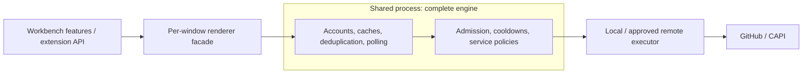
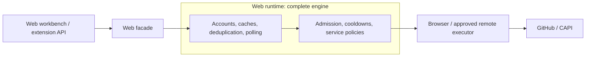
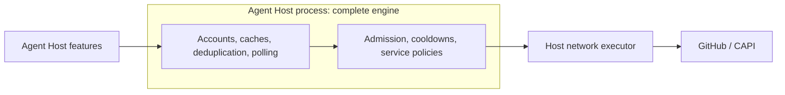

<!--
Copyright (c) Microsoft Corporation. All rights reserved.
Licensed under the MIT License. See License.txt in the project root for license information.
-->

# GitHub service

Reusable GitHub engine and cross-target architecture.

> **Status:** Draft consolidation design. The target architecture below is not yet implemented.

## Current implementation

[GitHubService](common/githubService.ts) owns shared admission, cooldowns and telemetry. Its legacy `IGitHubClient` combines credentials, capabilities, transport, queries, mutations, and PR subscriptions. Mission Control domains are exposed only by the portable [account facade](common/account/accountClient.ts) over execution-provider leases.

- The [workbench binding](../../workbench/services/github/browser/githubService.ts) selects the default account or an explicit session in the renderer. Legacy consumers retain their in-process clients. Portable default-account clients execute locally on web and through the [desktop IPC binding](../../workbench/services/github/electron-browser/githubService.ts) on desktop.
- The [Agent Host binding](../agentHost/node/agentHostGitHubService.ts) selects its host-owned repository credential resource without an attached workbench. Repository/PR association, creation, merge settings, auto-merge and issue/PR title context use its explicit clients. Copilot discovery and model requests still use the existing [Agent Host Copilot service](../agentHost/node/shared/copilotApiService.ts); migrating them is a separate change.
- The [shared-process binding](electron-utility/githubService.ts) hosts an additional engine with direct Node networking. Its [typed service boundary](common/remote/ipc.ts) supports directly disposable anonymous and explicitly authorized account clients with REST, buffered GraphQL, pinned public raw-content, Mission Control, and Copilot Connectors execution. Account credentials come from the acquiring renderer's callback channel. Sessions GitHub, Cloud Automations, Copilot Connectors, Issue Reporter anonymous search, and slow-extension issue search use this binding on desktop; other feature consumers retain their existing bindings.
- The [Sessions service](../../sessions/contrib/github/browser/githubService.ts) retains its observable models and polling while its fetchers use the portable account API. Extension clients still own independent requests and polling.

These instances do not currently share application-wide request state.

The [client inventory](client-inventory.md) maps runtime callers, migration boundaries, and remaining gaps.

### Code organization

The GitHub engine uses shared [types](common/types.ts), [queue](common/requestQueue.ts), [scheduler](common/scheduler.ts), [backoff](common/backoff.ts), [cooldown state](common/cooldownState.ts), [response readers](common/responseReader.ts) and [operation waiters](common/operationWaiters.ts) with neutral names. These mechanisms do not interpret service-specific payloads. GitHub header/GraphQL policy stays in [GitHubRateLimitCoordinator](common/githubRateLimitCoordinator.ts).

Shared schema parsers live in [client/schema.ts](common/client/schema.ts); domain clients compose them to validate API payloads. `parse.object` retains unknown and explicitly undefined fields. Unchanged plain objects and arrays are reused; transformations copy only the affected containers without mutating the input. `parse.copyObject` creates a fresh object containing only defined schema fields; nested filtering uses copying parsers explicitly. Execution providers select permitted transport options, request bodies are separated from IPC metadata, and task-feed connection metadata and retained error diagnostics use copying parsers to exclude unused fields. Strict [HTTP header readers](common/client/headers.ts) validate quota counters and Retry-After feedback. Shared [routing helpers](common/client/routing.ts) encode opaque identifiers, repository paths, and query parameters.

Response contracts preserve omitted fields and explicit nulls rather than substituting empty values. Check both GitHub's [REST OpenAPI descriptions](https://github.com/github/rest-api-description) and [GraphQL schema](https://docs.github.com/en/graphql/overview/public-schema), and verify discrepancies against the service implementation: published descriptions can lag nullable auto-merge metadata, review-comment positioning, and Actions job metadata. [Compatibility regressions](test/common/apiCompatibility.test.ts) exercise the real response parsers; consumers must not reintroduce stricter requirements for optional display metadata.

Git object IDs may be full lowercase SHA-1 or SHA-256 values (40 or 64 hexadecimal characters). Ref resolution and public raw-content confinement accept both while continuing to reject mutable refs, malformed IDs, and redirects outside the pinned repository revision. Identity checks, safe-integer bounds, response-size limits, and bounded pagination remain independent of optional response metadata.

An in-flight operation owns its controller and shared deadline. `OperationWaiters` owns individual callers' waiting, cancellation and result delivery, not network execution. One caller can detach without cancelling peers; the operation owner decides what happens when its last waiter leaves. This also supports service-wide metadata initialization, which is not an HTTP request.

### Authorization clients

The hosting binding selects provider/session/scopes and endpoints and supplies a context-specific credential bridge. The engine does not select accounts, prompt for sign-in, or fall back to another session. A missing repository-scoped session surfaces an authentication error; existing explicit sign-in actions remain responsible for consent. Account selection and credential resolution each have a cancellable five-minute deadline, including stalled authentication providers.

The workbench convenience API acquires anonymous clients, clients for the selected default account, or an explicit `GitHubAuthorizationContext` through `acquireAccountApiClient`. Explicit acquisition revalidates the exact session, account, scopes and issuer through the existing credential broker without requiring a default account or prompting for sign-in. It uses local execution on web and the existing IPC binding on desktop; credentials remain broker-owned.

Consumers retain a disposable reference from `acquireClient`. Equivalent grants share one client, including resources and coalesced reads. Different sessions, scope sets, issuers or endpoints have separate private caches and subscriptions, even when they resolve to the same GitHub account. They still share account/host/caller limits and stable-account cooldowns within the engine.

At most 64 clients are retained across authorization, anonymous and bootstrap contexts. Releasing the last reference cancels only that client's work and disposes its resources; bounded identity-backoff bookkeeping for authorization clients remains for up to five minutes so reacquisition cannot reset repeated-failure backoff. Unused bookkeeping can be evicted for a new client. Grant changes retire only affected session clients; same-session token-only renewals preserve the client, and default-account selection changes do not revoke explicit clients for other accounts. Live server quota and identity-bootstrap cooldowns survive client release/recreation until expiry. A resolved account's core or secondary cooldown also gates subsequent identity bootstrap; a search-only limit does not block identity lookup.

Each workbench/Agent Host binding retains one reference for its selected default/repository client so short-lived consumers reuse identity, ETags and capability observations. Selection changes and binding disposal release that reference. Other explicit clients remain caller-owned.

### Mission Control domains

The acquired account client exposes [automations](common/missionControl/automations.ts), [tasks](common/missionControl/tasks.ts), and [environments](common/missionControl/environments.ts). Each operation requires an `AbortSignal`; callers do not supply authentication, transport, or endpoint options:

`tasks.connectFeed` negotiates receive-only task-feed credentials through the binding-approved GitHub API gateway, separately from the Copilot-hosted task proxy. Desktop clients execute through the shared-process binding because the feed gateway does not provide CORS access for the desktop renderer origin. Feed credentials are neither cached nor coalesced.

```ts
const client = await service.acquireDefaultAccountApiClient(signal);
try {
	const page = await client.automations.list({ owner: 'dmitrivMS', repo: 'myRepo' }, signal);
	// Use page.data.automations; pagination remains explicit.
} finally {
	client.dispose();
}
```

`automations.listTools(signal)` and `automations.listTriggers(signal)` read the authenticated caller's unpaginated catalogs from `/agents/automations/tools` and `/agents/automations/triggers`. They return tool groups and trigger definitions, respectively, preserving field options, labels, permission scopes, and optional run-now support metadata without hard-coding the server's available tools or triggers.

`automations.getConfiguration(repository, signal)` reads server-resolved enablement, caller management permission, and trigger/write policy constraints from `/agents/repos/{owner}/{repo}/automations/configuration` through the existing Mission Control binding. It preserves caller options and uses the transport's standard cache policy, honoring the service's `private, no-store` response header. Disabled automations are a valid response, not an error; missing or malformed fields and service failures reject rather than becoming disabled defaults. The response does not authorize a later mutation, which remains subject to server enforcement.

The [Mission Control adapter](common/missionControl/missionControlClient.ts) is a portable domain wrapper over `IApiRequestProvider`; it parses JSON and validates domain responses in the caller. It uses the shared [request and response contracts](common/client/request.ts), with execution flags under `request.policy` and pagination/retry hints under `response.metadata`. The [local execution provider](common/client/localMissionControlRequestProvider.ts) owns credentials, service-host quota identity, retry/privacy policy, and buffered HTTP execution. The same provider supports existing in-process clients and the IPC server, without a parallel legacy transport implementation.

The renderer credential broker approves a single Mission Control endpoint for github.com requests: `https://api.githubcopilot.com/agents`, with its integration ID and without the GitHub REST API-version default. Other hosts must explicitly supply an approved endpoint through `GitHubClientOptions.missionControl`; no endpoint is inferred from an Enterprise REST URL. Without this configuration, only the Mission Control operations reject. Endpoint/header configuration participates in client lease identity and is never taken from individual request arguments. Model discovery remains with its existing consumers outside these clients.

Ordinary reads reuse account-scoped coalescing and ETag revalidation, including the original success status after a 304. Responses marked `no-store` evict cached bodies and validators, including after a 304. Reads retain the transport's single retry on network or 5xx failures when no server cooldown applies. Task event reads opt out of retries; complete AHP histories reject mismatched frame totals, while raw events remain paginated. Mutations and environment connect/reconnect requests are never replayed or coalesced; environment responses are not cached or shared because they can contain credentials. Mission Control redirects are not followed, and bodyless acknowledgements are not parsed as JSON. Dispatched writes with uncertain outcomes must be reconciled rather than blindly resubmitted.

Mission Control uses a separate cooldown identity keyed by the service host and originating GitHub account. Confirmed 403/429 throttling and 5xx `Retry-After` hints gate queued and subsequent requests; the original failure is surfaced rather than slept and replayed. Confirmed throttling without a usable hint uses a conservative 60-second delay. A successful 202 waking response's `Retry-After` is returned only as a polling hint. Header metadata is optional because browser CORS can hide it.

All domains share existing admission: twelve active requests overall and per host, ten per service-host/account pair, and eight per caller; retained limits are 256 overall and 64 per account and caller, including cooldown waiters. The caller label is `github.missionControl`. Coalesced reads have at most 64 waiters, and the domains do not add client-acquisition slots. These are runtime-local bounds, not a claim about deployed server quotas. Credential resolution and transport execution retain separate five-minute budgets; responses remain bounded to 16 MiB.

Cloud Automations uses these portable clients over IPC on desktop and through the same local providers on web. Its repository eligibility reads use `client.repositories`; the store no longer accesses transport, credential objects, or account handles. The older cloud sandbox API service is deliberately not migrated.

### Copilot Connectors

The portable account client's [Connectors domain](common/connectors/connectors.ts) exposes catalog reads and connect/disconnect operations over a host-approved product endpoint. The [execution provider](common/client/localConnectorsRequestProvider.ts) runs through the existing engine and account lease: shared-process IPC on desktop and local execution on web.

| Operation | Service contract |
| --- | --- |
| `getCatalog` | `GET /plugins`, HTTP 200 JSON containing `plugins`. Each entry includes top-level manifest fields, nested display metadata, advertised MCP URLs, and the user's lowercase catalog connection status. Nullable manifest lists and empty OAuth-discovery fields are preserved. |
| `connect` | `PUT /connectors/managed/{name}/connection`, HTTP 200 JSON with `status`, `provisioning_state`, optional `statuses`, and an optional `consent_link`. Sends `client_source: VS_CODE`; raw API Hub lifecycle/status strings are not catalog-state enums. |
| `disconnect` | `DELETE /connectors/managed/{name}/connection`, HTTP 204 without a response body. A missing connection (404) or conflict (409) remains an error, not a successful empty result. |

The [workbench service](../../workbench/contrib/chat/browser/aiCustomization/copilotConnectorsService.ts) owns account selection, explicit consent, feature gates, presentation, and connection polling. It retains one selected-session/account/scope client so catalog refreshes replay the service's opaque ETag and reuse a cached body only after HTTP 304. Account/grant changes, invalidation, feature disablement, and disposal release that client and its cache. Credential renewal clears the previous catalog body and validator even for a Connector endpoint on a different host. Each request still has one thirty-second acquisition/execution budget; cancelled late acquisitions are disposed without replacing the retained client.

Catalog browsing and connection checks use the authenticated status returned by the service without requesting Connector scope. Displaying a connected status does not authorize runtime MCP access: unscoped catalog refreshes do not reconcile runtime tools, and the workbench requests `write:plugin_gateway_connections` only for explicit management actions. The service owns credential-class and permission authorization; the generic transport does not reject a valid GitHub App grant merely because it lacks OAuth scopes. GitHub Enterprise remains unsupported by this workbench integration.

Connector responses are client-limited to 5 MiB, redirects are not followed, and requests are never automatically replayed. Catalog requests do not coalesce, so a refresh after a connection change cannot join an older in-flight read. `noCache` or a service `no-store` response disables catalog retention; connection mutations never retain their bodies. Shared queue limits and quota cooldowns still apply. Manifest homepage/author/version/repository/license/logo/keywords come from the service's top-level fields, while `metadata` contains display name, tier, release tag, capabilities, and export support. Advertised MCP and consent URLs are consumer-validated, never reconstructed; only usable HTTPS consent links are opened, and absent or unusable links do not prevent connection-status polling. Errors preserve HTTP status without transporting raw error bodies.

### Anonymous public reads

`acquireAnonymousClient()` is an explicit, read-only capability for GitHub.com's fixed API and raw-content endpoints. It accepts no endpoint options and does not select an account, invoke a credential provider, resolve `/user`, or acquire scopes. Hosts can construct the engine without a default credential provider; direct authenticated acquisition then fails explicitly. Shared-process account leases instead use an explicitly registered connection-owned credential scope.

Anonymous clients expose typed content, gist, and issue-search reads, not mutations, GraphQL, raw tokens, or arbitrary request headers. Their REST and public raw-content requests omit authorization, cookies and referrers, including on retries and confined redirects. Credential-bearing URLs, insecure endpoints and paths escaping the approved endpoint are rejected. Authenticated failures never automatically fall back to anonymous traffic.

Equivalent anonymous clients share requests and ETag state, but never share cached data with authenticated clients. All anonymous clients using the same API origin and engine-owned executor share an anonymous quota identity, independent of signed-in accounts; creating another client or releasing the final reference does not reset live server cooldowns. The engine's existing global/host/caller admission limits and client-capacity bound still apply. Independent engines/processes and unrelated clients behind the same public IP are not coordinated yet.

The Issue Reporter's GitHub similar-issue searches, in both the wizard and legacy/web UI, acquire this capability through `IWorkbenchGitHubService.acquireAnonymousApiClient(signal)`: IPC on desktop and local execution on web, without account selection. Each call acquires an anonymous client, searches issues with a ten-second request deadline, and disposes the client when the call finishes. The reporter does not retain a client or manage shared acquisitions; the service owns acquisition cancellation and request coordination. Both search backends invalidate obsolete work when the source/input changes or the reporter is disposed, so late responses cannot cancel or replace a newer search. Existing duplicate-detection service calls and authenticated issue submission remain separate. Anonymous Copilot/device token issuance and general text/binary transfers remain outside this capability.

The [slow-extension performance action](../../workbench/contrib/extensions/electron-browser/extensionsSlowActions.ts) also acquires the anonymous client through the workbench binding, using shared-process IPC on desktop. It searches one issue page with a single result to choose between reporting a new issue and showing existing issues. Client acquisition and search share a ten-second budget, and the client and timeout are released after every lookup. Failures are logged and do not offer an action, prompt for sign-in, or fall back to a direct request; profile export and issue-opening behavior are unchanged.

Existing consumers use these clients directly; there is no compatibility singleton API for queries or mutations. Agent Merge captures its authorized client with the turn. Host token refresh preserves the client and rotates credentials on the next request; revocation, endpoint changes and a resolved account change reset the dependent runtime. Async consumers release references that arrive after their owning scope has ended and do not install subscriptions with invalidated credentials.

VS Code forwards optional account provenance through the standard authentication `_meta` bag under `vscode.authentication.account`. The Agent Host uses the provider/account/issuer tuple to separate client and bootstrap quota ownership before `/user` resolves a new token; GitHub still establishes the authoritative account identity. Token expiry alone does not reset that selection. The binding reconciles provenance during token lookup and acquisition as well as authentication events, so scoped-token fallback and expired-token pruning notify dependent consumers. Hosts and clients without this metadata remain supported with a conservative per-resource bootstrap cooldown. Sealed-token adapters that substitute a different credential omit the original token's provenance.

### Credential-independent authenticated bootstrap

`acquireBootstrapClient` is an internal, API-relative GET capability for a trusted binding's explicitly supplied credential. It does not resolve `/user` or consult the accepted-token store, so Copilot discovery can run while provider authentication is still in progress without a circular dependency. It never makes that credential accepted.

Private caches and request sharing remain token/base-specific. Host-supplied account provenance affects only quota accounting: known IDs share applicable GitHub account limits, while unknown identities use a conservative origin-wide bootstrap bucket. Known bootstrap clients also honor outstanding unresolved-origin waits. A bootstrap waiter fails promptly as rate-limited when the cooldown cannot fit its deadline; authenticated repository and anonymous reads keep their existing deadline behavior. Client release preserves live server cooldowns and cannot cancel another token's work. Migrating Copilot discovery to this capability is a separate, deferred change.

### Repository discovery

Repository discovery uses the portable [repositories](common/core/repositories.ts) and [search](common/core/search.ts) domains. The authenticated repository listing returns repository objects; search returns `items`, `total_count` and `incomplete_results`. Query parameters, pagination limits, caller attribution and deadlines use the shared request options. Selection, search qualifiers and operation budgets remain caller-owned.

The [Cloud Sandbox repository picker](../../workbench/contrib/chat/browser/remoteAgentHost/cloudSandboxRepositoryPicker.ts) uses `IWorkbenchGitHubService.acquireDefaultAccountApiClient`: shared-process IPC on desktop and local providers on web, with the same silent selected-account repository grant and host binding. Recent repositories and qualified search use the typed repositories/search domains; the user and organizations domains resolve the search scope once per pick. Listings, searches and organization discovery each request only their first page, capped at 100 items. Scope failures never fall back to an unrestricted search, superseded results cannot replace current results, and closing the picker cancels requests and disposes its client. Its now-unused legacy `listRepositories` and `searchRepositories` entry points, options, page types and pagination helpers are removed; cloud sandbox task/environment operations are unchanged.

### Browser plugin repository materialization

The [browser plugin Git service](../../workbench/contrib/chat/browser/pluginGitCommandService.ts) uses typed content ref, tree and blob reads. Installs preserve the existing authentication sequence: an available GitHub session, anonymous access after authentication/authorization rejection, then one explicit request for repository access. Updates and checkouts do not prompt or switch credentials after a failed read. Rate limits, malformed responses and other non-authentication failures retain their shared API classification rather than triggering sign-in.

Tree and blob reads opt into `ApiRequestOptions.noCache`, so writing a file does not leave its encoded response body in the shared ETag cache. Ref resolution and per-target SHA metadata remain cacheable.

Each attempt owns one disposable client and cancels staged work on grant invalidation. Cancellation takes precedence over an in-flight authentication error, so invalidating a grant cannot restart the attempt anonymously or prompt for another grant. Extraction preserves binary content, skipped symlinks/submodules/unsafe paths, and the existing truncated-tree warning behavior. Up to ten extraction tasks run concurrently, additionally constrained by the shared queue's eight active requests per caller. Failed or cancelled downloads drain before staging cleanup or an authentication retry; only a completed extraction replaces the target and updates persisted SHA metadata. Native Git execution and remote AHP directory transfer are unchanged.

### Legacy resource and mutation surface

The [legacy query contract](common/githubQueryService.ts) retains repository/issue/commit subscriptions and batched resource hydration. Repository subscriptions expose only their resource and disposal; issue subscriptions additionally support priority updates and refresh, and commit subscriptions support refresh. Cache clearing is private lifecycle behavior. Capability probes are cached by host, without a caller-supplied Enterprise version.

Legacy repository snapshots contain only the canonical `nameWithOwner`, optional language and star count needed by link presentation; hydration requests only those fields. Full repository metadata remains available from the portable repositories domain.

The legacy client facade exposes authorization, credentials, queries, PR resources and mutations. Transport, endpoint routing and client invalidation remain engine internals; host capability probing is wired during construction rather than exposed as a client property. Credential resolution is performed through the selected credential provider, and transport clearing is part of disposal. The separate explicit bootstrap client is retained.

[PR resources](common/githubPullRequestService.ts) contain core, top-level comments, submitted reviews, review threads, checks, and mergeability. Inline review comments remain nested in review threads; there is no standalone inline-comment or participants fragment. Shared polling, body-release lifetimes, capability fallbacks, authoritative refreshes, and head/generation checks remain unchanged.

The [legacy mutation contract](common/githubPullRequestMutationService.ts) retains guarded reply-and-resolve, bounded workflow-log downloads, guarded reruns, and prepared merge/queue operations. Creation, marking ready for review, and enabling/disabling auto-merge are called directly through portable PR clients; their legacy entry points, types and request helpers are removed. Reply publication checks, uncertain-outcome reconciliation, and merge authorization remain part of the compound operations rather than being replaced with raw endpoint calls.

### Agent Host repository and PR operations

The [association resolver](../agentHost/node/agentHostPullRequestAssociationResolver.ts), [creation handler](../agentHost/node/agentHostPullRequestOperationHandler.ts) and [title controller](../agentHost/node/agentHostSessionTitleController.ts) retain an authorized client for each operation. They reuse the binding's selected repository resource and existing silent missing-token checks; title context does not introduce another scope requirement or a sign-in prompt. Title context uses typed `issues.get`, repository merge settings use typed `repositories.get`, and association uses typed `pullRequests.list` / `listForCommit`, through `acquireRepositoryApiClient`. Creation and simple lifecycle writes use this same binding directly; only guarded operations retain the legacy mutation accessor.

The Agent Host binding composes portable account clients over local request providers, without depending on workbench IPC or a Copilot credential. It retains a selected-account API lease between operations, preserving identity and ETag state while each caller disposes its own lease. Account, endpoint and grant changes retire the applicable clients. Identity changes discovered by either default client notify repository consumers even without account metadata; same-account token renewal remains silent. For a captured execution sponsor, both legacy and portable clients isolate credentials and caches by source and session, without falling back to the host account when the sponsor is unavailable.

PR preparation and submitted auto-merge validation share one projection of the four repository merge flags: `allow_auto_merge`, `allow_merge_commit`, `allow_squash_merge`, and `allow_rebase_merge`. If any flag is missing, it logs a warning and returns `autoMergeAllowed: false` with no merge methods to both callers. Request failures and invalid field types remain errors: preparation logs them and keeps other draft details, while submitted auto-merge fails before Git writes or session-configuration changes. The portable client is captured at invocation start, preserving the selected account through the operation. The now-unused legacy merge-capabilities query and its result type are removed.

Title enrichment submits its bounded batch at background priority directly to the engine's request queue, without a separate concurrency limiter. The caller still caps enrichment at ten references, bounds the model context, and imposes a five-second budget on the optional reads. Null issue/PR bodies become empty text; representations that omit the optional body are skipped without logging an error. The unused legacy `getIssueOrPullRequest` operation and its result type are removed.

Operation cancellation spans the workflow, while individual domain requests manage credential-generation signals. Same-account token renewal can therefore recover through subsequent requests or create reconciliation without switching the captured client or account.

Branch lookup requests the most recently updated PR across open and closed states, using the fork's remote branch when applicable. Approved-URL lookups request one 100-item page and select the first open candidate in caller order, otherwise the first approved closed candidate; an empty approved set issues no lookup. The HEAD fallback requests one 100-item commit-association page, matches the exact PR head SHA rather than any contained commit, and requires a unique result unless approved URLs constrain selection. A full first page remains inconclusive and is logged. The resolver treats the shared API's `MissingCommitError` as no match; other request failures still propagate. These selection rules live in the Agent Host rather than the legacy query API. The typed title-context read accepts the issues endpoint's PR payload without subscribing to an issue-only resource.

`MissingCommitError` is a common GitHub request error, not a PR-specific type. GitHub REST uses the same missing-commit 422 response for repository commits, checks, commit comments, statuses and gist revisions. The [shared typed-request provider](common/client/request.ts) classifies it after raw execution for both local and IPC-backed clients, retaining the original request error as its cause and preserving its message, kind, HTTP status, response body and response metadata. Other 422 responses, 404s, malformed error bodies, authentication failures and cancellation are not reclassified. Raw IPC execution and GraphQL error handling remain unchanged; no additional wire error tag is needed.

Git/worktree changes, folder/session association and notifications remain caller-owned. PR creation uses typed `pullRequests.create`; after a create failure the handler reconciles by reading the same head through the captured client, never by replaying the write. A timeout before dispatch is not reconciled. Repository settings and auto-merge share governed transport, while optional settings/context failures retain the existing logged fallback behavior. Creation and lookup results stay in their native API shape without a legacy lookup DTO or conversion helper.

PR creation uses one portable client and credential/cache scope for reads, creation, reconciliation and auto-merge. Simple lifecycle actions also acquire only the portable client, validate the target host, and use the status service's authoritative refresh after success or failure. Guarded merging alone acquires the legacy client in the lifecycle handler. Agent Merge still captures separate portable-read and legacy-guarded-operation clients, so its identity validation can occur once per scope and again after renewal.

### Agent Merge workflow diagnostics

Agent Merge retains a portable account client for each monitoring runtime and passes it into the captured turn context. Workflow inventories, attempt-specific jobs and check annotations use the typed Actions/Checks domains with 100-item pages and a 100-page limit. Incomplete pagination fails rather than publishing partial diagnostics. Runtime shutdown releases the client and cancels dependent reads; authorization, PR head and workflow attempt are still rechecked before exposing evidence.

Only known positive safe-integer workflow attempts authorize pinned job logs. Jobs from another run, head or known attempt are excluded, and check-run identity is derived from the API's check-run URL. Evidence retains only bounded job metadata rather than the complete API object. Model-facing responses preserve string run/job IDs, established field names and status capitalization. Log download bounds/redaction and rerun reconciliation remain in the guarded legacy mutation service; its workflow-run parser/result type stays because uncertain reruns still use it. The obsolete workflow listing paginator, job/annotation mappers and their legacy types are removed.

### Review-thread replies

Review-thread reply outcomes distinguish publication: `succeeded` and `reconciled` require a `SUBMITTED` comment, `pending` means an unpublished reply in the viewer's pending review, and `indeterminate` means publication could not be confirmed. Only confirmed published replies permit `replyAndResolveThread` to resolve the thread. Mutation responses and fully paginated reconciliation reads retain comment state; duplicate operation markers cannot identify a unique reply and never trigger replay or resolution.

The service never submits, discards, or replaces a pending review. Agent Merge reports pending or unconfirmed replies and leaves review management to the user. After a confirmed pending reply, it disables monitoring for that folder when the repair turn ends and notifies the user; resuming requires explicitly enabling Agent Merge again. Turn finalization waits for in-flight replies, including after cancellation, and preserves the changed-worktree safeguard before clearing the repair baseline. Explicit `resolveThread` remains a separate intentional operation.

### Request execution

Portable `ApiRequestOptions.priority` selects an existing scheduling lane and is validated at local and IPC boundaries. REST, GraphQL, raw-content and Mission Control providers forward it to the engine; omission preserves each operation's current default. Priority changes queue scheduling, not credentials, quota identity, cache keys, retry policy or mutation-outcome handling.

`ApiRequestOptions.noCache` bypasses transport response-cache reads and writes when `true`, without clearing another caller's stored representation. It is validated at local and IPC boundaries and applies to REST and Mission Control reads; omission or `false` preserves normal ETag revalidation. REST requests with different cache policies do not coalesce, while compatible non-retaining requests can still share in-flight work. GraphQL and raw downloads already do not retain response bodies.

Callers use `background` for periodic PR/CI/review/issue polling, automatic branch discovery, cloud catalogue/history polling and deferred Agent Merge workflow checks; passive reads backing visible UI use `visible`. Optional personalized prompt options and commit-card metadata use `enrichment`. New user-awaited reads and writes retain their interactive and mutation defaults; failed PR creation lookups use `mutationReconciliation`.

PR, CI, review-thread and issue models rejoin reads when higher-priority demand arrives so the provider can promote queued shared requests. Superseded responses cannot overwrite newer state, and forced post-write refreshes still perform a fresh read after pending work. Cloud catalogue/history operations retain their existing serialization and promise coalescing: joining an ongoing refresh does not reprioritize it.

Internal requests carry caller attribution and a deadline. Current transport defaults, not public API guarantees:

- At most 256 retained requests, including queued and cooldown-waiting work; 64 per account or caller. Up to eight slots in each limit are reserved for interactive/mutation work.
- At most twelve active requests overall and per host, ten per account, and eight per caller. Equal-priority callers share scheduling fairly; parked requests consume no active slot.
- A five-minute request deadline includes queueing, cooldowns, retries, and body reads. Callers can tighten it; deadlines are rechecked before wire attempts and successful settlement even if timer callbacks are delayed. Responses are capped at 16 MiB; JSON overflow fails explicitly, while bounded downloads report truncation.
- Equivalent reads share a request with at most 64 waiters and independent cancellation/deadlines; detached waiters are released immediately. Credential invalidation preserves live cooldowns and reclaims inactive account state once they expire.
- Retryable REST and GraphQL reads share at most one transient-failure retry across fetch and response-body reads when not rate-limited. Body-read failures are classified as network errors; cancellation, deadlines, invalid JSON and oversized responses keep their own classifications and are not retried. Writes are not automatically retried by the transport; mutation services reconcile ambiguous writes, but never a request that timed out before network dispatch.
- Server cooldowns also gate repeated identity lookups and authenticated download redirects. Download error classification inspects at most an 8 KiB diagnostic prefix, without exposing it in errors or telemetry.
- Credential resolution has a separate five-minute caller deadline covering token acquisition, identity backoff and shared identity lookup. A caller timing out does not erase server cooldowns or cancel another caller's identity lookup.
- Long server cooldowns use bounded native timer chunks. Queue drains also expire overdue active requests after wall-clock jumps; rejected unique reads never retain coalescing entries or waiter timers.

HTTP error classification, response telemetry and cooldowns share the same quota-evidence check. A generic HTTP 403 with "Rate Limit Exceeded" wording remains an authorization failure unless valid exhausted-quota or `Retry-After` headers, an explicit primary message without usable remaining-quota feedback, or explicit secondary-limit evidence establish throttling. HTTP 429 still establishes throttling; malformed refusal headers do not invent cooldowns, healthy quota observations do not erase existing waits, and storage-origin download denials do not establish GitHub account limits. Later exhausted-quota responses extend existing waits while preserving `Retry-After` precedence.

REST admission recognizes fixed core, checks, code-search, semantic-search and other-search route families, including the Enterprise `/api/v3` prefix. Checks also honor legacy core waits; specialized searches honor legacy search waits, and code search honors its expanded bucket. This deliberately favors safe backoff over exact credential-specific quota isolation.

An unexpected REST resource uses one account-scoped REST cooldown in the existing storage instead of a learned route mapping. This aggregate stores only deadlines derived from each response's own validated hints, not quota counters from unrelated resources. Valid server retry/reset timing governs admission, retries, authenticated downloads and bootstrap waiters; an exhausted successful response also establishes a wait. Such a wait can delay otherwise independent REST requests, but does not block another account or GraphQL. REST admission waits are separate from identity's core/secondary cooldown checks, so token renewal does not promote an unrelated REST wait into credential resolution; cooldowns returned by the identity request itself remain enforced. Successful identity responses preserve their fallback on the resolved account and renewal gate before bootstrap cleanup. HTTP quota counters and retry hints are validated strictly, and healthy feedback cannot erase a live wait.

### Request identification

Bindings supply trusted product/channel/version and originating component/version metadata. Configured GitHub endpoints receive `X-Client-Application`, `X-Client-Source`, an allowlisted `X-Client-Feature`, and `X-Is-Retry` on Node egress. Shared reads retain the initiating caller's attribution; arbitrary caller strings are never sent.

`X-Is-Retry` is `"true"` only for an engine-controlled retry and `"false"` for an initial attempt. New polls, pages, refreshes, and redirect hops are not retries. Higher-layer authentication or feature retries are not currently labeled, and these headers do not introduce retries or mutation replay.

Browser fetch, including desktop renderers, sends only `X-Client-Application` to `https://api.github.com`. The other headers are not in GitHub.com's CORS allowlist. Enterprise browser endpoints receive no identification headers until their allowlists are established; CAPI requires its own endpoint policy. This is an explicit egress policy, not a fallback after failed requests. Cross-origin download storage hops receive no identification or retry headers.

### Host networking

GitHub service implementations own their plain [RequestFetch](common/types.ts) functions. The workbench uses browser fetch, the shared-process service creates its proxy-aware fetch in its constructor, and Agent Host reuses its existing host fetch. There is no fetch service, fetch IPC or automatic move to a different machine after a failure.

The browser redirect fallback forwards only `Accept`, `Authorization`, and `X-GitHub-Api-Version`; it omits cookies, referrers, cached validators, integration IDs, and identification headers. Browser fetch strips `Authorization` when crossing origins. The final URL must still match the approved origin and, for anonymous/bootstrap reads, the API prefix before its body or quota hints are accepted. This is not a per-hop destination guarantee: the browser can contact another origin before the final check, and its own redirect-count limit applies. The existing overall deadline and response-size limit still apply; telemetry observes fetch attempts, not each browser-internal redirect hop. Accepted canonical URLs are cached so later reads resume normal conditional requests. Node bindings retain their existing pre-hop validation and redirect limit.

- **Web and desktop workbench:** browser fetch is used directly, including in the Agents window. CORS and browser/OS proxy and certificate decisions still apply. After an opaque redirect, browser bindings retry bodyless repository REST GET/HEAD reads with browser-native following. Ordinary reads retain manual handling and conditional caching; writes, dispatch-sensitive operations, non-repository endpoints, and explicit redirect handoffs do not use this fallback.
- **Standalone Agent Host:** GitHub receives the same fetch as Copilot and other host services, without an additional wrapper. The existing Agent Host proxy resolver owns host/PAC, authentication and certificate handling. The foundation preserves explicit test overrides for all consumers.
- **Shared process:** [createFetch](electron-utility/githubFetch.ts) lazily configures Node fetch with local-machine proxy, Basic/Kerberos and certificate lookups. System/PAC lookup uses the native host's existing `resolveProxy` API, which uses Electron's application-level resolver for windowless callers.

The bindings retain the runtime's normal fetch behavior, including HTTP 421 recovery and streaming decompression. They add no application retries or lower-level request/response adapter. Engine attempt counts describe fetch invocations, not a guarantee of one physical request. Engine limits apply to decoded bytes; callers must consume or cancel bodies, and engine cancellation reaches fetch through its abort signal.

The transport enforces manual redirects. Anonymous and bootstrap requests also enforce credential omission and no-referrer policy in the transport. Anonymous requests never invoke authentication. Explicit authorization headers supplied by the engine remain intact for permitted hops.

#### Shared-process proxy and certificate behavior

Routing follows the proxy helper's precedence and loopback bypass: `http.noProxy`/`NO_PROXY`, configured/environment proxies, then host system/PAC lookup. Network-interface changes invalidate cached system routes at `http.experimental.networkInterfaceCheckInterval`. Configuration comes from local-user/default values, not remote-workspace settings.

On the first GitHub request, the shared-process fetch uses the [standard shell environment resolver](../shell/node/shellEnv.ts) and merges its result over the inherited process environment. This preserves login-shell proxy variables on GUI launches without delaying shared-process startup, and honors the resolver's Windows, CLI-launch, and user-environment flags. Lookup failures are logged once per fetch instance and retain the inherited environment, matching the existing request service.

`http.proxyAuthorization` is supplied to proxy CONNECT requests rather than the origin and is not repeatedly resent after rejection. Kerberos uses the existing host lookup. With `http.systemCertificates` enabled, additional host certificates honor `http.systemCertificatesNode` and retain Node's default CA set.

Certificate and hostname verification remain enabled by default. `http.proxyStrictSSL: false` is not translated into a verification bypass or weaker-TLS retry. Extension-specific proxy/fetch switches do not select this GitHub helper. Proxy diagnostics do not include URLs, credentials or response bodies.

The helper does not promise full Chromium parity: SOCKS4/4a, native NTLM, ordered PAC failover and Chromium certificate exceptions are not reproduced.

### Shared-process contracts (Stage 1)

The neutral [IPC contract](common/remote/ipc.ts) defines `ISharedProcessGitHubService.acquireAnonymousClient(signal)` and `acquireClient(authorization, signal)`. Both return promises of directly disposable domain clients, not reference wrappers. The [anonymous client](common/anonymous/anonymous.ts) exposes content reads, `gist.get`, and `search.issues`; the [account client](common/account/account.ts) adds full gist/search and core capabilities while staying pinned to its explicit authorization context. Default-account selection remains with the caller.

The acquisition signal governs acquiring a lease, not its subsequent lifetime. Cancellation rejects acquisition even while the shared-process connection is pending; cleanup still uses the original connection when it becomes available. The wire acquisition and release commands identify a client-generated, connection-scoped lease ID so a cancelled acquisition can release it even if its reply is lost. Request messages carry that ID and an endpoint profile: `rest`, `graphql`, `rawContent`, `missionControl`, or `connectors`. Content metadata and gist operations use the REST profile; public raw files use a separate `rawContent` provider.

[Request providers](common/client/request.ts) use one request contract with JSON, text, and empty-response modes. Request bodies are objects before serialization and occupy a separate text slot in the IPC tuple afterward; response and error bodies likewise use separate text slots. The [remote provider](common/remote/ipcClient.ts) decodes successful JSON and invokes domain parsers in the calling process. No parser, `Headers`, or `Response` instance crosses IPC.

Request-provider and IPC responses retain data and HTTP status, including accepted-but-not-completed results such as HTTP 202. Core domain methods normally return parsed values or `void` directly rather than exposing that transport wrapper. ETags and response header collections stay internal to the engine. List operations return the requested page by default and support opt-in bounded collection as described below; JSON result counts and GraphQL page information remain domain data. Diff methods return text, and log-redirect methods expose a download target rather than requiring callers to inspect a Location header. Streaming and binary download execution are not implemented in this stage.

The [wire error codec](common/remote/serialization.ts) preserves GitHub error kinds, status details, response text, GraphQL errors, diagnostic metadata, timeout dispatch status, rate-limit delays, and cancellation in both directions. Unknown failures remain ordinary IPC errors. No mutation replay is introduced.

Anonymous and authenticated acquisition are implemented below. Account selection remains in the caller; there is no shared-process default-account client.

### Local REST execution (Stage 2)

The [transport](common/githubTransport.ts) now exposes buffered-text REST execution alongside its existing JSON methods. Serialized request bodies pass to fetch unchanged, and successful response bodies remain bounded text until the caller decodes them. The existing JSON methods are compatible wrappers over the same execution path, retaining legacy conditional-response metadata and counting serialization time against the request deadline.

The [local request provider](common/client/localApiRequestProvider.ts) implements the portable `IApiRequestProvider` contract using a caller-owned transport and optional, explicitly selected credentials. Local and remote providers share body serialization, decoding, and lease cancellation through `BufferedApiRequestProvider`. Its `requestText` method accepts an already-serialized body and returns response text, allowing the IPC server to execute without reserializing either body. The engine may still inspect error bodies for error classification and rate-limit handling.

Both paths reuse the existing admission queue, cooldowns, bounded response reader, cancellation, read retries, coalescing, and conditional cache. Mutations are not replayed. JSON, text, and empty-response modes have separate cache identities. ETags and headers remain internal; a revalidated response exposes its original success status, including HTTP 202, rather than HTTP 304.

The provider confines REST paths to its fixed HTTPS API endpoint. Anonymous execution only permits bodyless GET/HEAD requests and never resolves credentials. Authenticated execution uses the supplied credential binding, rejects host mismatches, and propagates credential-generation invalidation without selecting another account or falling back to anonymous access. Explicit caller deadlines bound credential resolution and HTTP execution, while the engine retains ownership of timeout dispatch evidence. The provider does not own or dispose the transport or credentials.

### Anonymous IPC and client replacement (Stage 3)

The [channel registration](common/remote/ipcServer.ts) installs a separate lease owner on each physical IPC connection, including connections that already exist at registration time. Ownership does not depend on a reusable window/context string. Each request and release resolves its lease only within that connection; reconnecting or restarting the server does not revive old handles.

The [channel client](common/remote/ipcClient.ts) returns the same [anonymous facade](common/anonymous/anonymousClient.ts) used locally. The facade exposes content operations, `gist.get`, and `search.issues`, not generic HTTP execution or a reference wrapper. Disposing it aborts its outstanding calls and sends an idempotent release; non-cancellation release failures are logged. A cancelled acquisition sends release even if the reply was lost. The server retains successful leases independently of the acquisition call's cancellation token and releases all leases on disconnect or channel disposal.

`GitHubService` owns one reference-counted anonymous engine for the fixed GitHub.com endpoints. Each local facade or IPC lease has its own cancellation scope; releasing one does not cancel another's coalesced read. All anonymous leases share transport state, and the final release disposes that transport without resetting shared live cooldowns. The internal `acquireAnonymousRequestProviders()` reference is for execution infrastructure only; public `acquireAnonymousClient()` returns the disposable facade directly.

The issue reporter uses typed `search.issues` through desktop IPC or the local web provider, preserving its caller attribution, ten-second deadline, cancellation, and error reporting. Dev Container samples use the content operations described below through their host-local `IGitHubService`.

### Portable account REST clients (Stage 4)

The [account facade](common/account/accountClient.ts) composes content, gists, search, Actions, checks, issues, notifications, organizations, pull requests, repositories, reviews, and users over one `IApiRequestProvider` and one directly owned lease. Its authorization value is the explicit grant selected by the caller. The facade does not choose a default account, resolve a token, or expose transport state.

The shared [core client](common/core/coreClient.ts) delegates REST JSON, text, and acknowledgement operations to its local or remote provider, returning parsed domain data or `void`. The domain parser still runs beside the caller. This makes the typed core clients portable without duplicating authentication, retry, cache, or IPC behavior. GraphQL uses the separate endpoint profile described below.

Core calls such as `repositories.get`, `users.get`, and `reviews.resolveThread` return their objects directly; ordinary REST lists return arrays, and diff methods return strings. Search, workflow/check pages, and GraphQL connections retain their domain-level counts, incompleteness signals, nullable nodes, and cursors without an outer `ApiResponse`. `issues.createReaction` returns the reaction directly for both an existing reaction (HTTP 200) and a newly created one (HTTP 201).

`pullRequests.listConnection(repository, signal, { query: { first, after } })` reads one GraphQL page of open pull requests ordered by descending update time, defaulting to 100 items. Its `Connection<PullRequestListItem>` preserves cursors, nullable nodes and authors, branch metadata, draft state, timestamps, and change counts; a null repository result remains null rather than an empty list. The existing REST `pullRequests.list` operation and its filters remain unchanged.

Authenticated clients also expose `search.pullRequests(expression, signal, { query: { first, after } })`, returning a `Connection<PullRequestSearchItem>`. Each match extends the listing summary with GitHub's `mergeable` state and `commits(last: 1)` data: the commit's RFC 3339 `committedDate` and nullable `statusCheckRollup.state`. Unknown mergeability, missing commit nodes, and absent check results remain distinct rather than becoming success or conflict defaults. The operation adds `is:pr`; repository, viewer, state, and sort qualifiers remain in the caller's expression. Pages default to 100 items and GitHub limits search retrieval to 1,000 results. Both facades use the same search client; the anonymous facade exposes only REST issue search and supplies a GraphQL provider that rejects requests with an authentication error.

REST issue-search matches include the server's `updated_at` timestamp, validated as RFC 3339 without changing its representation. An authenticated `search.issues('repo:owner/repo is:open assignee:@me', signal, { query: { per_page: 5, sort: 'updated', order: 'desc' } })` retrieves up to five of the current user's most recently updated assigned issues.

`reviews.listThreadSummaries(pullRequestId, signal, { query: { first, after } })` returns one GraphQL page of thread IDs, resolution states, and the newest comment's creation time through `comments(last: 1)`, defaulting to 100 threads. It preserves nullable threads and comment nodes and distinguishes an unavailable PR from an empty connection. The full `reviews.listThreads` operation remains unchanged.

`issues.getClosingPullRequestCounts(repository, issueNumbers, signal, options)` returns closing-PR counts keyed by issue number, including closed PRs through `closedByPullRequestsReferences`. Duplicate issue numbers are queried once, empty input makes no request, and queries run sequentially in batches of at most 50 issues with the same caller/deadline options. Zero means no closing PRs; null entries mean the issue or reference data was unavailable, and a null result means the repository was unavailable. A failed batch rejects the operation rather than returning partial counts.

Fixed-status acknowledgements return `void`; this does not turn asynchronous acceptance into completion. Fork creation and branch updates still only acknowledge acceptance, and Actions cancellation/reruns do not wait for termination or a new attempt. Providers validate the documented success statuses before unwrapping data, and failures retain their typed errors and HTTP status.

Every public operation in content, core, gists, and Mission Control accepts one optional trailing options object. `ApiRequestOptions` supplies `caller` and an absolute `deadline`; `ApiQueryOptions<TQuery>` keeps API query parameters under `query`. `PageOptions` and `CursorOptions` remain query-only types. Optional non-query arguments, such as a workflow `attempt`, `enableDebugLogging`, `expectedHeadSha`, or `pullRequestReviewId`, are named fields alongside the request options. Clients separate those fields and query parameters from transport metadata, so caller attribution and deadlines never become URL parameters, GraphQL variables, or request-body fields.

Paginated core reads and Mission Control automation/task/event listings use `ApiPaginationOptions<TQuery>`, adding `maxPages` and `pageLimitBehavior: 'throw' | 'returnPartial'` to that same options object. Omitting `maxPages` retains single-page behavior and ignores `pageLimitBehavior`. A supplied positive integer counts the initial page and starts at the requested page or cursor; collection stops early when the server advertises no continuation. If more results remain at the limit, the default is `PaginationLimitError`; `returnPartial` explicitly permits the collected subset. Authentication, network, schema, cancellation, and invalid-continuation failures always reject. The same signal, caller, and supplied absolute deadline apply to all collected pages.

Page collection runs in the domain-client layer, not in the HTTP provider. REST uses advertised `Link` continuations normalized to the configured HTTPS API base before crossing IPC; it never guesses that a full page implies another one. GraphQL uses `hasNextPage` and `endCursor`, rejecting missing or repeated continuations. No extra page is fetched just to detect overflow. Pagination controls do not become wire request metadata, URL parameters, or GraphQL variables.

Arrays are concatenated in server order. Search, workflow, check, and task envelopes retain server totals rather than summing them; search incompleteness is retained if any collected page reports it. Connection cursors, Mission Control continuation links, and response-time hints come from the last collected page. Nullable GraphQL nodes remain nullable; unavailable connection nodes are not replaced by empty arrays. A null parent result remains null for the whole operation. Nested connections, such as comments within review threads, are not collected implicitly. Commit reads collect changed files, while comparisons collect commits and retain files from the initial page. GitHub endpoint-specific result caps still apply.

`returnPartial` does not add a new result wrapper: arrays do not report completeness, and `incomplete_results` keeps its server-defined meaning. Connections and Mission Control pages retain their continuation when the caller stops early. Non-paginated operations, including content trees and environment connections, do not expose collection options.

```ts
const repository = await client.repositories.get({ owner: 'microsoft', repo: 'vscode' }, signal);
const issues = await client.search.issues('repo:microsoft/vscode', signal, {
	caller: 'issuePicker',
	query: { per_page: 20, sort: 'updated' },
});
await client.notifications.markRead(threadId, signal);
const reviews = await client.reviews.list({ owner: 'microsoft', repo: 'vscode' }, 42, signal, {
	query: { per_page: 100 },
	maxPages: 10,
	pageLimitBehavior: 'throw',
});
```

Actions log methods retain redirects manually. They require an executor that exposes redirect status and headers; browser Fetch returns an opaque redirect instead, so these methods are unsupported through the local web provider. The transport validates the Location target, rejects absent, malformed, credential-bearing, or non-HTTPS targets, and projects only the validated URL as response data. Headers remain engine-owned, redirects are not followed with the GitHub credential, and the URL can cross IPC through the existing body-text slot.

The facade's execution is independent of account selection and credential ownership. Shared-process acquisition supplies those through the connection-bound broker below; REST, GraphQL, and raw-content providers all share the same lease lifetime.

### Sessions GitHub integration

The [Sessions GitHub service](../../sessions/contrib/github/browser/githubService.ts) uses the portable account domains for repositories, issues, PRs, reviews, search, file content, commits, and CI. Its [client binding](../../sessions/contrib/github/browser/githubApiClient.ts) retains one disposable selected-account lease so conditional-response state survives polling, and releases it on account/grant invalidation or service disposal. It does not construct HTTP requests, parse GraphQL envelopes, expose ETags, or select arbitrary authentication sessions. Desktop execution uses the shared process; web execution uses the local provider.

Ordinary reads and polling never prompt for sign-in. The explicit repository-access action obtains the default account with `repo` scopes before acquisition. Default-account switches and grant invalidation cancel pending work, clear account-bound model snapshots and branch lookups, and prevent late results from repopulating the previous account's state. Same-account credential renewal remains provider-owned.

Sessions retains domain-to-UI projections, polling cadence, issue freshness throttling and display snapshots, and review/CI actions. ETags and HTTP statuses stay in the provider; REST-backed models suppress notifications when mapped values are unchanged. Complete review, file, comment, CI, and thread reads use domain-client auto-pagination with `maxPages: 100`; nested review comments reuse the embedded first page and collect at most 99 more. Cloud automation discovery collects at most 10 pages before hydrating details with bounded concurrency. Collection failures do not publish partial snapshots. Lazy PR browsing and intentionally bounded search, recent-work, and automation-history reads remain single-page. Pending-review creation remains pending, and writes are never retried by the feature.

The read-only [repository filesystem](../../sessions/contrib/fileTreeView/browser/githubFileSystemProvider.ts) uses the same selected-account binding and typed `content.getTree` / `content.getBlob` operations. Its GitHub.com resources never prompt for sign-in or route to an Enterprise account. The five-minute tree cache, one-minute missing-ref cache, and in-flight tree sharing are cleared on account or grant changes; disposal cancels outstanding work. Truncated recursive trees fail explicitly instead of becoming partial filesystems, and blobs are decoded to bytes at their cached Git object SHA. File reads accept at most 10 MiB of decoded content: known oversized files are rejected before downloading, and actual decoded bytes are checked independently of metadata. The shared 16 MiB response limit remains in force for base64 JSON; size failures report `FileTooLarge` with guidance to clone the repository for larger local reads.

### Authenticated IPC leases (Stage 5)

The [desktop service binding](electron-browser/githubService.ts) registers a reverse credential channel before acquiring clients. Both desktop workbenches use the [workbench credential provider](../../workbench/services/github/browser/githubCredentialProvider.ts), extracted from the existing local binding. The provider silently resolves the exact provider/session/scopes/issuer and optional account provenance supplied by the caller, then pins the resolved account provenance in the returned client. It never consults the default-account service or creates a session. Only the built-in GitHub and GitHub Enterprise providers are accepted by this broker; Enterprise endpoints must come from the matching session's HTTPS issuer, not a guessed host or an operation's URL.

`acquireClient(authorization, signal)` exchanges grant and endpoint metadata, not a token. The first authenticated operation requests a token through the same physical connection's callback and uses the existing credential service to verify identity through `/user`. Tokens remain internal to the credential callback and shared engine; the domain facade and ordinary request messages do not expose them. Missing credentials fail explicitly, including for otherwise public REST operations on an account client.

Each connection owns a request-provider scope in the shared `GitHubService`. Equivalent leases within that scope reuse the existing grant pool, identity backoff, transport, and private conditional cache. Other connections, even with identical context strings and grant metadata, do not share private caches or credential callbacks. All scopes still share the engine's bounded admission queue, client capacity, and verified-account quota coordination. Disconnect or registration disposal drops the scope, including unused backoff entries and subscriptions, without resetting live server cooldowns.

Grant removal or changes to account, scopes, or issuer retire only the affected connection's matching leases. Token renewal instead invalidates the credential generation and its in-flight work while retaining the lease; later operations silently resolve the replacement token. A token callback that races renewal is cancelled rather than allowed to re-establish the obsolete generation. An existing lease also rejects a renewal that resolves a different GitHub identity. No mutation is replayed after renewal, an authentication error, or an uncertain network/server failure.

Pending acquisitions are tracked before the first callback. Release, cancellation, grant changes, and disconnect cancel that pending record, so late replies cannot resurrect a lease or overwrite a reused ID. Successful leases outlive the acquisition call's token, and cancelled acquisitions release allocated leases even when the success reply was lost. Credential callbacks retain the existing five-minute deadline and are bounded even when the authentication provider ignores cancellation.

The focused tests exercise the serialized bidirectional IPC path, notifications reads and mutations, explicit-grant matching, private-cache isolation, shared cooldowns, renewal and revocation, lost acquisition replies, stalled callbacks, lease disposal, and registration/disconnect cleanup. Legacy workbench and Agent Host consumers remain on their current bindings; portable consumers can opt into the desktop IPC binding without moving account selection to the shared process.

### Buffered GraphQL execution (Stage 6)

The [account facade](common/account/accountClient.ts) supplies a separate GraphQL request provider to the core client. It uses the existing `IApiRequestProvider` contract with `POST`, JSON response mode, and the path marker `/`; the execution provider sends to the grant's exact `graphQlUri`, not to a path appended to its REST base. This preserves Enterprise's distinct `/api/v3` and `/api/graphql` endpoints. Anonymous leases do not have this capability, and the execution side rejects alternate paths, response modes, or redirect handling.

GraphQL bodies contain `query` and optional object `variables`. Operation selectors, persisted-query extensions, batched requests, and malformed payloads are rejected rather than allowed to change the executed operation independently of the query. The engine derives its existing read-versus-write policy from the serialized document; IPC metadata cannot claim that a mutation is a read.

The [transport](common/githubTransport.ts) exposes `graphqlText` alongside its legacy `graphql` method. Both use one execution path. Object payloads are serialized once, and already-serialized request text is passed to fetch unchanged. Successful response text crosses IPC unchanged, without reserializing the GraphQL data. The engine still decodes the GraphQL envelope for errors and quota accounting; this is not a zero-parse transport. Its parsed result is also reused by legacy in-process callers, while portable domain parsers run in the calling process.

Identical queries retain coalescing across the legacy and buffered entry points, including canonicalized variable-key ordering and independent waiter cancellation. Safe reads retain the single transient-failure retry; mutations are neither coalesced nor replayed. Absolute deadlines cover serialization and execution, and the provider also bounds credential resolution. Generation invalidation, lease disposal, and disconnect abort GraphQL work just as they do REST work.

Legacy `graphql` callers continue to receive partial data and typed errors for their existing fallback logic. Portable clients reject any nonempty GraphQL error list before parsing domain data, including HTTP-200 partial results. Error kinds, paths, extension codes, actual HTTP status, response text, and diagnostic metadata survive IPC. Malformed envelopes fail explicitly; missing data is not replaced by an empty object, and explicit nulls remain available to parsers that permit them.

Focused tests cover local and serialized-IPC execution, review pagination and nullable nodes, PR/review mutations, byte-for-byte text forwarding, one-time variable serialization, error-only and partial responses, malformed envelopes, Enterprise routing, selector rejection, read retries, no mutation replay, deadlines, and cancellation during token renewal. Live-provider smoke testing and migration of additional desktop feature consumers remain follow-up work.

### Mission Control IPC and Cloud Automations

The account facade exposes automations, tasks, and environments over one buffered Mission Control request provider. Serialized request text goes straight to HTTP; successful response text crosses IPC before JSON/domain parsing. Pagination continuation, server time, and retry-delay hints are explicit response metadata. Raw header collections and ETags remain internal.

The execution provider enforces sensitive environment reads, credential-minting connect/reconnect semantics, and non-retrying task-event reads from the normalized route, regardless of caller flags. Sensitive responses are not cached/coalesced, and their HTTP errors retain neither raw bodies nor parsed diagnostics. Both `ApiRequestError` and `MutationUncertainError` retain their types and documented fields across IPC.

Mission Control requests use connection/lease-scoped request IDs and an acknowledged cancellation command. Cancelling the HTTP operation does not abandon the IPC reply: the server can distinguish an undispatched cancellation from a dispatched write with an indeterminate outcome. Connection loss without a confirmed result remains indeterminate for mutations. This preserves Cloud Automations' write lock until explicit reconciliation rather than making a possibly accepted write look safely retryable.

`IWorkbenchGitHubService.acquireDefaultAccountApiClient` selects the repository grant in the renderer and pins its account provenance before asynchronous acquisition. Desktop workbenches acquire it through `ISharedProcessGitHubService`; web workbenches use equivalent local providers. The client itself is disposable and exposes credential-change and grant-invalidation notifications without exposing tokens. Late acquisitions are disposed after cancellation or selection changes.

Cloud Automations retains its feature/account gates, private-repository preflight, bounded discovery/history, account-scoped persistence, mutation serialization, and uncertainty handling. Tests exercise its real repository-discovery path over serialized IPC as well as every Mission Control operation family. The legacy cloud sandbox service and other callers are outside this migration.

### Public repository files

[The content client](common/content/contentClient.ts) accepts a `RepositoryRef` (`{ owner, repo }`) for repository file, tree, blob, and ref reads, matching the core clients. `content.resolveRef(repository, ref, signal, options)` requests `GET /repos/{owner}/{repo}/commits/{ref}` with the SHA media type and validates the returned commit. `content.getRawFile(repository, commitSha, path, signal, options)` downloads `/{owner}/{repo}/{commitSha}/{path}` from the configured raw base. It does not resolve a ref, use the Contents API, or follow a response-provided `download_url`.

Both operations take an `AbortSignal` and optional caller attribution and absolute deadline. A caller composing them supplies the same deadline to bound the whole operation. Raw content is returned as UTF-8 text without JSON/base64 parsing, preserving BOM and whitespace. Empty files and exactly 1 MiB are accepted; larger decoded byte streams fail explicitly and are cancelled. The raw provider validates the GET/text-only operation and the encoded repository/commit/file path on the execution side, not only in the facade. Returned HTTP status is checked by the caller's response parser.

Raw downloads use the same host-local fetch, admission queue, bounded body reader, cancellation and deadline handling as other engine traffic, but their quota identity is the raw origin rather than the API origin. A REST quota cooldown does not block a different raw origin; raw throttling is retained independently and does not block the API origin. Every raw request omits credentials, referrers, authorization and API-identification headers. Redirects must stay on the configured raw origin within the pinned repository/commit path.

[CancellationToken.toAbortSignal](../../base/common/cancellation.ts) converts token cancellation to an `AbortSignal` with a `CancellationError` reason and registers the token listener in the caller's disposable store. `abortOnDispose` uses the same cancellation reason when its store is disposed. Caller-provided signals passed directly to the APIs retain their original abort reasons.

Local `acquireAnonymousClient()` always uses `https://api.github.com` and `https://raw.githubusercontent.com`; it has no endpoint parameters. Shared-process acquisition takes only a cancellation signal and uses those same endpoints. Anonymous acquisition does not configure Enterprise or custom raw-content hosts.

[Dev Container sample preparation](../agentHost/node/devContainerAgentHostService.ts) acquires the default local anonymous facade in its source-read callback, adapts its token once, resolves `HEAD`, and downloads the configuration at that commit. Both calls use the default request options, with a separate five-minute timeout for each request. Its operation store releases the token adapter and facade on success, failure, or cancellation. The `{ commit, content }` source cache, pinned checkout, volume identities, and clone-before-hooks ordering are unchanged. Cache hits do not acquire a GitHub client or create a token adapter.

Desktop sample reads inherit the shared-process proxy and certificate behavior and its documented Chromium-compatibility limits above. Standalone hosts retain their local `AgentHostProxyResolver.fetch` binding.

### Telemetry

[Request telemetry](common/githubRequestTelemetry.ts) uses the existing product telemetry service and usage-telemetry controls. Active ten-minute windows emit one `githubRequestSummary` with traffic, outcome, rejection and queue counters, at most ten reservoir-sampled `githubRequestTiming` events, and one `githubRequestDomainSummary` per domain with completed work or capacity rejections. There are nineteen allowlisted domains, including `connectors`, bounding emission to thirty events per interval. Disposal flushes completed observations best-effort; idle engines emit nothing.

Bindings notify the collector immediately when usage telemetry is disabled, discarding buffered aggregates and invalidating completion handles even if no request or timer callback runs during the opt-out.

Timing samples separate queue, cooldown and execution time and include their sample population and API domain. Transport-kind and quota-resource categories are not emitted; quota resources remain internal to scheduling and rate-limit coordination. The reservoir remains engine-wide, not per domain: weight a sample by `max(1, samplePopulation / 10)` when estimating request-population distributions. Domain summaries are unsampled and retain rare-domain counts even when that domain is absent from the reservoir.

Typed clients explicitly pass `actions`, `automations`, `checks`, `content`, `environments`, `gists`, `issues`, `notifications`, `organizations`, `pullRequests`, `repositories`, `reviews`, `search`, `tasks`, or `users` at each request call site; identity resolution and capability probes use `credentials` and `capabilities`. Unclassified operations, including legacy calls without an explicit domain, use `other`. This names the logical API domain, not a hostname or quota bucket: a GraphQL review query is `reviews`, and a blob fetch is `content` even when its caller is a plugin installer. REST, GraphQL, pagination, raw-content downloads, and Mission Control preserve the attribution through local and IPC providers. Domain attribution is carried by API and GitHub transport requests, not the shared `RequestOptions` interface. Domain metadata is validated at IPC boundaries and never changes caller-based scheduling, quotas, request headers, cache keys, or coalescing.

`githubRequestDomainSummary.admittedCompleted` counts completed admitted queue operations, including queued cancellations and timeouts. Its outcome counters and `queueMsTotal`, `cooldownMsTotal`, and `executionMsTotal` cover that same population; divide time totals by `admittedCompleted` for per-operation means, not by the number of reporting windows. Capacity rejections are recorded separately as `engineRejected`, `accountRejected`, `callerRejected`, and `waiterRejected`, including domains whose requests were never admitted. Coalesced reads are attributed to the initiating operation's domain once; joining logical calls and wire retries are not additional completed operations. Work crossing an interval boundary contributes its full lifetime on completion, so these totals are not time-average queue occupancy. Engine-wide high-water marks remain in `githubRequestSummary`.

Categories are allowlisted; payloads contain no account/repository identifiers, hostnames, URLs, headers, request/response content, GraphQL text, or raw errors. The engine summary still distinguishes logical callers from wire attempts and GraphQL partial-error responses; domain outcomes describe transport completion, not subsequent typed response validation or application-level success.

## Consolidation scope

Consolidate VS Code, built-in extensions, and [GitHub Pull Requests](https://github.com/microsoft/vscode-pull-request-github) behind a governed service and public extension API. Include REST/GraphQL, Copilot API (CAPI), and content transfers. Exclude GitHub MCP server/tool traffic, git transport, build tooling, and arbitrary browser URLs; track SDK-owned exceptions. REST/CAPI requests for MCP registry and connector management remain in scope.

Keep portable contracts and mechanisms in [common](common). Adapters own hosting, credentials, and networking; the engine must not depend on workbench UI.

### Common guarantees

Every target uses the **complete engine**, not merely the same HTTP client:

- **Identity:** Explicit account/session selection, extension consent, and authorization-scoped caches for GitHub.com, GHE.com, GHES, and anonymous access. No background sign-in prompts or authentication bootstrap cycles.
- **Admission:** Bound active, queued, and rate-parked work with deadlines, request-rate budgets, fairness, and reserved interactive capacity.
- **Cooldowns:** Honor primary/secondary limits and `Retry-After` across callers and credential rotation. Account for every attempt, including pages and retries.
- **Resources:** Share compatible caches, in-flight reads, and polling plans. Bound retention/subscriptions; use freshness, conditional requests, cancellation, backoff, jitter, and consumer interest.
- **Operations:** Bound pagination, bytes, and time; never automatically replay mutations. Separate CAPI/streaming/bulk policies from repository metadata, preserving entitlement and policy enforcement.
- **Results:** Explicit overload, timeout, and incomplete-result states; cancellation and backpressure across process boundaries; diagnostics without credentials or private content.

Cache hits need no network admission; every wire request does. Credentials and arbitrary authenticated URLs are not exposed by the new extension API.

## Target hosting

### Desktop



Facades own consent, visibility, and consumer lifetimes; the existing shared process shares engine state across windows. Electron main only handles lifecycle and connection setup.

### Web



Web uses all the same protections. Core and extensions share the engine; cross-tab coordination remains open. Shared code does not imply shared runtime state.

### Standalone Agent Host



Host-owned credentials and lifetimes require no attached workbench. Coordination with other engines must be explicit.

Preserve reachability, proxies, certificates, and CORS in every deployment. Remote execution must return rate-limit feedback to the admitting engine, not bypass it.
