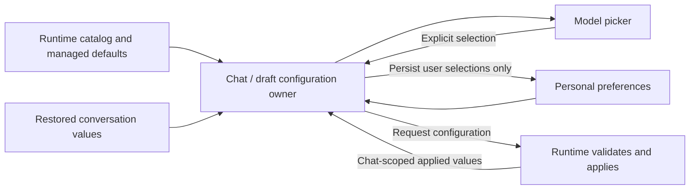

# Model picker configuration and data flow

The picker displays configuration; the runtime owns policy and execution. Keep catalog defaults, personal preferences, conversation values, and runtime-applied values distinct. Equal values do not imply equal intent.

## Flow

## Rules

- **One owner per chat or draft.** Picker writes and request assembly use the same state, including after eager creation. Automations remain isolated.
- **Preserve intent.** Defaults must not become explicit choices. Restore the conversation's own effective values, not another chat's values left in the editor; keep runtime-owned values out of durable preferences.
- **Use the runtime contract.** Do not duplicate policy composition, capability validation, or resume reconciliation. Offer only supported options; honor genuine schema `readOnly` properties even without optional metadata.
- **Protect reports.** Use the exact advertised chat identity. Reject client writes to host reports and preserve them across settings replacements. Schema `readOnly` alone is not host-side write protection.
- **Respect lifecycle ordering.** Subscribe before asynchronous reads, bound refreshes, and discard stale results. Old disposals must not delete successor reports or resurrect removed chats.

## Managed defaults

Server composition can remove the authoring-time [`overridable` wrapper](https://docs.github.com/en/enterprise-cloud@latest/copilot/how-tos/administer-copilot/manage-for-enterprise/use-managed-settings/override-settings-for-teams). Do not infer a user lock from a delivered scalar or composition metadata.

Copilot Agent Host uses `enableManagedSettings` without the separate `enforceManagedModelDefaults` opt-in: model options remain mutable startup defaults. Permission/sandbox enforcement is unchanged. Genuine locks advertised by other hosts remain supported without erasing personal preferences.

## Test the boundaries

Use server-shaped payloads and the runtime mode the client actually enables. Assert outgoing requests or applied values, not just picker labels.

Cover eager-create/edit/send, cross-chat restoration before model registration, unavailable options, policy removal, report replacement/disposal races, and accessible selected/disabled states. Keep strict-mode tests and known-defect characterizations separate from default-only coverage.

## Implementation entry points

- [Configuration resolution and provenance](chatModelConfigurationLogic.ts)
- [Workbench per-chat store](chatModelConfigurationStore.ts)
- [Shared picker configuration access](modelPicker/modelPickerModelConfig.ts)
- [Agents draft/automation preferences](../../../../../../sessions/contrib/automations/browser/automationModelConfiguration.ts)
- [Agents picker selection adapter](../../../../../../sessions/contrib/chat/browser/sessionModelSelection.ts)
